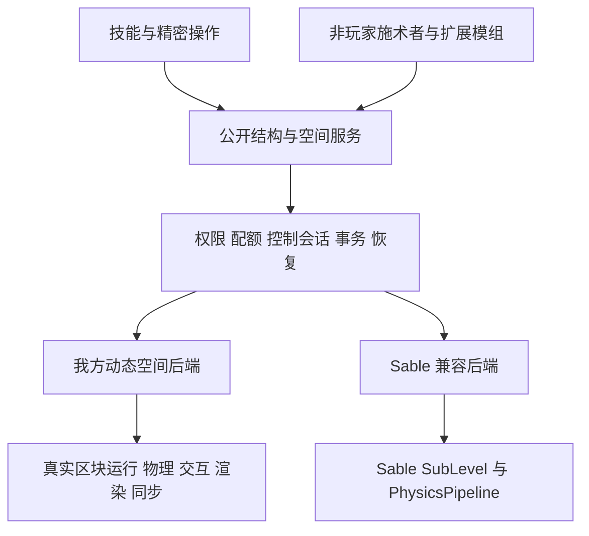

# 方块结构物理化与 Sable 兼容设计方案

本方案将能力使用的方块结构升级为可运动、可碰撞、可逐格操作的动态方块空间。独立安装 AcademyCraft 时也必须支持放置、破坏、交互和物理运动；安装 Sable 时，技能通过同一套公共接口操纵 Sable 结构，并由 Sable 承担该结构的世界运行与物理求解。

建议采用“公共结构服务 + 我方独立动态空间后端 + 可选 Sable 后端”。现有快照实体保留为旧存档迁移入口。完整目标包含独立后端，不能用“安装 Sable 才有完整交互”作为最终交付。

设计基线为 2026 年 10 月 11 日的本地工作区。我方 HEAD 为 `70d4751535f48ca2724eadb9af325bf53145c1f4`；Create fork HEAD 为 `7ec030e99193b16f34eca960ee7ab298ab737c1e`，其移植代码包含大量未提交修改，不能仅用这个提交号复现。2026 年 10 月 12 日起逐批推进空间/安全基础、独立真实区块容器及受限玩家操作；第六批持续采掘和既有客户端回归、第七批独立 Rapier f64 绑定及专项验收已完成。第八批已接真实结构和宿主地形的有界刚体区域，2026 年 10 月 13 日专服 r3、客户端 r1、四类新增保护、专项/全量测试、两种构建及三组 GameTest 均已通过；证明范围和失败记录见[第八批验证与重跑](D:/mcmodtest/AcademyCraft-Reborn-26.2/docs/block_structure_entity_system.md#第八批验证与重跑)。第九批已加入移动玩家交互的有界延迟协调，真实双客户端直连及双向各 100 ms 延迟验收已通过；最终全量/两种构建与既有采掘客户端回归也已通过，其证据不继承第八批通过结论。下文除“本批次落地进展”与独立后端当前实现明确列出的部分外，接口、流程和能力仍为拟议设计。

第十批已完成有界区域与运动检查点及显式恢复，最新 r2 三个独立专服 JVM 已通过正常保存、缺少原生配置时保留数据、恢复与停服门禁；客户端 r2、最终全量/原生测试、三组 GameTest 和两种构建也已通过。此结果不代表自动启动求解、任意崩溃恢复或完整 P0 已完成。

## 本批次落地进展

第一批完成 P0 的空间/单位基础和现有快照实体的数据安全改动，第二批加入独立 `ServerLevel` 容器，第三批加入模型投影、旋转后的逐格命中、作用域上下文和受限拉杆交互，第四批加入普通单箱，第五批加入受限放置。第六批实现受限持续采掘及掉落归属处理，第七批完成独立双精度刚体绑定；第八批增加真实结构、地形几何、内容屏障及姿态发布的有界连接。第九批接续服务器姿态历史、同帧玩家回执、请求去重和最新采掘观察，已通过直连与固定延迟的真实双客户端链，最终全量/两种构建也已通过。P0 整体未完成；本表区分已写入代码的范围与完整目标，详细验收及剩余边界见系统文档。

| 范围 | 已写入当前代码的行为 | 仍有边界 |
| --- | --- | --- |
| 宿主投影与同步 | 临时投影实体、状态模型视图和独立姿态头；原版区块变化的有界收集；任意四元数姿态、普通单箱模型和裂纹；第八批客户端已核对 42 个移动姿态样本及两张实际截图 | 最多 4096 格受支持方块；无通用 BE 渲染、网络插值、网络单格差量；物理投影通过不等于连续运动中的玩家操作通过 |
| 逐格命中与上下文 | 真实 OUTLINE 形状、局部/宿主坐标、遮挡、运行期身份/版本重验；线程作用域 SpaceContext | 查询不授予权限，宿主缺块拒绝；尚无通用世界事件转换 |
| 受限交互与菜单 | 原版拉杆和普通单箱；服务端真实视线、控制门禁、保护事件及回调后重验；实际箱子库存和当前姿态下的菜单距离；宿主点击/开关声 | 只适配普通干燥单箱等已审计入口；保护插件须识别空间上下文，不能声称所有原版事件与菜单已等价兼容 |
| 受限逐格放置 | 六种原版方块、主副手选择、真实 `BlockItem.place`、逆变换方向、任意姿态候选碰撞及单件物品预留；第五批已有验收 | 无多格、流体、重力块、通用物品组件或模组机器；写后异常不重放、不覆盖库存 |
| 受限持续采掘 | 第六批加入 START/HOLD/STOP/ABORT 会话、逐 tick 服务端校验、真实工具/掉落/经验、普通单箱内容和输出交付账本；其最终 r3 覆盖移动、取消、旧包、资源及部分交付故障；第九批 HOLD/STOP 追加最新命中观察 | 十种审核方块与原版工具边界；整体方块状态版本变化保守取消；没有通用 HIT_BLOCK 附魔效果或自动恢复；新增移动多人链已通过限定场景，延迟下仍可能取消采掘 |
| 独立 Rapier f64 绑定 | 第七批完成 `rapier3d-f64 0.36.1`、独立 C ABI 与 Java 25 FFM；有界生命周期、原点相对 double、复合盒、重力、碰撞、冲量、睡眠和 CCD；真实加载与引擎探针已通过 | 原生制品仍显式配置、普通 JAR 不含原生库；Linux 制品仍待实际验收，绑定本身不提供玩家承载或 Sable 桥 |
| 真实结构物理区域 | 第八批 `StructurePhysics`/`StructurePhysicsRegion` 接入实际体素几何、已加载宿主地形、共享刚体接触、变更重建和成组姿态发布；专服 r3、客户端 r1 通过代表场景及新增保护 | 每轴 24 格、每宿主一个/每服务器最多三个区域；动态 128 非空气格/64 盒、世界合计 2048 盒；无玩家承载、材料系统、技能或 Sable 接入；延迟协调和运动保存分别另列，不能计入第八批验收 |
| 移动玩家操作与延迟协调 | 第九批已写入最多六 tick/八帧的服务器物理姿态历史、命中点位移不超过 0.75 格的双射线复验、同帧回执、右键 nonce/应答，以及最新采掘观察；公开查询仍严格匹配当前版本 | 直连 r6/固定延迟 r1 双客户端链已通过，最终全量/两种构建与既有采掘回归也通过；只覆盖已有受限操作，不提供任意延迟容忍、插值或承载，骑乘玩家拒绝 |
| 物理检查点与显式恢复 | 第十批 manifest v2 保存区域、附加、线角速度、旧局部质心、睡眠观察和稳定碰撞摘要；整组姿态/运动发布，旧 v1 静止兼容；三 JVM r2、客户端 r2 及最终回归通过 | 不自动加载原生库或恢复步进；摘要不匹配暂停整区，重新匹配可继续；睡眠恢复时唤醒，空运动从零速开始；不构成跨文件崩溃原子保存 |
| 空间身份与姿态 | `StructureRef`、`SpaceBlockRef`、`StructurePose`、`StructureAnchor`；double 位置、单位四元数、点/方向正逆变换、表面速度及防御复制 | 已有独立后端生命周期服务；尚无自动锚点重映射和多个后端的选择/迁移 |
| 旧接口衔接 | `BlockStructure.reference()`、`pose()`、`velocityPerSecond()`；旧 yaw 转换补偿 snapshot pivot；`LegacyMotionUnits` 集中换算速度和加速度 | 旧实体仍使用 tick 单位及 Y 轴姿态，技能未全面迁移，质量/力值未重新标定 |
| 捕获与还原 | 捕获前验证 BE 数据能完整重建，通过实体生成事件后再核对来源 state/NBT；写前记录原状态和预期结果，提交及回滚均整批校验；阻挡结算返回 `RETAINED`，保留完整载荷 | 外部回调已转移库存或产生不明确写入结果时保持隔离；这不构成跨区块/实体文件的崩溃原子提交 |
| 重力结算 | 整批接纳自然落方块、写入固定格后才撤源结构；生成取消时撤销批次并回滚；BE 格不走原版落方块路径 | 仍是现有快照实体的终止行为，不是持久刚体睡眠或完整物理 |
| 放置副作用 | 准备写入时抑制 `onPlace`，在内容归属提交后补发放置回调与邻居更新，避免雪傀儡等生成逻辑先消费方块、随后又回滚复制材料 | 提交后的通知失败不应重新生成原载荷；不宣称任意外部回调副作用可回滚 |
| 未完成回滚 | `BlockStructureTransferState` 保留完整 before/after-images、写入及回滚状态；pending 状态随实体保存，重载后冻结、不可选中、无碰撞，普通恢复返回 `RECOVERY_REQUIRED` | 外部修改、未知格式或缺失 after-image 的记录不能自动回滚；独立持久日志、启动协调器和管理恢复入口仍待实现 |
| 碰撞接入 | 包裹我方结构外包框提交，保留原查询并补入索引遗漏；取消原先 HEAD 整体替换 | 仍是现有复合体素碰撞，不代表已经完成与 Sable 的混装验证 |
| 独立容器与公开访问 | 四个静态 void 维度，每身份独占真实 `ServerLevel`；`StructureSpaces`、`StructureBackend`、`StructureHandle`、`StructureWorldAccess` 提供服务端生命周期、局部读取和完整 state/NBT 比较后写入 | 每存档四个永久槽；空结构仍不回收槽；受信内容 API 与玩家操作分离，旧技能尚未接入 |
| 原版运行与加载 | 每槽 16 个实体 tick 票据；原版 BE、红石、计划 tick 和局部实体使用独立 level；`LOADING` 等待区块与实体就绪，停用或隔离暂停整个 level tick | 公共 gameTime 仍推进，恢复时过期计划 tick 可立即触发；外围区块仍受票据等级影响，暂停不保证即时内存驱逐，实体物理边界和第三方机器尚未完整适配 |
| 独立持久化与 I/O 门禁 | 原版区块/实体存储，独立 manifest、永久 owner marker 和 recovery 证据；原版明确报告的存储错误按槽锁存，失败槽禁止继续活动 | 原版静默解析丢弃未全面监测；索引与内容不构成崩溃原子事务；验证限于正常重启和错误报告注入 |

第一批单测覆盖空间变换、锚点、单位和碰撞组合；`academy:block_structure_safety` GameTest 覆盖库存守恒、生成取消、来源变化、异常回滚、落方块批次失败、pending 保存隔离、自然落方块/箱子混合正常结算、雪傀儡放置副作用，以及写后库存外移时拒绝回滚复制。2026 年 10 月 12 日第一批检查已通过：2319 项 JUnit 测试、包含九类场景的 GameTest、隔离客户端检查及开发/发布两种构建。命令与证明范围见[第一批验证记录](D:/mcmodtest/AcademyCraft-Reborn-26.2/docs/block_structure_entity_system.md#第一批验证记录)；这些结果不自动覆盖第二批新增代码。

第二批的 `academy:native_structure_space` GameTest 覆盖独立容器、原版运行和生命周期；正常重启通过同一存档跨两次独立 JVM 启动验证，没有以进程内卸载/装载代替。2026 年 10 月 12 日最终检查结果如下：

| 第二批检查 | 预期证明范围 | 当前结果 |
| --- | --- | --- |
| JUnit 与原有安全 GameTest | Manifest/owner/recovery 和公共契约；旧捕获、还原路径回归 | 2333 项 JUnit 和九类安全场景通过 |
| 真实容器 GameTest | 双 level 隔离、完整 BE CAS、负坐标与边界、传送入口、无人时机器/红石运行、失效句柄 | 通过，含停用 60 tick 后恢复运行 |
| 正常重启 | 身份、永久槽、姿态、完整库存、局部实体及恢复后 tick | 两个独立客户端 JVM 通过；7 钻石、铁矿物料和唯一盔甲架保持，未来计划 tick 完成 |
| I/O 故障报告 | 同步/异步 load/save 报告锁存，普通维度不污染，拒绝分配报告失败的槽位 | 通过错误报告注入；未模拟真实磁盘损坏 |
| 客户端与 dev/release 构建 | 真实普通世界的新维度/Mixin 注册与两进程 native 探针；不证明新容器移动渲染 | 全部通过；旧快照路径本轮由安全 GameTest 回归 |

完整命令与逐项状态见[第二批验证记录](D:/mcmodtest/AcademyCraft-Reborn-26.2/docs/block_structure_entity_system.md#第二批验证记录)。第三批的投影、旋转命中和受限拉杆交互结果见[第三批验证记录](D:/mcmodtest/AcademyCraft-Reborn-26.2/docs/block_structure_entity_system.md#第三批验证记录)。第八批已连接有界真实方块/地形与刚体，但宿主到容器的内容迁移、移动中的完整原版方块交互、实体承载、Sable 适配器和跨后端迁移仍未实现。pending before/after-images、独立 manifest 与原版保存也不是 durable crash-atomic journal：世界区块和实体可能分开落盘，不能据此宣称任意进程崩溃点的数据原子性已经获得验证。

第四批普通单箱和第五批受限放置的实际验收保留在[系统文档](D:/mcmodtest/AcademyCraft-Reborn-26.2/docs/block_structure_entity_system.md)。第六批的设计、工具/方块边界、恢复证据语义、隔离客户端重现命令及验证表见[受限持续采掘](D:/mcmodtest/AcademyCraft-Reborn-26.2/docs/block_structure_entity_system.md#第六批受限持续采掘)。本批 2398 项 JUnit、两种构建、三组 GameTest 及最终采掘客户端 r3 已通过；故障证据核对为已交付 7、未交付 5、BE 剩余 0。既有放置、单箱菜单及投影客户端已在最终代码的全新副本上全部通过；第五批结论不冒充新增路径的验证。

第七批已通过 2414 项基础 JUnit、12 项 Rust 测试、17 项真实引擎 JVM 测试，以及实际 NeoForge 客户端/专服的模块加载与求解探针。动态 `academy` 模块通过固定资源加载独立 unnamed FFM 桥，实际权限由显式 `--enable-native-access=ALL-UNNAMED` 授予。本批最终开发/发布构建及成品资源核对均已通过，详细范围见[第七批验收记录](D:/mcmodtest/AcademyCraft-Reborn-26.2/docs/block_structure_entity_system.md#第七批验证与重跑)。上述结果证明独立绑定和加载生命周期，不代表真实方块物理或 Sable 混装通过。

第八批已通过全量 2425 项 JUnit（包含 11 项新增专项）、12 项 Rust、17 项真实引擎 JVM 和 104 项编辑器测试，均无失败或错误，基础 JUnit/编辑器也无跳过；开发/发布构建及三组结构 GameTest 均通过。两份 JAR 都包含新公开 API 和固定桥资源，不含 DLL/SO/dylib。最终专服 r3 用 240 tick、客户端 r1 用 272 tick 完成三格/四盒/质量 2.25 的真实结构下落、非 yaw 接触、宿主/局部变更重建、动态体接触、空/卸载释放及缺块暂停。两端还验证附加期间 `setPose` 拒绝、NaN/10001 速度拒绝且状态不变、蛛网暂停 10 tick 后恢复、tick freeze 暂停 10 tick 后恢复。客户端记录 42 个移动样本，两张截图已打开核对；初始化仍有旧日志也存在的 `Missing uniform Globals` 异常，不声称零异常。首次专服 r1 因夹具没有持续区块票据而失败，r2 修正夹具后基础通过，r3 才包含新增保护；完整轨迹见[第八批验证表](D:/mcmodtest/AcademyCraft-Reborn-26.2/docs/block_structure_entity_system.md#第八批验证与重跑)。两端均为 `actual_keyboard_actions=false` 的服务端夹具；第八批验收当时将连续运动下真实双玩家操作留待下一阶段，后续第九批的限定场景见下文。

查询 GameTest 首次 r1 在第 15 tick 遇到 `metadata.dat` 原子替换 `AccessDeniedException`；失败日志和目录保留，同一源码在全新 r2 目录通过，未改代码隐藏故障。manifest 读写句柄只读复审未见未关闭路径，具体原因仍未知；第五批也曾发生相似访问拒绝，不能把重跑通过解释为已确定持锁来源或已修复。真实容器 GameTest 本轮运行 550 tick 并包含 `SYNTHETIC_IO_REPORTS_PASSED`，仍不等于真实磁盘故障与所有崩溃点已覆盖。各项日志、成品摘要与边界集中保存在上述系统文档。

### 第九批的实现与验收边界

第九批针对第八批尚未证明的移动玩家操作补充有界协调。只有服务器成功发布、仍属于同一运行期且内容未变的物理姿态可以进入历史；最多六个服务器 tick、八帧，目标表面点到当前姿态的位移不超过 0.75 格。服务器用真实玩家视线验证历史 OUTLINE，再从真实眼睛验证重投到当前姿态的同一格/同一表面；宿主、其他结构、实体和权限始终按当前状态检查。公开 `StructureQueries.validate` 仍严格匹配当前姿态与版本，不为受信 API 的一般调用开启历史宽容。

一次操作以 `NativeStructurePlayerTarget.Observation` 固定接受时的命中、宿主、玩家位置、眼睛、视线和距离。保护事件后及放置/采掘提交前的复验必须返回同一固定目标，不能在回调改变结构或玩家后重新定位。两次查询共享宿主状态/已加载区块/BE 身份回执，最终无形状回调复验，且有读取预算；这不替代第三方位置敏感逻辑的适配。原版玩家始终位于宿主，真实物品和菜单继续沿用既有所有权保护。

右键编号按连接单调消费，重复/倒退返回 `REPLAYED`，拒绝应答不导致自动重试。采掘 START/HOLD/STOP 带最新目标观察，逐 tick 以最近观察校验同一局部格；HOLD 不增加进度，STOP 不能跳过真实服务端工作量。普通单箱按当前世界位置检查距离；骑乘玩家的新操作与持续菜单均拒绝。无玩家承载、姿态插值、通用方块/工具扩展、技能迁移或 Sable 接入，P0 仍未完成。

新增 `validation/native_structure/multiplayer.init.gradle` 为真实专服、actor 和 observer 三个独立 JVM 导出启动参数，固定延迟代理为 `validation/native_structure/tcp_delay.py`。直连与每方向固定 100 ms 的代理轮各用全新隔离目录；代理保序，不覆盖乱序、丢包或断线。启动顺序为 server、observer、actor，使 actor 自然留在前台；阶段使用 `coord/phases/000001.properties` 等只追加记录，客户端校验 session 与单调 sequence，不覆盖正在共享读取的文件。验收须同时保留三端结果、资源归属、共享单箱截图、观察者移动裂纹截图及正常停服证据。

本批 17 项真实引擎 JVM、12 项 Rust 与 query/space/safety 三组 GameTest 已通过，space 包含 550 tick 与存储错误报告注入。真实双客户端直连 r6 三端 PASSED：服务器 717 tick，actor/observer 分别 571/569 个移动版本；双向各 100 ms 的延迟 r1 三端 PASSED：服务器 910 tick，分别 672/670 个移动版本。两轮最终均为 7 钻石、17 圆石、storage 玩家数 0，重复右键/采掘和旧菜单包未改变归属，正常保存、服务端线程结束及退出 0；六张共享单箱/观察者裂纹图已实际打开核对。场景使用真实 TCP 与客户端路径，记录仍为 `physical_keyboard_mouse=false`，不声称全程物理键鼠。

延迟轮首次采掘请求取消，随后新请求完成，MINE 阶段共 242 tick；取消原因尚未定位，不能宣称延迟完全无拒绝。代理日志保留每方向 100 ms 与双向流量，正常关服后的 `Connection lost` 不代表零异常。既有采掘 `runClientDev` 回归也已通过：真实输入、取消/换工具/保护事件、移动/旧包、单箱 7 件、耐久、矿石经验 4、精准采集、创造模式、空结构重载与部分交付隔离均通过；故障注入为已交付 7、待交付 5、BE 剩余 0、总计 12，不是意外错误。`build/native-physics-p9-mining-client.log` 记录成功及正常保存退出，两张石头/单箱裂纹截图已实际核对。

本批最终全量 JUnit 实际为 2446 项，编辑器 104 项、原生 JVM 17 项，均零失败、错误或跳过；Rust 为 12 项通过。开发/发布构建均成功，日志分别为 `build/native-physics-p9-test.log`、`build/native-physics-p9-build-dev.log`、`build/native-physics-p9-build-release.log`，耗时 11/24/28 秒。三组 GameTest 均以 `All 1 required tests passed` 验收，安全组没有另设自定义 PASSED 标记。当前遮挡、距离、骑乘拒绝、保护事件和回调复验由既有 GameTest、相关单测及源码复审分别覆盖，没有把每项都作为本批新增多人负例执行；生产只读复审未发现新增可行动问题。完整扩展矩阵继续保留待验范围。

直连 r1 因观察者名称超长，r2 因未定位的 GLFW `pollEvents` 崩溃，r3 因夹具过早控制陈旧几何，r4 因协调文件替换访问拒绝而未完成；r5 在超距关箱后的旧包检查等待期间仍水平移动，触发区域越界。r6 仅让夹具在双方菜单关闭后停止水平驱动，没有放宽边界。r2 的外部窗口激活只有时间关联，actor 未加载物理 DLL；r4 只改变测试协调，不表示生产 `metadata.dat` 的历史问题已修复。命令、完整失败记录、截图和验收表见[第九批实现与验收](D:/mcmodtest/AcademyCraft-Reborn-26.2/docs/block_structure_entity_system.md#第九批移动玩家操作与有界延迟协调)。第八批的 `actual_keyboard_actions=false` 夹具结论保持原有证明范围。

### 第十批的实现与验收边界

第十批在同一 manifest v2 Entry 中绑定姿态与可空物理关联，保存 bounds、线角速度、旧局部质心、睡眠观察、碰撞/求解配置 SHA-256 和恢复许可。批量 `putAll` 先验证完整候选表，再一起发布；未知格式、非有限值、不一致宿主 bounds 等拒绝并保留原 metadata。v1 不带物理字段时保持原有静止语义。摘要基于稳定局部盒和固定求解配置，不包含运行期计数，也不替代方块、库存或宿主地形校验。

启动仅按既有规则装载结构内容；`savedRegionBounds` 不加载原生库，`resumeRegion` 才显式尝试恢复，缺少配置或权限时保留原记录。已有记录会阻止新 `openRegion` 和直接 `setPose`。活动结构等待装载/几何/宿主区块/时间域满足条件，inactive 结构需显式 load；摘要不匹配暂停整区并保留检查点，原几何重新匹配后可继续。恢复统一唤醒以重建接触，睡眠仅是观察；motion 为空的附加从零速度开始，不补算离线时间。在线内容变更继续按新质心转换旧刚体速度场，不宣称材料密度或全部动量重分配已经实现。

成员卸载暂停当前共享区域并保留记录；detach 清指定关联，显式 close 清整个区域关联，未开启区域可通过 `discardSavedRegion` 明确放弃。以上均保留内容和已发布姿态。正常停服只释放原生资源，先设置 stopping 门禁阻止回调新建/装载或修改检查点，内部关闭、失败标记和最后持久化仍可执行。隔离/求解失败保留数据并撤销恢复许可。此协议不含跨区块/实体/metadata 的崩溃原子提交、硬终止自动恢复或自动修复。

最新 r2 在 `run/native-structure-physics-persistence-20261013-p10-r2` 依次完成 prepare、unavailable、resume 三个独立 JVM：PID 为 81064/72192/83332，分别运行 67/42/23 tick；三阶段结果均 PASSED、正常保存退出 0，均核对 `stopping_guards_verified=true`。非零线角速度与另一睡眠体的观察保存、缺库拒绝后检查点保持、几何不匹配三 tick 且零步进、恢复首步、完整七钻石箱 NBT、卸载/重载、旧句柄/旧命中拒绝及 detach/close 清除均通过。日志为 `build/native-physics-p10-persistence-{prepare,unavailable,resume}-r2.log`。r1 prepare 也是通过，但早于停服门禁修补，仅记历史预检，不列为失败或最终验收。

最终基础 JUnit 为 2459 项、编辑器 104 项、真实引擎 JVM 17 项，均零失败、错误或跳过，Rust 12 项通过；首轮 27 项 focused 已由最终全量再次覆盖。开发/发布构建分别 24/28 秒成功，三组 query/space/safety GameTest 均通过；space 运行 550 tick 并包含存储错误报告注入。所有结果按第十批最新日志与 XML 核对，不沿用第九批结论。具体数值、命令和证据语义见[第十批实现与验收](D:/mcmodtest/AcademyCraft-Reborn-26.2/docs/block_structure_entity_system.md#第十批有界物理区域与运动状态保存恢复)。完整 P0、玩家/实体承载、材料系统、技能迁移及 Sable 桥仍未完成。

客户端回归 r1 在第 223 tick 进入 UNLOAD 时失败：生产区域已按新契约停在 `PAUSED: awaiting_structure_activation`，旧夹具却在分支之前统一要求 READY，尚未执行 UNLOAD 检查便抛异常。`build/native-physics-p10-client-r1.log` 及对应失败目录保留。只调整夹具，改为连续 20 tick 验证暂停原因、步数不变、零刚体和不可 resolve；未修改生产行为，因此三 JVM r2 验收仍有效。全新客户端 r2 已在 276 tick 通过，记录 41 个移动样本、卸载暂停 20 tick 后恢复、正常保存全部维度及退出 0，`build/native-physics-p10-client-r2.log` 为 `BUILD SUCCESSFUL in 56s`。[下落前](D:/mcmodtest/AcademyCraft-Reborn-26.2/run/native-structure-physics-smoke-client-20261013-p10-r2/screenshots/native-structure-physics-before-13264.png)和[接触后](D:/mcmodtest/AcademyCraft-Reborn-26.2/run/native-structure-physics-smoke-client-20261013-p10-r2/screenshots/native-structure-physics-landed-13264.png)两张截图已由根代理打开核对，倾斜复合体到落地没有明显模型错位；该回归仍为服务端夹具，`actual_keyboard_actions=false`。

首次 query GameTest 命令遗漏 `-I validation/native_structure/query.init.gradle`，因此选择器报告未发现测试，并非生产代码断言失败。补入 init 后在全新 `run/native-structure-query-gametest-20261013-p10-r2` 通过，保留 `build/native-physics-p10-query-gametest.log` 与 `build/native-physics-p10-query-gametest-r2.log`。此记录与旧批 Windows `metadata.dat` 替换访问拒绝是不同事件，不能相互归因。

最终证据集中于 [validation](D:/mcmodtest/AcademyCraft-Reborn-26.2/build/native-physics-p10-validation.json)、[artifacts](D:/mcmodtest/AcademyCraft-Reborn-26.2/build/native-physics-p10-artifacts.json)、[source-manifest](D:/mcmodtest/AcademyCraft-Reborn-26.2/build/native-physics-p10-source-manifest.json)、[all-files-manifest](D:/mcmodtest/AcademyCraft-Reborn-26.2/build/native-physics-p10-all-files-manifest.json) 和 [delta-manifest](D:/mcmodtest/AcademyCraft-Reborn-26.2/build/native-physics-p10-delta-manifest.json)。本批影响 16 个文件，连同未提交 P8/P9 累计相关 56 个；没有生成资源更改，当前没有本批提交授权。开发 JAR SHA-256 为 `5db0e2c5b37644ceb2612c95359d2320447b39f650cf8c7ff4af20f3e5454a34`，发布 JAR 为 `24a9474907904536c8e8e8e7053511110f2e1f55738c58359f4f0c835e86284b`；成品含新 Java 恢复类型及固定 FFM 资源，不含原生 DLL/SO/dylib，外部 DLL 未变。

## 现有系统与目标的差距

当前[系统文档](D:/mcmodtest/AcademyCraft-Reborn-26.2/docs/block_structure_entity_system.md) 同时记录技能正在使用的快照实体后端和新建的独立真实区块容器原型；两者尚未完成内容迁移与调用合并。完整动态空间仍按本方案逐步实现。

| 领域 | 当前实现 | 本次目标 |
| --- | --- | --- |
| 内容 | 旧技能使用不可变快照；新后端持有可变真实区块、BE 和局部实体 | 将内容运行、跨空间迁移与移动世界语义组成可靠闭环 |
| 结构身份 | 旧实体可导出 `StructureRef`；新后端已有实体无关的持久身份和运行时句柄 | 全部技能、程序和两个后端统一使用身份服务 |
| 姿态 | 旧运动仍为平移/yaw；新容器在显式有界区域内由刚体发布四元数姿态和运动快照，第十批检查点及显式恢复已通过本批验收 | 扩展通用控制、插值与完整移动交互 |
| 碰撞 | 旧实体复合盒平移裁剪；新区域有真实体素几何、宿主固定体及同区域动态体接触 | 加载/分区调度、材料响应、实体接触与高速旋转扫掠完整验收 |
| 承载 | 按平移量推动站立实体 | 支持旋转表面速度、上下船、跳离和挤压处理 |
| 原版操作 | 旧实体整体可选中；新容器已有受限拉杆、普通单箱、放置及已验收专用客户端链的持续采掘；CAS 仍只服务受信调用方 | 正常工具采掘、放置、物品使用、菜单与交互距离验证 |
| 运行 | 旧快照 BE 冻结；新容器运行原版 BE、红石和计划 tick，宿主呈现模型及普通单箱 | 将当地逻辑与移动空间交互、通用 BE、流体和实体边界连通 |
| 终止 | 停止后尝试静态化或落方块结算，失败保留，未完成回滚则隔离 | 睡眠与静态化分离；由技能生命周期策略决定是否还原 |
| 同步 | 旧实体同步快照；新容器姿态、无库存状态视图和真实菜单分离，第六批增加有序裂纹更新 | 姿态插值、分区内容增量、多人跟踪和拆分重映射 |

关键证据是 [BlockStructure](D:/mcmodtest/AcademyCraft-Reborn-26.2/src/main/java/org/academy/api/common/structure/BlockStructure.java:10)、[实体 tick](D:/mcmodtest/AcademyCraft-Reborn-26.2/src/main/java/org/academy/internal/common/world/entity/structure/BlockStructureEntity.java:133) 和 [运动会话](D:/mcmodtest/AcademyCraft-Reborn-26.2/src/main/java/org/academy/internal/common/structure/BlockStructureKineticRuntime.java:90)。后者强制要求 `BlockStructureEntity`，所以仅给 Sable 包一层现有接口仍不能运行。

已有选区、捕获策略、网格吸附、资源消耗、伤害上限和纯算法测试可以复用。快照可继续作为导入导出格式，但不能继续充当活动方块世界的唯一数据源。

设计基线发现的两类优先风险已在本批次修改实现，后续仍需完整验收：

- [结算管理器](D:/mcmodtest/AcademyCraft-Reborn-26.2/src/main/java/org/academy/internal/common/structure/BlockStructureManager.java) 原先在失败时生成不含 BE 数据的普通方块 ItemStack，现改为整体还原或完整保留；重力结算也不再先撤销源结构后无条件逐格降级。回滚无法完成时保留恢复材料并停止结构活动。
- [碰撞 Mixin](D:/mcmodtest/AcademyCraft-Reborn-26.2/src/main/java/org/academy/mixin/common/MixinEntityGetter.java) 已改为局部包裹结构形状提交与返回结果补充，不再在 HEAD 取消整个查询。实际模组组合的注入与行为验证仍是后续兼容工作的必要部分。

## 参考工程的实际机制

`create-fork` 根工程是 Create。真正的物理结构实现位于 `.porting/sources/Sable`，航空学位于 `.porting/sources/Simulated-Project`，基础坐标接口位于 `.porting/sources/Sable-Companion`。

Sable 的核心是带独立姿态的 SubLevel。方块仍处于真实区块中，只是存储地址落在受管理的 plot 区域；世界中的可见位置通过姿态变换得到。区块访问、同步、方块射线、放置方向、交互距离、实体碰撞、渲染均围绕这个空间边界适配。由此可以继续利用原版方块和 BE 逻辑。[上游说明](https://github.com/ryanhcode/sable) 也将其定义为包含普通区块、实体和方块实体的移动子空间。

值得借鉴的是职责分层与行为契约，不是把全部 Mixin 或实现复制到我方：

1. 存储空间和世界姿态分离，普通方块拥有稳定地址。
2. 服务端统一求解物理，客户端插值展示。
3. 方块、交互、玩家、菜单和网络使用一致的空间转换。
4. 装配、拆分、还原会同时处理方块数据、速度与附属关系。
5. 物理力在子步生效，方块逻辑仍按游戏 tick 运行。

两处不能直接照搬的细节尤其重要。Sable 的 `Level.clip` 命中结构后可能返回 plot 地址及 plot 中的命中点，不能直接把它解释成世界坐标。`getContaining` 检查的也是存储 plot 的归属，而不是“世界中的这个点碰到哪艘船”。此外，[assembleBlocks](D:/mcmodtest/create-fork/.porting/sources/Sable/common/src/main/java/dev/ryanhcode/sable/api/SubLevelAssemblyHelper.java:71) 并非我方所需的完整事务：其逐块迁移存在记录异常后继续执行的分支，必须补充预检、校验和恢复机制。

## 对玩家可见的行为契约

独立后端和 Sable 后端需要通过同一份行为测试。二者可以有不同的物理数值和渲染实现，但不能改变方块归属、物品数量、技能输入含义和存档安全性。

| 场景 | 约定 |
| --- | --- |
| 向移动结构放置 | 默认加入命中结构的局部网格；多格方块必须完整通过检查后一起放置 |
| 挖掘结构方块 | 沿用工具、采掘时间、附魔、掉落、游戏模式和权限规则；最后一格移除后回收结构 |
| 右键和容器 | 使用实际局部方块与 BE；距离按结构当前世界位置计算；失去访问条件时关闭菜单 |
| 结构停止 | 进入物理睡眠，仍可交互；方块 tick 是否运行由正常加载及模拟距离规则决定 |
| 技能结束 | 释放控制。需要恢复地形的技能单独请求静态化，不能销毁玩家后来加入的内容 |
| 切断连接 | 按六向连接及专用连接适配器拆成刚体；不因两个结构碰到一起自动合并 |
| 击碎 | 方块破坏改变结构几何；高速撞击碎裂另设材料阈值和限额，避免第一次上线即无限碎片化 |
| 外部船只 | 对整船施力、切出局部结构、破坏单格是三个显式动作；不能命中一格便默认拆走整船 |
| 局部机器连接 | 同一结构内红石、漏斗、管线按局部格工作；跨结构连接需要明确的连接器或专项适配 |
| 原版重力方块和流体 | 方块规则沿局部格轴运行；刚体重力沿世界轴。跨空间流体交换、掉落实体离开结构有专用边界处理 |
| 任意姿态还原 | 只接受有合法整数网格和方块状态旋转映射的姿态；失败则保留结构 |

上表是完整目标。最后一格移除后清除投影，第八批也会在碰撞几何为空时释放刚体；原身份、活动容器和永久槽仍保留并允许保存/加载，尚未实现“回收结构”的槽位协议。受限工具与方块支持表也不能代替表中的通用原版交互要求。

“完整能力”首先指结构作为方块空间具备正常放置、破坏、交互、运行和物理运动。它不等于任意第三方机器无需适配即可工作。门户、跨维度机器、外部网络绑定、特殊多方块控制器列入逐项适配表；不支持的捕获应返回明确原因，而不是先拆走再损坏。

## 模块和公开接口

首期在本仓库内按模块职责分包，待两个后端都稳定后再决定是否拆为独立发行组件。公开类型位于 `org.academy.api`，后端实现位于 `org.academy.internal`。



| 接口与拟议扩展 | 职责 |
| --- | --- |
| `StructureRef` | 逻辑 UUID、所在维度、后端标识、身份代次；不要求对应 Entity |
| `StructureHandle` | 生命周期、空间、内容访问和支持的能力；失效句柄不隐式改指另一结构 |
| `SpaceBlockRef` | 空间身份和局部整数格，替代有歧义的裸 BlockPos |
| `StructurePose` | 局部原点的世界位置、单位四元数；固定单位缩放 |
| `StructureAnchor` | 结构身份、局部格、点偏移和法线；可绑定方块代次，解析方负责验证；偏移可伸出格子以支持表面附属物 |
| `StructureHit` | 目标空间、局部格和面、局部及世界命中点、有效几何版本 |
| `StructureWorldAccess` | 分区读取、受控变更、BE、计划 tick、空间事件；写入必须由服务端事务执行 |
| `StructureMotion` | 在给定点施力或冲量、力矩、控制约束、速度读取和受控传送 |
| `StructurePhysics` / `StructurePhysicsRegion` / `StructureMotionState` | 第八批已实现的受限子集：显式有界区域、精确句柄附加、运动快照、质心速度与宿主点冲量；第十批增加保存区域查询、显式恢复及放弃关联；不等于完整 `StructureMotion` |
| `StructureTransaction` | 捕获、还原、拆分、迁移的准备、提交、回滚及恢复结果 |
| `StructureBackend` | 创建、查询、装载、导出、持久化和能力协商 |
| `StructureActorContext` | 施术者、归属、权限主体、伤害归属和资源提供方；允许非玩家来源 |

公共方法应覆盖 `capture`、`raycast`、`applyForceAt`、`applyImpulseAt`、`holdAnchor`、`releaseControl`、`tryMaterialize`、`extractRegion`、`teleportGroup`。施力不隐含捕获权限，捕获也不隐含控制整艘第三方船的权限。

`StructureRef`、`SpaceBlockRef`、`StructurePose`、`StructureAnchor` 已有第一版实现。第二批又实现 `StructureSpaces` 入口及 `StructureBackend`、`StructureHandle`、`StructureWorldAccess` 的最小服务子集：创建空容器、精确查找、装载/停用、状态查询、姿态元数据和局部单格 CAS。第三批加入 `StructureHit`、`StructureQueries` 和 `StructureContexts`，第四至六批围绕它们增加受限操作及公开保护事件。第八批新增实体/玩家无关的 `StructurePhysics` 区域入口，不暴露原生句柄。表内的能力协商、导出、批量事务、有限力约束及通用控制仍是拟议扩展。

保留旧 `BlockStructure` 的兼容适配器和弃用期，但新服务不依赖 `asEntity()`。不能为 Sable 建一个假实体后继续使用旧的移动、碰撞和存档逻辑。确需原版伤害归属代理时，该代理只能携带归属，不负责结构内容和运动。

## 坐标与时间单位

需要明确区分世界坐标、结构局部坐标、后端存储坐标。plot 地址只能存在于后端内部，不应流入技能、音效、粒子、射程、保护区或菜单距离逻辑。

使用双精度位置和单位四元数。局部原点固定，允许局部负坐标；放置新方块或质心移动不能重新编号已有格子。

```text
世界点 = 世界原点 + R × 局部点
世界方向 = R × 局部方向
表面速度 = 质心线速度 + 世界角速度 × (世界点 - 世界质心)
力矩 = (施力点 - 世界质心) × 世界力
```

全局位置、包围盒和射线使用 double。我方独立后端的物理岛及 GPU 数据先转换为局部原点相对坐标，避免把 plot 地址或千万级绝对坐标直接转成 float。当前 Sable 后端仍继承其世界坐标 f32 精度限制，桥不能只给我方结构减原点，否则会与其静态世界和其他刚体错位。若要求 Sable 在远坐标达到同等精度，须另行改造 fork 的整体原点重定位或 f64 求解链路，并重新验收。

新物理接口统一以秒计时：格/秒、弧度/秒、质量单位、力和冲量。旧技能速度为格/tick，集中通过 `LegacyMotionUnits` 转换：速度乘 20；旧每 tick 速度增量换算加速度乘 400。现有 `force / mass` 每 tick 直接加速，质量模型又将变化，因此旧 force 数值不能仅做一次乘法就当新力值；按代表结构的加速度、最大速度、射程和资源消耗重新标定。

游戏 tick 更新目标和资源预算；固定物理子步消费力与约束。一次性冲量带唯一序号，只消费一次；连续力按实际子步时长积分，不能每个子步重复一整个游戏 tick 的冲量。服务器卡顿时限制追赶子步数，不以过大的时间步穿透世界。

## 独立运行后端

### 方块运行与存储

P0 第二批已选择并实现独立 `ServerLevel` 容器，未采用共享宿主的远处 plot。共享 level 的世界规则、实体查询、光照和原始区块入口不能仅靠地址约定形成隔离，所以当前每个结构独占一个静态保留维度。四个 `academy:structure_space_0..3` 由普通维度 JSON 声明，使用 vanilla overworld type 和空 layers 的 flat 生成器，关闭结构、湖泊及装饰；由服务器原版维度加载、保存与关闭流程管理，不动态修改维度注册表。

当前每槽允许固定局部 X/Z `[-32, 31]`，Y 使用实际 level 的构建边界。结构以该 level 的真实区块、BE ticker、block/fluid 计划 tick、邻居更新、光照和实体记录运行，内容由原版存储链保存。对四个 storage level 的公共 Level 方块读写入口施加边界：越界写入失败，读取分别返回屏障、空流体或无 BE；普通维度不变。此约束不覆盖任意直接 `LevelChunk` 访问、直接实体注册及实体物理越界，尚不是所有方块/实体来源的完全隔离层。

公共访问通过 `StructureSpaces.backend(server)` 取得实体无关服务。`createEmpty` 不捕获宿主内容；`StructureRef` 的维度是可见宿主，存储槽保持内部细节。`resolve` 不装载，`load` 返回 `LOADING` 句柄，等区块及实体就绪后进入 `ACTIVE`。`unload` 先保存再停用、撤票，旧句柄永久失效；再次装载保留身份、返回新句柄。新分配在同步区块检查和完整实体加载后两次验空，发现未知旧内容保留认领并隔离。

`StructureWorldAccess` 只允许服务端线程读取和比较后写入完整 state/NBT，读出的 BE 数据为副本。CAS 的 `APPLIED` 表示本次写入已提交，正常回调可能随后消费或改变方块；它不是多格事务，也不负责玩家权限、物品消耗、工具、菜单或掉落。调用方必须是受信服务端逻辑。准备写入失败时仅在整批镜像仍一致的条件下回滚，不确定则进入 `RECOVERY_REQUIRED`，不能恢复陈旧库存。

每槽对 X/Z 区块 `[-2, 1]` 持有 16 个 `ENTITY_TICKING` 票据，flags 14（加载、模拟、保持维度活动），可按 type/ChunkPos/level 明确撤销。原版票据传播会加载外围环，16 不是全部驻留区块上限。`LOADING` 和 `ACTIVE` 才允许运行 storage level 的完整 tick；无活动句柄、停用、隔离或 I/O 失败时从 `ServerLevel.tick` HEAD 暂停。停用意味着冻结和撤票，不承诺立即驱逐所有内存区块，不改变宿主 worldborder 或全局 gamerule。当前加载由显式生命周期和有限票据驱动，按可见世界模拟距离调度仍属后续工作。

每个身份永久认领一个槽位；`owner_N.txt` 不随 unload 删除，四槽用尽后不覆盖旧内容。`metadata.dat` 保存身份、姿态、active/quarantined 标记，第十批 v2 追加可空物理关联；坏档禁止继续分配/加载，孤立 marker 也保留占用。`recovery_N.dat` 存在即拒绝激活，既不自动重放，也不据此生成第二份内容。正常停服/启动装载健康 active 结构内容，inactive 需显式 load，物理仍须另外显式 resume；重启验证必须覆盖原版库存和实体文件，不能只读取 manifest。

原版 `reportChunkLoadFailure`/`reportChunkSaveFailure` 被动观察四个维度的存储错误并按服务器/槽位锁存，保留原诊断。异步报告不访问世界；失败槽当次会话不能靠 load 清除，运行时尝试保存隔离证据。普通世界报告不受影响。锁存不能发现未进入报告入口的静默解析丢弃，也不能保证磁盘已经完全不可写时仍留下持久隔离。原版缺失 BE/实体类型、无效字段被跳过等需要后续完整性校验和人工恢复工具；索引原子替换不等于跨区块/实体文件崩溃原子。

入口保护通过 NeoForge travel event 拒绝进入保留维度；原版命令与门户走该路径，直接添加实体不在此保护内。只对已保存于四个精确保留维度的登录玩家尝试回主世界安全出生点，不改背包；实际门户、玩家重登录和异常恢复结果仍需单独记录。

后续仍需为跨容器操作建立可嵌套 `SpaceContext`：玩家交互、菜单、声音、粒子、爆炸、实体出入及网络命中都要携带身份，显式完成局部与宿主坐标转换，并在 finally 中恢复上下文。真实玩家不得被全局临时改位置/维度来调用容器逻辑。现有本地格运行不等于这些世界路由已经完成；刚体睡眠与容器停用也将作为不同状态处理。新增容量、动态维度、内容迁移、可见世界模拟距离以及 Sable 后端选择继续服从上层稳定身份契约，不借此复用旧槽。

### 刚体与碰撞

第七批已锁定官方 `rapier3d-f64 = 0.36.1`、Rust `1.99.0` stable 和依赖图，并完成最小 Java/Rust 绑定。实现采用 Java 25 FFM 与独立 C ABI；不复用 Sable 的 JNI 实现。第八批通过显式 `StructurePhysics.openRegion` 接入真实结构，普通启动仍不自动加载原生库或附加结构。Rapier 官方提供 `rapier3d-f64`，刚体支持 CCD 和睡眠。[精度选项](https://rapier.rs/docs/user_guides/rust/getting_started/)、[刚体功能](https://rapier.rs/docs/user_guides/rust/rigid_bodies/)。

第七批已锁定引擎版本、Java 25 FFM ABI、平台清单和制品哈希，采用独立库名、符号、私有加载副本及明确释放流程；Windows x86_64 的独立专服与客户端加载已通过，Linux x86_64 仍待实际验收。后续接入真实结构时，安装 Sable 并选择其后端应不加载我方原生求解库；引擎不可用时应保留结构恢复记录、禁止新捕获，不降级成会损坏内容的假成功。这些后端选择和捕获联动尚未实现。

第八批当前实现为固定有界区域：每轴不超过 24 格，每宿主 level 一个、每服务器最多三个。动态结构最多 128 个非空气格和 64 个碰撞盒；区域中动态与地形合计最多 2048 盒，地形按 64 盒分组为固定体。宿主只读取已加载 chunk，缺失时暂停，不隐式加载。真实 storage 的 `BlockState.getCollisionShape` 经守卫 `BlockGetter` 和空 `CollisionContext` 提取 `toAabbs()`，保留真实空隙；不消费供展示使用的 `NativeStructureChanges.take`。严格原版身份/审核类门禁拒绝流体、未知 mod/BE/上下文相关形状，而不是把它们降级为完整方块。

每 tick 重采结构及宿主实际形状，保存存储变化版本、宿主扫描的全部状态、形状邻居读取和区块身份，在物理步前复验；结构跳过的空气格由存储变化版本覆盖。缺块、超限或观察不一致时不继续旧几何。内容/地形变化构建完整候选世界后替换；相同区域的结构共享动态接触。局部质心改变时保留原速度场 `v_new = v_old + ω × R(c_new - c_old)`，不重编号局部格；重建唤醒刚体，不能让移除支撑后的睡眠体悬空。当前密度 1、摩擦 0.6、回弹 0，动态体开启显式 CCD。

当前每正常 tick 固定 `0.05` 秒、三个子步。先检查所有求解结果仍在区域内，再由运行时成组发布姿态，第十批同时发布对应运动检查点，随后更新菜单有效性、投影和采掘。实时或保存关联中的外部 `setPose` 均拒绝，需 detach 或明确放弃关联后改变姿态。越界或引擎异常使区域失败、保留最后一致姿态/运动并撤销恢复许可，不回放半步。空碰撞几何释放刚体但保留结构身份/永久槽及空运动关联；卸载保留检查点并暂停当前共享组，停服释放资源但保留记录，下一服务器会话须显式恢复。此为第十批新增语义，不能计入第八批原有验收。

时序门禁当前仅为保守暂停：宿主 tick freeze 或任一成员的几何包围盒中心锚点（空几何使用原点）在 `TemporalChannel.ENTITY` 下倍率不为 1 时，暂停整个区域、拒绝新速度/冲量、不积攒追赶步。它不代表整个船体的时间域积分，也不暂停 storage level 的所有逻辑。连续运动点击的有界版本/延迟协调已于第九批接入；玩家承载、技能迁移与 Sable 仍未接入。

后续完整目标仍为按分区缓存和失效传播、宿主加载调度与材料响应；门、活板门、活塞等需逐项审核，不能因普通楼梯/栅栏通过便全部开放。合并盒必须保持真实空洞，世界静态分区变化与内容版本在同一物理步屏障前就绪。当前固定区域不是无限移动世界。

后续质量由数据驱动的方块密度和形状计算，必要时由适配器补充容器内容质量；不将硬度直接当密度。引擎已有非零质心、惯性、摩擦、回弹、阻尼和重力倍率基础，公共结构控制仍需有限力约束或 PD 控制器，不以每 tick 强制 setPos 实现悬浮抓取。任意 setVelocity 和传送均属于显式受控操作。

第八批三个子步仅已覆盖有界代表场景，不承诺高速投掷和旋转扫掠。后续将几何、质量、连通性和内容组成统一 mutation epoch，在下一物理步前一起发布。跨空间交易可延后提交；原版门、活塞或 BE 已经完成的普通空间内更新，则同步重建必要几何，或暂停受影响刚体的下一物理步直至新 epoch 就绪。预算不足不能让已改变的方块继续配旧碰撞运动。

### 原版交互与实体承载

客户端统一射线比较世界方块、普通实体和结构的真实世界距离，再在目标空间内进行体素命中。服务端重新验证 UUID、局部格、朝向、射程、视线、权限和几何版本；不能接受客户端任意 plot 坐标直接写世界。

采掘保留 START、ABORT、STOP 及进度同步；移动不改变正在挖掘的局部格，破坏或超出距离才取消。放置通过局部上下文调用原版放置流程，处理支撑、多格状态、waterlogged、消耗物品与事件取消。普通空间内变更使用 mutation batch，跨空间迁移使用持久化事务；两者最终都经过 epoch 屏障发布内容、质量、碰撞、连通性、渲染和跟踪增量。

第五批已完成六种方块的局部 `BlockPlaceContext` 放置子集。第六批会话新增 HOLD 续租：正数请求 ID 按连接递增，HOLD 不推进进度，STOP 只锁存完成请求，服务端在投影更新后逐 tick 检查真实射线和工具，进度足够才提交。目标绑定局部格，单独改变 pose 可以继续；当前整个存储方块状态版本变化仍会保守取消。`StructureMiningEvent` 提供 START/FINISH 保护入口，真实玩家始终留在宿主。第六批以单人集成客户端验收该子集；第八批加入物理步排他及发布顺序，第九批进一步接入有界历史姿态协调、最新 HOLD/STOP 观察和同帧提交回执，直连及每方向 100 ms 延迟的真实双客户端链已通过。本段完整目标中的多格、含水、通用交互和完整物理 epoch 协调仍未完成。

| 执行上下文 | 坐标和调用规则 |
| --- | --- |
| 方块、BE、邻居、红石、计划 tick | 目标空间的局部格；访问不穿入相邻 plot |
| 玩家位置、射程、领地保护、伤害归属 | 真实世界坐标；事件额外携带结构和局部格供兼容模块识别 |
| 放置方向、方块内部射线 | 由玩家世界视线逆变换得到局部方向，不改写真实玩家位置或所属维度 |
| 菜单和 ContainerLevelAccess | 方块读取走局部空间，距离与有效性走当前世界姿态 |
| 漏斗等局部实体查询 | 查询同空间实体及经边界服务映射的世界候选，并按实体 UUID 去重 |
| 声音、粒子、物品生成和爆炸 | 标明来源空间；在边界统一转换，爆炸还需查询其他空间的受影响对象 |

P0 的最小探针增加持续打开移动箱子菜单、旋转后正确朝向放置、漏斗拾取结构内物品和保护事件取消。入口通过作用域对象及 finally 恢复上下文，不使用全局暂改真实玩家坐标的方案。

菜单必须绑定 `StructureRef + local BlockPos`，每次有效性检查使用当前姿态。普通广播只使用 BE 更新数据；完整容器库存继续通过合法菜单同步，完整持久化 NBT 不作为公开渲染包发送。

玩家承载由同一接触服务处理平移和旋转，记录支撑结构及局部接触点；离开时继承表面速度。必须覆盖行走、跳跃、楼梯、低顶、上下船、边缘脱离和双平台接触。刚体接触、承载推动和玩家伤害只能结算一次；不能一边由求解器推人，一边再调用旧实体搬运代码。

实体拥有唯一空间归属。玩家和普通世界生物继续是世界实体，站立关系用支撑锚点表达；结构内产生的物品、落沙和 TNT 可作为局部实体继续参与当地漏斗、落块和 tick。穿过空间有效边界时执行一次归属迁移，转换位置、朝向和相对速度并叠加表面速度；不能一生成就全部扔到主世界，也不能永久滞留隐藏 plot。进入另一结构必须由边界服务确认后转换，多个空间查询同一实体按 UUID 去重。局部爆炸通过统一空间查询影响实际邻近的方块、结构和世界实体。

流体空间边界默认封闭，结构内部及含水状态遵循局部原版规则；在边缘使用水桶仍修改目标局部格，不能流进相邻 plot。跨空间出水、进水和泄漏作为显式边界能力，只有定义并验证物质映射和限流后启用，不将这部分计入首期已支持的原版外流语义。P2 必测旋转结构内落沙、漏斗拾取、抛物出结构、TNT 和边界水桶。

### 渲染与网络

独立后端使用分区网格缓存、BE 渲染、流体和透明层，保持局部光照与世界环境采样的明确分工；运动只改变姿态，不逐帧重建全部模型。选中框、破坏裂纹、声音、粒子均使用同一个插值姿态。

初次跟踪发送有限分片的内容基线，后续按分区 revision 发送增量。姿态使用服务器 tick、序号、位置、四元数和线角速度；内容使用可靠传输。乱序、迟加入、断线、拆分和 UUID 复用通过代次和 revision 处理。客户端插值不反写服务端状态。

首期独立后端使用现有可靠连接，不另建 UDP 通道。Sable 后端完全复用 Sable 的方块及姿态同步，我方只发控制归属、技能状态和特效。拆分、姿态变更和内容修改在物理步边界发布一致版本，避免客户端先收到新几何却仍使用旧空间。

## 捕获与恢复事务

本节描述后续完整事务目标。当前已有调用内回滚、before/after-images、失败隔离，以及快照实体 pending 数据和独立容器 recovery 文件；后者是失败证据，不是写入前持久准备日志。第六批增加采掘输出账本，在 `adapter_evidence` 中记录 `native_mining_drops_v1`、`manual_recovery_only`、写入与工具观察、剩余 BE 和逐项交付状态。`PUBLISHED` 不是待补发库存，`UNCERTAIN` 不能按未交付重试；写前整箱与原始战利品字段明确只作观察，不可直接恢复或重放。证据编码/落盘失败时只保证当前运行时继续持有对象并隔离，不能保证进程崩溃后的持久恢复。尚无下述跨存储提交协议、管理员恢复入口及重启协调恢复。

统一生命周期为 `STATIC → PREPARING → ACTIVE ↔ SLEEPING → MATERIALIZING → STATIC`。另有 `UNLOADED`、`RECOVERING` 和 `REMOVED`，控制会话与生命周期分开。

捕获、静态化、拆分、后端迁移均执行以下流程：

1. 预检完整选区、来源空间、加载、权限、数据配额、多格依赖和旋转支持；记录源状态版本。
2. 对受影响格子及库存建立短时写入排他；在服务端线程准备目标，暂停该事务范围内的计划 tick、BE ticker、物品转移及重入邻居回调，防止重复产出。
3. 保存交易 ID、源/目标身份、方块及 BE、计划 tick、附属锚点、内容校验值和恢复动作，形成持久化准备记录。
4. 目标写入后逐项校验；源与目标只能有一份可交互的有效所有权。配合区块保存顺序及提交标记，避免世界区块已保存而日志尚未落盘。
5. 提交归属后解除冻结、发布增量及延后的 `onPlace`/邻居更新；最后清理旧容器和事务记录。准备阶段不能让放置回调提前消费方块并生成实体；提交后的通知失败也不能再恢复整份源快照，以免复制已经生成的产物。
6. 任意异常或重启按交易 ID 幂等恢复。恢复写入也需检查结果；不能把日志记录失败当成功回滚。

跨存储文件并无天然原子性，必须有故障注入测试证明恢复策略。备份存在并不授权重新生成第二份库存。未能完成回滚的数据进入可查询的恢复记录，停止交互直至恢复。

静态化先检查整个 footprint、世界边界、实体挤压、区块加载、保护区域和放置策略。默认支持四向水平网格姿态；完整三维整格旋转共 24 种，需要逐方块及 BE 的旋转适配后开放。`BlockState.rotate` 只支持水平旋转，不能直接处理任意 pitch/roll。先进行安全对齐，再整体放回；不允许逐格四舍五入导致重叠。

失败时保留活动或睡眠结构，或者存入可恢复记录。仅显式破坏行为走原版掉落。移除依赖、技能超时、还原占位均不能自动把箱子转成空箱子物品。

新放置与被破坏的方块均以当前内容为准，不从旧捕获快照“恢复”它们。技能可以记录原始格子来源，用于限制自动还原策略，但不能复制已被玩家取走的物品。

## Sable 共存与后端选择

后端按结构固定，不按每次调用重新猜测。运行环境具有可用且经过验证的 Sable 桥时，新建 Academy 结构使用 Sable；没有 Sable 时使用独立后端。仅存在 Create 或航空学不是启用桥的充分条件。

| 能力 | 本地参考入口 | 桥接职责 |
| --- | --- | --- |
| 结构查询及空间变换 | `SableCompanion.INSTANCE`、`getAllIntersecting`、`SubLevelAccess.logicalPose` | 对外归一为世界/局部类型，隐藏 plot 地址 |
| 从存储坐标找结构 | `getContaining` | 只用于已确认的存储命中；不能拿世界位置直接找船 |
| 装配 | `SubLevelAssemblyHelper.assembleBlocks` | 外层权限、交易记录、后置校验和失败恢复 |
| 施力及速度 | `RigidBodyHandle.of`、`PhysicsPipeline` | 单位、局部/世界方向、作用点、冲量序号转换 |
| 执行时序 | `ForgeSablePrePhysicsTickEvent` | 在物理子步消费控制目标 |
| 碰撞与承载 | Sable 物理和实体接触流程 | 提取统一接触事件；停用旧碰撞、搬运和重复伤害 |
| 内容及呈现 | Sable plot、方块更新、同步和渲染 | 我方不再维护另一份活动内容或模型 |

`SubLevelHelper` 虽位于 api 包，其类被标记为内部接口，且 push/pop 使用单槽临时状态，不作为我方通用接口依赖。`RigidBodyHandle.applyImpulseAtPoint` 的局部/世界注释存在歧义；已核对当前 Java pipeline 和 Rust 实现：作用点为 plot-local，冲量为局部向量，随后由刚体姿态转到世界空间。连续力必须先乘子步时长得到冲量。`addLinearAndAngularVelocity` 则接收世界速度。桥需集中完成这些转换，并通过“旋转 90 度后偏心冲量”的契约测试防止版本变化带来回归。

如果上游缺少可恢复装配、接触回调、数据附件或拆分映射等必要扩展点，应在 fork 提供窄接口，再由桥调用。不能用不稳定的反射写私有字段替代可靠数据迁移。原生 Rapier 类属于内部实现，我方不直接调用或再次加载它。当前 Sable 还存在无效质量触发方块销毁的路径、部分卸载事件和实体碰撞行为的 TODO；桥必须对无质量内容、BE 卸载和接触去重做专项验证。若现有路径不能满足内容守恒，需要先修复 fork 扩展点再开放该类捕获。

我方结构创建者与外部 Sable 船所有者分开保存。对已有船只只建立引用，不复制船体；控制权使用有期限的 lease，协商 Sable 手杖、航空学控制器和其他学院技能的冲突。一般推力可以叠加，独占抓取、时停和传送需要明确优先级及撤销规则。不能默认把“能看见船”视为“能拆解船”。

Sable 和我方独立求解器不同时求解会互相接触的动态结构。现有独立后端存档首次切换到 Sable 时，先进行批量迁移预检，再执行可恢复迁移；需要保留的其他类型通过导入导出适配。迁移未完成的对象保持可恢复但不参与第二套动态物理。不能把两个世界互相映射成静态碰撞代理后宣称获得了正确的动量交换。

模组安装本身不触发静默破坏性重建。提供后端状态、迁移预览和显式迁移入口。世界启动采用以下状态：

| 状态 | 运行行为 |
| --- | --- |
| `NATIVE` | 未加载 Sable 且原生存档一致，启用我方动态空间及求解器 |
| `SABLE` | 桥兼容且迁移完成，由 Sable 承担所有活动动态结构 |
| `MIGRATION_REQUIRED` | 后端变化、版本不兼容或迁移未完成；显示原因与数量，只读加载旧内容和检查点，暂停受影响结构的 tick、交互、物理及新捕获 |

迁移状态下普通世界可运行，受影响结构需有可见的只读状态和恢复入口，不能无声消失。迁移取消保持原数据；部分成功按交易记录保留已提交归属并等待续作，不提前启用两套求解器。旧 plot 与 Sable 数值地址冲突时只离线读取旧数据进行导入，禁止将旧 plot 注册到当前 Level 路由。服务器回到原来的兼容依赖组合后，才可在一致性检查通过的前提下恢复原后端。

缺少原后端时保留注册表与最近一致的恢复检查点；Sable 自己的存档保留原样。在移除 Sable 前执行导出/迁移；卸载后不能保证仅凭我方元数据恢复它最后一次保存的全部内容，必须明确提示所需依赖或一致检查点。

构建采用隔离兼容包及固定版本 `compileOnly`；兼容测试配置单独添加运行依赖。发布 Academy JAR 不嵌入 Sable、Veil、Suite 或其 JNI。公共方法签名与常驻静态初始化中不得出现可选类；[MixinPlugin](D:/mcmodtest/AcademyCraft-Reborn-26.2/src/main/java/org/academy/mixin/plugin/MixinPlugin.java:24) 增加模组和能力门禁。版本不兼容时明确关闭桥及新捕获，不把结构加载失败当作结构不存在。

## 现有技能迁移

先梳理各能力分类的通用效果，再迁移技能。结构移动、受力、命中、归属、约束和材料查询均成为公开服务，供精密操作与非玩家施术者复用。

| 分类及入口 | 当前耦合 | 迁移要求 |
| --- | --- | --- |
| 矢量操作的动能投掷 | 捕获和 hold/launch 依赖旧结构实体 | 保留选区与资源规则；使用结构控制句柄、真实接触事件与显式释放策略 |
| 空气操纵的高速喷流 | 喷口跟随 Entity UUID 和 yaw，持续推力取发射时方向 | 改为持久锚点；每子步将局部喷射方向转到世界，在喷口点施力并产生力矩 |
| 气流喷射、气动抓取、拒绝之风等 | 用实体查询和 `instanceof BlockStructure` | 统一运动目标查询，同时覆盖普通 Entity 与动态结构；有限力和质量限制 |
| 电磁操纵及其程序节点 | 临时 FallingBlockEntity、直接赋速、释放重力 | 单格也作为结构；磁性按材料和实际参与质量聚合，不以一块铁无限吸动整船 |
| 矢量反射与折射 | 从伤害 direct Entity 找结构，直接 setPos/setDeltaMovement | 接触上下文携带结构身份、速度、碰撞点、归属；通过公共服务改变刚体运动 |
| 单体和区域传送 | 原版 Entity 列表与 AABB 安全检测 | `TeleportGroup` 管理结构、乘员、喷口及附属实体；检查完整几何、去重并整体传送 |
| 时停及时间缩放 | 主要从 Entity/Level tick 拦截 | 分开控制刚体、局部块 tick 与乘员；外部后端只应用一次时间倍率 |
| 精密操作 | 坐标只有 dimension 和 x/y/z，目标多为 Entity | 增加结构引用、空间格和锚点类型；旧世界坐标节点保持原义 |

喷口必须依靠静态化、拆分及迁移事件重映射，而不是父实体暂时消失后寻找附近 sturdy 方块重新挂载。[现有喷口](D:/mcmodtest/AcademyCraft-Reborn-26.2/src/main/java/org/academy/internal/common/world/entity/skill/HighSpeedJetNozzle.java:288) 的这种回退会在后端卸载时误挂。

磁力精密操作的 `damageAlongTrajectory` 目前对预设整段轨迹提前结算。迁移后应由真实接触事件施伤，并保留原有威力、冷却和归属，避免实际没有抵达的目标提前受伤，以及新旧两条伤害路径重复结算。[对应运行时](D:/mcmodtest/AcademyCraft-Reborn-26.2/src/main/java/org/academy/internal/common/ability/electromaster/program/ServerElectromasterProgramRuntime.java:438)。

精密操作保存格式新增版本，`ProgramBlockPosition` 仍表示主世界格，新增类型显式表达结构格与跟随锚点。新增“世界点转换为结构局部点”“解析锚点世界位置”“对结构施力”“提取结构区域”等节点；程序回滚必须调用结构事务，不能直接 discard 后补原方块。

时停默认冻结被选结构的刚体，阻止新增控制力；整结构时间冻结才暂停其局部方块逻辑。乘员依据自己的时间规则行动。恢复时撤销本次控制覆盖并按策略恢复速度，不能对冻结期间被删除、拆分的结构应用陈旧状态。跨维度传送需同时迁移内容、结构注册、加载 ticket 和跟踪者，不能仅改变一个姿态字段。

## 拆分与控制生命周期

方块变更后在预算内重算受影响连通域。门、床、专用连接件由连接规则适配器处理；Create 胶水等连接仅在对应后端/模组启用时采用。

拆分出的每个刚体继承原角速度，其质心速度按 `v_child = v_parent + ω × (c_child - c_parent)` 计算；质量和惯性重新计算，随后发布身份及格子映射。主结构保留哪一个 UUID 必须固定规则，其他子体分配新 UUID。喷口和局部锚点跟随实际格子；整体控制会话按技能策略选择主子体或终止，不能默认对所有碎片复制完整推力和伤害预算。

玩家退出、死亡、跨维度、程序取消、结构卸载、控制超时或锚点破坏均撤销 lease。控制释放不销毁结构。静态化、回收和分解由独立服务负责，也必须考虑其他玩家后来修改过的内容。

## 配额与性能目标

捕获、导入、公开 spawn、网络解码和结构扩展共用校验，覆盖格数、空间跨度、分区数、碰撞形状数、BE 字节、计划 tick、实体数和交易日志大小。现有 256 格默认捕获、4096 格快照硬限可以作为迁移期基线，不能未经测量直接套在大型外部船只上；对外部结构应分别限制允许施加的力、参与查询的几何和操作预算。

每维度设活动刚体、拆分、几何重建、邻居更新、网络字节与区块 ticket 预算。睡眠和距离分级降低物理及渲染开销；超额时拒绝新的操作或延后事务，不删除已有数据。

在固定硬件和存档下记录 MSPT、物理子步耗时、GC、内存、上传带宽、客户端帧时间和长期漂移。建议建立 1、16、64 个活动结构以及 1、33、256、4096 格的场景网格；其中 64×4096 属于压力用例，不预先承诺实时支持。验收性能阈值在 P0 实测基线后冻结，不用空场景帧率代表满载能力。

## 分阶段实施与验收

| 阶段 | 交付 | 完成条件 |
| --- | --- | --- |
| P0 数据安全与技术原型 | 修复旧结算丢数据；定义空间/单位契约；验证真实区块路由、刚体绑定、旋转后交互 | 强制异常与重启不复制或丢失库存；独立原型完成箱子、拉杆、楼梯的运动交互；锁定引擎及地址方案 |
| P1 公共服务与旧 API 迁移 | 结构身份、锚点、控制会话、事务、接触归属；旧 Entity 适配 | 技能和程序核心不再强制依赖 BlockStructureEntity；现有行为回归通过 |
| P2 独立动态空间闭环 | 原版放置破坏、BE/红石/计划 tick、保存重载、菜单、同步及渲染 | 不安装 Sable 的单人及真实专服完成核心交互闭环 |
| P3 完整物理和技能迁移 | 旋转碰撞、CCD、承载、拆分；喷口、磁力、反射、传送及时停 | 同一功能通过玩家、程序和非玩家入口；不重复伤害、不误挂、不穿透代表场景 |
| P4 Sable 接入与跨后端迁移 | 版本门禁、Sable 子步控制、原版命中归一、可恢复导入导出 | 同一行为契约在两个后端通过；既有独立存档能安全迁移；无双重求解 |
| P5 航空学与发布组合 | 控制争用、Create 网络、外部船只、渲染模组、性能及平台制品 | 固定成品 JAR 和模组哈希的整合包专服验收通过 |

Sable API 契约探针可以在 P1 后与独立后端开发并行，但不先把技能写成 Sable 特例。P2 是独立完整能力的必要里程碑；P4 或某个简单演示不能代替它。

当前阶段状态为 **P0 部分落地**：空间/单位值类型、旧接口读取适配、结算失败保留、回滚隔离和碰撞接入调整，以及四个独占 `ServerLevel` 的真实容器、公共生命周期与受控内容访问已写入代码。第三至六批完成模型投影、旋转命中、拉杆、普通单箱及受限放置/采掘的代表场景；第七批完成独立 Rapier f64 绑定和专项验收。第八批有界真实结构/宿主地形求解、姿态发布和生命周期已通过其完整检查；第九批的移动共享单箱、竞争放置/采掘、重放保护和观察者裂纹已通过真实双客户端直连与每方向 100 ms 延迟的限定场景，既有采掘客户端回归也通过，最终全量/两种构建也已通过。运动承载、通用原版交互、技能迁移、Sable 桥及完整异常/网络矩阵仍未完成。上表完成条件保持不变，不将有界原型与代表场景计作整个 P0、P1 或 P2 完成。

连续运动下的受限交互和并发验证已在第九批推进到上述有界范围，后续不再将其整体列为未做。第十批的运动检查点与显式恢复已通过最新三 JVM 专项、客户端和最终回归；此后按纵向场景补齐尚未覆盖的部署/网络边界，并扩展分区与加载调度、有限力控制、材料与承载。通用方块/工具、菜单、跨空间实体/流体和恢复容量仍逐项验收。固定延迟通过不覆盖迟加入、断线重连、丢包、乱序或全部高转速情况，延迟轮已出现一次被保守取消后重新发起的采掘。原版 tick freeze/解冻已有证据，真实 Temporal 混合区域、能力时间倍率和异常发布仍需专项验证。技能迁移和 Sable 桥按 P1 至 P4 的契约推进，不因限定多人链或正常重启通过便提前宣告混装或完整玩家物理完成。

每阶段保持可运行的纵向场景：先“一组箱子和楼梯被抓起，移动中放置拉杆、开箱、挖掉一格，再保存重载”，再扩大到喷口和复杂机器。任何阶段的未完成项明确列为待验证，不能以能渲染或能编译代替世界语义。

## 验证矩阵与发布基线

两边当前均使用 Java 25 与 NeoForge 26.2.0.70；我方 Minecraft 元数据为 `26.2.0`，fork 为 `26.2`，最终需以打包后的依赖范围和实际启动验证。

fork 锁文件记录 Sable `2.0.6-port.26.2.0.70`、Companion `1.6.0-port.26.2.0.70`、Veil `4.3.2-port.26.2.0.70` 和 Simulated/Aeronautics/Offroad `1.3.2-port.26.2.0.70`。[锁文件](D:/mcmodtest/create-fork/porting/aeronautics-dependencies.json:1)。相同版本字符串可能对应不同本地修复，验证报告必须记录 JAR SHA-256。

| 验证轴 | 必须覆盖 |
| --- | --- |
| 安装组合 | Academy 单独；Academy + Sable；Academy + Create + Sable + Suite；最终整合包 |
| 游戏部署 | 单人；真实双客户端专服；迟加入、断线、重连、换维度 |
| 方块内容 | 普通块、台阶/楼梯、门/床、含水块、沙砾、箱子、熔炉、漏斗、红石、活塞、至少一种 Academy 机器和一种 Create 机器 |
| 空间命中 | 任意姿态、结构空洞、两个结构前后遮挡、结构内向外瞄准、移动时采掘、保护区拒绝 |
| 刚体运动 | 平移和旋转、斜坡、堆叠、体间碰撞、高速、偏心推力、低顶承载、边界与远坐标 |
| 数据安全 | 含库存的捕获/还原、覆盖拒绝、每个事务阶段崩溃、区块卸载、正常重启、模组缺失、重复包 |
| 技能 | 动能投掷、各空气推动入口、磁力、反射折射、单体/区域传送、时停、程序回滚和非玩家 API |
| 网络 | 内容分片丢失后的恢复、乱序姿态、版本过期、拆分重映射；Sable UDP 开关及 TCP 回退 |
| 渲染 | 原版、Sodium、Iris 无着色包、明确名称版本的着色包；透明层、BE、流体、资源重载 |
| 发布 | dev/release 成品；支持平台原生库、重复开关世界与释放；长时间运行及压力场景 |

测试分层包括：纯函数单测验证变换/网格/单位/序号；故障注入测试验证交易恢复；两个后端共同执行的 GameTest 验证交互契约；真实双端验证渲染、承载、协议与服务器权威。外部行为测试不能只镜像实现公式。

现有 fork 的 [physical-block-fix](D:/mcmodtest/create-fork/porting/physical-block-fix.md:35) 记录完整组合中的白色混凝土和拉杆交互，所用 Sodium 0.9.2、Iris 1.11.4、Jade 26.2.10 与我方开发依赖 0.9.1、1.11.2、26.2.8 不同。其 [手杖验证记录](D:/mcmodtest/create-fork/porting/physics-staff-fix.md:27) 未覆盖真实多人和开启着色包；[Sable 测试说明](D:/mcmodtest/create-fork/porting/tests/sable/README.md:64) 也限定了独立网络测试与远坐标测试的证明范围。这些记录可以作为测试起点，不能作为本次混装验收结论。

每批代码实现按仓库要求依次执行 `./gradlew test -DisDev=true`、`./gradlew build -DisDev=true`、`./gradlew build -DisDev=false`，并通过 `runClientDev` 及真实专服进行受影响场景验证。各批次执行结果与待验收边界记录在[结构系统文档](D:/mcmodtest/AcademyCraft-Reborn-26.2/docs/block_structure_entity_system.md)。第五批完成单测、两种构建、三组 GameTest 和集成客户端受影响场景；第六批完成其基础检查、最终采掘客户端和既有客户端回归，当时尚未做真实双客户端专服。第九批已补独立后端的真实专服加双客户端直连及每方向 100 ms 延迟场景，并重跑三组 GameTest、原生测试和既有采掘 `runClientDev`，最终全量及开发/发布构建均已通过。采掘单人重跑见[第六批入口](D:/mcmodtest/AcademyCraft-Reborn-26.2/docs/block_structure_entity_system.md#第六批重跑入口)，移动多人重跑与失败轨迹见第九批记录；本方案完整部署、网络、内容和混装矩阵仍未全部通过。

## 代码来源与许可边界

我方项目元数据为 GPL-3.0-only。参考目录中的 [Sable 许可证](D:/mcmodtest/create-fork/.porting/sources/Sable/LICENSE.md:1) 是 PolyForm Shield 1.0.0，并含 Noncompete 条款；[Companion](D:/mcmodtest/create-fork/.porting/sources/Sable-Companion/LICENSE:1) 为 MIT；[航空学许可证](D:/mcmodtest/create-fork/.porting/sources/Simulated-Project/LICENSE.md:3) 将代码与保留所有权的 assets 分开。

因此独立后端以我方行为契约和自行编写的实现为基础，直接依赖经确认许可的物理引擎；Sable 通过外部依赖桥接。不能把“可以阅读参考源码”解释成“可以把整库实现改包后作为我方 GPL 代码发布”。若后续选择迁移具体代码或再分发资源，应按所用文件核实授权范围和 notices；本方案不作这种复制或发布授权判断。

## 后续实施需要保持的决定

1. 独立运行完整能力为必选目标，动态空间是基础设施工程，不作为实体类的小幅增强估算。
2. 每个结构只有一个有效内容所有者、一个物理求解者、一条原版交互路径和一个姿态权威。
3. 世界坐标、局部坐标与后端存储坐标在类型和边界上分离。
4. 先保证方块、库存和附属关系守恒，再增加物理与视觉效果。
5. 睡眠不等于还原；技能释放不等于删除；安装模组不等于无条件迁移存档。
6. 统一公开服务先行，技能、精密操作和非玩家实体共同使用；两个后端通过相同的行为契约验收。
