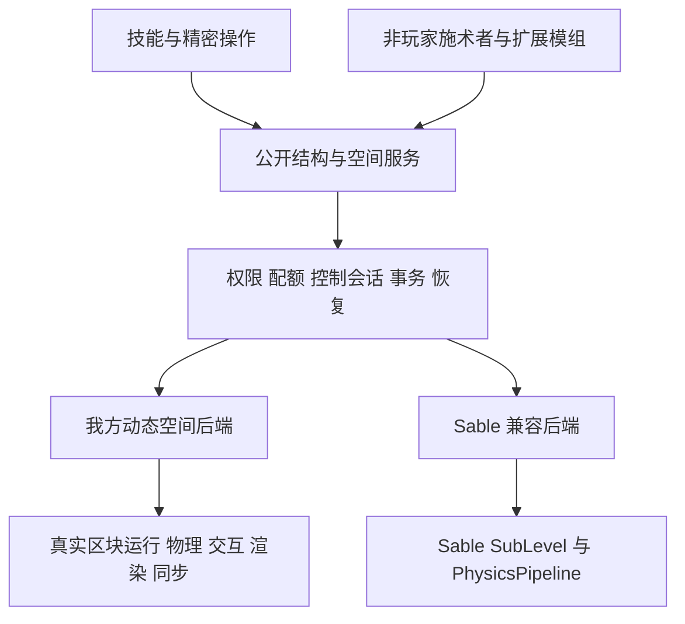

# 方块结构物理化与 Sable 兼容设计方案

本方案将能力使用的方块结构升级为可运动、可碰撞、可逐格操作的动态方块空间。独立安装 AcademyCraft 时也必须支持放置、破坏、交互和物理运动；安装 Sable 时，技能通过同一套公共接口操纵 Sable 结构，并由 Sable 承担该结构的世界运行与物理求解。

建议采用“公共结构服务 + 我方独立动态空间后端 + 可选 Sable 后端”。现有快照实体保留为旧存档迁移入口。完整目标包含独立后端，不能用“安装 Sable 才有完整交互”作为最终交付。

设计基线为 2026 年 10 月 11 日的本地工作区。我方 HEAD 为 `70d4751535f48ca2724eadb9af325bf53145c1f4`；Create fork HEAD 为 `7ec030e99193b16f34eca960ee7ab298ab737c1e`，其移植代码包含大量未提交修改，不能仅用这个提交号复现。2026 年 10 月 12 日开始落地第一批基础改动；下文除“本批次落地进展”明确列出的部分外，接口、流程和后端能力仍为拟议设计。

## 本批次落地进展

本批次完成的是 P0 的空间/单位基础和现有快照实体的数据安全改动，尚未完成 P0 整体。实现范围如下：

| 范围 | 已写入当前代码的行为 | 仍有边界 |
| --- | --- | --- |
| 空间身份与姿态 | `StructureRef`、`SpaceBlockRef`、`StructurePose`、`StructureAnchor`；double 位置、单位四元数、点/方向正逆变换、表面速度及防御复制 | 是可使用的数据契约，尚无动态空间注册器、后端路由或自动锚点重映射 |
| 旧接口衔接 | `BlockStructure.reference()`、`pose()`、`velocityPerSecond()`；旧 yaw 转换补偿 snapshot pivot；`LegacyMotionUnits` 集中换算速度和加速度 | 旧实体仍使用 tick 单位及 Y 轴姿态，技能未全面迁移，质量/力值未重新标定 |
| 捕获与还原 | 捕获前验证 BE 数据能完整重建，通过实体生成事件后再核对来源 state/NBT；写前记录原状态和预期结果，提交及回滚均整批校验；阻挡结算返回 `RETAINED`，保留完整载荷 | 外部回调已转移库存或产生不明确写入结果时保持隔离；这不构成跨区块/实体文件的崩溃原子提交 |
| 重力结算 | 整批接纳自然落方块、写入固定格后才撤源结构；生成取消时撤销批次并回滚；BE 格不走原版落方块路径 | 仍是现有快照实体的终止行为，不是持久刚体睡眠或完整物理 |
| 放置副作用 | 准备写入时抑制 `onPlace`，在内容归属提交后补发放置回调与邻居更新，避免雪傀儡等生成逻辑先消费方块、随后又回滚复制材料 | 提交后的通知失败不应重新生成原载荷；不宣称任意外部回调副作用可回滚 |
| 未完成回滚 | `BlockStructureTransferState` 保留完整 before/after-images、写入及回滚状态；pending 状态随实体保存，重载后冻结、不可选中、无碰撞，普通恢复返回 `RECOVERY_REQUIRED` | 外部修改、未知格式或缺失 after-image 的记录不能自动回滚；独立持久日志、启动协调器和管理恢复入口仍待实现 |
| 碰撞接入 | 包裹我方结构外包框提交，保留原查询并补入索引遗漏；取消原先 HEAD 整体替换 | 仍是现有复合体素碰撞，不代表已经完成与 Sable 的混装验证 |

新增单测覆盖空间变换、锚点、单位和碰撞组合；`academy:block_structure_safety` GameTest 覆盖库存守恒、生成取消、来源变化、异常回滚、落方块批次失败、pending 保存隔离、自然落方块/箱子混合正常结算、雪傀儡放置副作用，以及写后库存外移时拒绝回滚复制。2026 年 10 月 12 日最终检查已通过：2319 项 JUnit 测试、包含九类场景的 GameTest、隔离客户端检查及开发/发布两种构建。命令与验证边界见[系统说明的本批次验证记录](D:/mcmodtest/AcademyCraft-Reborn-26.2/docs/block_structure_entity_system.md#本批次验证记录)。

本批次未实现独立动态世界、移动中的原版方块交互、原生刚体库绑定、任意旋转碰撞/承载、Sable 适配器或跨后端迁移。保存 pending before-images 也不是 durable crash-atomic journal：世界区块和实体可能分开落盘，不能据此宣称任意进程崩溃点的数据原子性已经获得验证。

## 现有系统与目标的差距

当前[系统文档](D:/mcmodtest/AcademyCraft-Reborn-26.2/docs/block_structure_entity_system.md) 记录已运行的快照实体后端及本批次基础改动；完整动态空间仍按本方案逐步实现。

| 领域 | 当前实现 | 本次目标 |
| --- | --- | --- |
| 内容 | 不可变方块快照，保存 BlockState、BE NBT、碰撞盒 | 可变分区数据，具有方块实体生命周期、计划 tick、邻居更新和可靠存档 |
| 结构身份 | 运行对象仍为普通 Entity，已可导出 `StructureRef` | 稳定结构 UUID，Entity 仅为可选关联 |
| 姿态 | 运行仍为平移/yaw；已提供四元数姿态数据及转换 | 平移、四元数、线速度、角速度、质心、惯性 |
| 碰撞 | 复合体素盒平移裁剪，旋转盒再包成 AABB | 真正刚体接触、摩擦、回弹、旋转接触和高速碰撞 |
| 承载 | 按平移量推动站立实体 | 支持旋转表面速度、上下船、跳离和挤压处理 |
| 原版操作 | 结构整体可选中，无逐格破坏和交互 | 正常工具采掘、放置、物品使用、菜单与交互距离验证 |
| 运行 | BE 冻结，缺少完整流体与 BE 渲染 | 常规原版方块逻辑继续运行，模型、BE、流体均可显示 |
| 终止 | 停止后尝试静态化或落方块结算，失败保留，未完成回滚则隔离 | 睡眠与静态化分离；由技能生命周期策略决定是否还原 |
| 同步 | 实体数据携带整体快照和完整 BE NBT | 姿态流、分区内容增量、菜单数据分离 |

关键证据是 [BlockStructure](D:/mcmodtest/AcademyCraft-Reborn-26.2/src/main/java/org/academy/api/common/structure/BlockStructure.java:10)、[实体 tick](D:/mcmodtest/AcademyCraft-Reborn-26.2/src/main/java/org/academy/internal/common/world/entity/structure/BlockStructureEntity.java:133) 和 [运动会话](D:/mcmodtest/AcademyCraft-Reborn-26.2/src/main/java/org/academy/internal/common/structure/BlockStructureKineticRuntime.java:90)。后者强制要求 `BlockStructureEntity`，所以仅给 Sable 包一层现有接口仍不能运行。

已有选区、捕获策略、网格吸附、资源消耗、伤害上限和纯算法测试可以复用。快照可继续作为导入导出格式，但不能继续充当活动方块世界的唯一数据源。

设计基线发现的两类优先风险已在本批次修改实现，后续仍需完整验收：

- [结算管理器](D:/mcmodtest/AcademyCraft-Reborn-26.2/src/main/java/org/academy/internal/common/structure/BlockStructureManager.java) 原先在失败时生成不含 BE 数据的普通方块 ItemStack，现改为整体还原或完整保留；重力结算也不再先撤销源结构后无条件逐格降级。回滚无法完成时保留恢复材料并停止结构活动。
- [碰撞 Mixin](D:/mcmodtest/AcademyCraft-Reborn-26.2/src/main/java/org/academy/mixin/common/MixinEntityGetter.java) 已改为局部包裹结构形状提交与返回结果补充，不再在 HEAD 取消整个查询。实际模组组合的注入与行为验证仍是后续兼容工作的必要部分。

## 参考工程的实际机制

`create-fork` 根工程是 Create。真正的物理结构实现位于 `.porting/sources/Sable`，航空学位于 `.porting/sources/Simulated-Project`，基础坐标接口位于 `.porting/sources/Sable-Companion`。

Sable 的核心是带独立姿态的 SubLevel。方块仍处于真实区块中，只是存储地址落在受管理的 plot 区域；世界中的可见位置通过姿态变换得到。区块访问、同步、方块射线、放置方向、交互距离、实体碰撞、渲染均围绕这个空间边界适配。由此可以继续利用原版方块和 BE 逻辑。[上游说明](https://github.com/ryanhcode/sable) 也将其定义为包含普通区块、实体和方块实体的移动子空间。

值得借鉴的是职责分层与行为契约，不是把全部 Mixin 或实现复制到我方：

1. 存储空间和世界姿态分离，普通方块拥有稳定地址。
2. 服务端统一求解物理，客户端插值展示。
3. 方块、交互、玩家、菜单和网络使用一致的空间转换。
4. 装配、拆分、还原会同时处理方块数据、速度与附属关系。
5. 物理力在子步生效，方块逻辑仍按游戏 tick 运行。

两处不能直接照搬的细节尤其重要。Sable 的 `Level.clip` 命中结构后可能返回 plot 地址及 plot 中的命中点，不能直接把它解释成世界坐标。`getContaining` 检查的也是存储 plot 的归属，而不是“世界中的这个点碰到哪艘船”。此外，[assembleBlocks](D:/mcmodtest/create-fork/.porting/sources/Sable/common/src/main/java/dev/ryanhcode/sable/api/SubLevelAssemblyHelper.java:71) 并非我方所需的完整事务：其逐块迁移存在记录异常后继续执行的分支，必须补充预检、校验和恢复机制。

## 对玩家可见的行为契约

独立后端和 Sable 后端需要通过同一份行为测试。二者可以有不同的物理数值和渲染实现，但不能改变方块归属、物品数量、技能输入含义和存档安全性。

| 场景 | 约定 |
| --- | --- |
| 向移动结构放置 | 默认加入命中结构的局部网格；多格方块必须完整通过检查后一起放置 |
| 挖掘结构方块 | 沿用工具、采掘时间、附魔、掉落、游戏模式和权限规则；最后一格移除后回收结构 |
| 右键和容器 | 使用实际局部方块与 BE；距离按结构当前世界位置计算；失去访问条件时关闭菜单 |
| 结构停止 | 进入物理睡眠，仍可交互；方块 tick 是否运行由正常加载及模拟距离规则决定 |
| 技能结束 | 释放控制。需要恢复地形的技能单独请求静态化，不能销毁玩家后来加入的内容 |
| 切断连接 | 按六向连接及专用连接适配器拆成刚体；不因两个结构碰到一起自动合并 |
| 击碎 | 方块破坏改变结构几何；高速撞击碎裂另设材料阈值和限额，避免第一次上线即无限碎片化 |
| 外部船只 | 对整船施力、切出局部结构、破坏单格是三个显式动作；不能命中一格便默认拆走整船 |
| 局部机器连接 | 同一结构内红石、漏斗、管线按局部格工作；跨结构连接需要明确的连接器或专项适配 |
| 原版重力方块和流体 | 方块规则沿局部格轴运行；刚体重力沿世界轴。跨空间流体交换、掉落实体离开结构有专用边界处理 |
| 任意姿态还原 | 只接受有合法整数网格和方块状态旋转映射的姿态；失败则保留结构 |

“完整能力”首先指结构作为方块空间具备正常放置、破坏、交互、运行和物理运动。它不等于任意第三方机器无需适配即可工作。门户、跨维度机器、外部网络绑定、特殊多方块控制器列入逐项适配表；不支持的捕获应返回明确原因，而不是先拆走再损坏。

## 模块和公开接口

首期在本仓库内按模块职责分包，待两个后端都稳定后再决定是否拆为独立发行组件。公开类型位于 `org.academy.api`，后端实现位于 `org.academy.internal`。



| 接口与拟议扩展 | 职责 |
| --- | --- |
| `StructureRef` | 逻辑 UUID、所在维度、后端标识、身份代次；不要求对应 Entity |
| `StructureHandle` | 生命周期、空间、内容访问和支持的能力；失效句柄不隐式改指另一结构 |
| `SpaceBlockRef` | 空间身份和局部整数格，替代有歧义的裸 BlockPos |
| `StructurePose` | 局部原点的世界位置、单位四元数；固定单位缩放 |
| `StructureAnchor` | 结构身份、局部格、点偏移和法线；可绑定方块代次，解析方负责验证；偏移可伸出格子以支持表面附属物 |
| `StructureHit` | 目标空间、局部格和面、局部及世界命中点、有效几何版本 |
| `StructureWorldAccess` | 分区读取、受控变更、BE、计划 tick、空间事件；写入必须由服务端事务执行 |
| `StructureMotion` | 在给定点施力或冲量、力矩、控制约束、速度读取和受控传送 |
| `StructureTransaction` | 捕获、还原、拆分、迁移的准备、提交、回滚及恢复结果 |
| `StructureBackend` | 创建、查询、装载、导出、持久化和能力协商 |
| `StructureActorContext` | 施术者、归属、权限主体、伤害归属和资源提供方；允许非玩家来源 |

公共方法应覆盖 `capture`、`raycast`、`applyForceAt`、`applyImpulseAt`、`holdAnchor`、`releaseControl`、`tryMaterialize`、`extractRegion`、`teleportGroup`。施力不隐含捕获权限，捕获也不隐含控制整艘第三方船的权限。

表中的 `StructureRef`、`SpaceBlockRef`、`StructurePose`、`StructureAnchor` 已有第一版实现；其他服务型接口及上述完整操作集尚未实现，不能仅凭值类型存在就认为动态后端已经可用。

保留旧 `BlockStructure` 的兼容适配器和弃用期，但新服务不依赖 `asEntity()`。不能为 Sable 建一个假实体后继续使用旧的移动、碰撞和存档逻辑。确需原版伤害归属代理时，该代理只能携带归属，不负责结构内容和运动。

## 坐标与时间单位

需要明确区分世界坐标、结构局部坐标、后端存储坐标。plot 地址只能存在于后端内部，不应流入技能、音效、粒子、射程、保护区或菜单距离逻辑。

使用双精度位置和单位四元数。局部原点固定，允许局部负坐标；放置新方块或质心移动不能重新编号已有格子。

```text
世界点 = 世界原点 + R × 局部点
世界方向 = R × 局部方向
表面速度 = 质心线速度 + 世界角速度 × (世界点 - 世界质心)
力矩 = (施力点 - 世界质心) × 世界力
```

全局位置、包围盒和射线使用 double。我方独立后端的物理岛及 GPU 数据先转换为局部原点相对坐标，避免把 plot 地址或千万级绝对坐标直接转成 float。当前 Sable 后端仍继承其世界坐标 f32 精度限制，桥不能只给我方结构减原点，否则会与其静态世界和其他刚体错位。若要求 Sable 在远坐标达到同等精度，须另行改造 fork 的整体原点重定位或 f64 求解链路，并重新验收。

新物理接口统一以秒计时：格/秒、弧度/秒、质量单位、力和冲量。旧技能速度为格/tick，集中通过 `LegacyMotionUnits` 转换：速度乘 20；旧每 tick 速度增量换算加速度乘 400。现有 `force / mass` 每 tick 直接加速，质量模型又将变化，因此旧 force 数值不能仅做一次乘法就当新力值；按代表结构的加速度、最大速度、射程和资源消耗重新标定。

游戏 tick 更新目标和资源预算；固定物理子步消费力与约束。一次性冲量带唯一序号，只消费一次；连续力按实际子步时长积分，不能每个子步重复一整个游戏 tick 的冲量。服务器卡顿时限制追赶子步数，不以过大的时间步穿透世界。

## 独立运行后端

### 方块运行与存储

采用受管理的真实区块容器，而不是只实现 `BlockGetter` 的渲染代理。建议沿用所属 `ServerLevel` 的方块上下文，通过独立分配的存储 plot 地址和受控区块路由访问我方 `LevelChunk` 容器；结构区块独立持久化，不生成自然地形，不作为普通远处区域加载。

每个空间拥有分区、BE 实例与 ticker、block/fluid 计划 tick、随机 tick 策略、邻居事件队列、光照状态和结构内实体记录。路由至少覆盖区块访问、方块修改广播、计划事件、实体生成及查询、光照、保存和卸载。声音、粒子、爆炸及实体进入世界时从局部地址转回世界坐标。任意未经过空间归属检查的全局坐标替换都应禁止。

所有受控入口携带可嵌套的 `SpaceContext`：BE ticker、计划 tick、邻居回调、交互、菜单和局部实体更新都必须进入指定空间，并在 finally 中恢复上下文。普通世界查询不能只因某个 BlockPos 恰好落在 plot 数值范围就进入结构；无空间上下文的命令、地图扫描和地形生成不读取或生成结构内容。合法网络交互先解析结构身份，再进入该上下文，不能将任意客户端 BlockPos 当作访问凭据。

地址分配器需持久化并保证隔离，不能把硬编码远坐标认作永久保留区。已有地形、世界边界、地图工具和其他模组的地址空间必须排除；分配冲突直接失败。每个 plot 明确保留容量和隔离带，越界邻居访问返回空间边界；扩展超过容量时先事务迁移存储地址，局部格和逻辑身份不变。混装时我方新结构统一使用 Sable 后端，不启动第二个独立 plot 分配器。

P0 必须证明区块访问、地形生成、世界边界、光照、存档索引和无上下文查询都能可靠隔离；“目前远处还没有生成地形”不构成证明。如果共享 ServerLevel 无法满足上述条件，则切换为独立 ServerLevel 容器架构，并承担跨容器菜单及实体路由成本，不能继续用地址约定补洞。这个原型门槛决定存储实现，不改变上层空间接口和行为契约。

结构加载采用世界空间的模拟距离及有限 ticket。睡眠仅停止刚体积分，不等于停止机器。卸载前保存内容、姿态和事务状态，控制会话撤销；不得强加载结构前方无限区块。未加载障碍区按安全边界处理，等待有限加载或暂停前进。

### 刚体与碰撞

建议直接选用 Rapier 的双精度 3D 变体作为独立求解器候选基线，并编写我方最小 Java/Rust 绑定；不复用 Sable 的 JNI 实现。Rapier 官方提供 `rapier3d-f64`，刚体支持 CCD 和睡眠。[精度选项](https://rapier.rs/docs/user_guides/rust/getting_started/)、[刚体功能](https://rapier.rs/docs/user_guides/rust/rigid_bodies/)。

P0 原型需锁定实际引擎版本、JBR 25 ABI、支持平台和制品哈希，再确认该选型。原生库使用独立名称、符号、缓存路径和明确释放流程；独立专服与客户端均需加载验证。安装 Sable 并选择其后端时，不加载我方原生求解库。引擎不可用时应保留结构恢复记录、禁止新捕获，不降级成会损坏内容的假成功。

几何由实际 BlockState 和上下文相关碰撞形状生成，按分区缓存；门、活板门、围墙、活塞等变化触发相邻区域失效。合并盒必须保持真实空洞，不能用包围盒填实。世界静态体按附近分区建立并订阅修改。结构间共享同一个求解世界，支持质量与动量交换。

质量由数据驱动的方块密度和形状计算，必要时由适配器补充容器内容质量；不将硬度直接当密度。支持非零质心、惯性、摩擦、回弹、阻尼和重力倍率。控制使用有限力的约束或 PD 控制器；不以每 tick 强制 setPos 实现悬浮抓取。任意 setVelocity 和传送均属于显式受控操作。

建议从每游戏 tick 3 个物理子步开始测量，作为可调起点而非已验证数值。高速投掷开启 CCD，同时覆盖旋转扫掠。几何、质量、连通性和内容使用统一 mutation epoch，在下一物理步前一起发布。跨空间交易可延后提交；原版门、活塞或 BE 已经完成的普通空间内更新，则同步重建必要几何，或暂停受影响刚体的下一物理步直至新 epoch 就绪。预算不足不能让已改变的方块继续配旧碰撞运动。

### 原版交互与实体承载

客户端统一射线比较世界方块、普通实体和结构的真实世界距离，再在目标空间内进行体素命中。服务端重新验证 UUID、局部格、朝向、射程、视线、权限和几何版本；不能接受客户端任意 plot 坐标直接写世界。

采掘保留 START、ABORT、STOP 及进度同步；移动不改变正在挖掘的局部格，破坏或超出距离才取消。放置通过局部上下文调用原版放置流程，处理支撑、多格状态、waterlogged、消耗物品与事件取消。普通空间内变更使用 mutation batch，跨空间迁移使用持久化事务；两者最终都经过 epoch 屏障发布内容、质量、碰撞、连通性、渲染和跟踪增量。

| 执行上下文 | 坐标和调用规则 |
| --- | --- |
| 方块、BE、邻居、红石、计划 tick | 目标空间的局部格；访问不穿入相邻 plot |
| 玩家位置、射程、领地保护、伤害归属 | 真实世界坐标；事件额外携带结构和局部格供兼容模块识别 |
| 放置方向、方块内部射线 | 由玩家世界视线逆变换得到局部方向，不改写真实玩家位置或所属维度 |
| 菜单和 ContainerLevelAccess | 方块读取走局部空间，距离与有效性走当前世界姿态 |
| 漏斗等局部实体查询 | 查询同空间实体及经边界服务映射的世界候选，并按实体 UUID 去重 |
| 声音、粒子、物品生成和爆炸 | 标明来源空间；在边界统一转换，爆炸还需查询其他空间的受影响对象 |

P0 的最小探针增加持续打开移动箱子菜单、旋转后正确朝向放置、漏斗拾取结构内物品和保护事件取消。入口通过作用域对象及 finally 恢复上下文，不使用全局暂改真实玩家坐标的方案。

菜单必须绑定 `StructureRef + local BlockPos`，每次有效性检查使用当前姿态。普通广播只使用 BE 更新数据；完整容器库存继续通过合法菜单同步，完整持久化 NBT 不作为公开渲染包发送。

玩家承载由同一接触服务处理平移和旋转，记录支撑结构及局部接触点；离开时继承表面速度。必须覆盖行走、跳跃、楼梯、低顶、上下船、边缘脱离和双平台接触。刚体接触、承载推动和玩家伤害只能结算一次；不能一边由求解器推人，一边再调用旧实体搬运代码。

实体拥有唯一空间归属。玩家和普通世界生物继续是世界实体，站立关系用支撑锚点表达；结构内产生的物品、落沙和 TNT 可作为局部实体继续参与当地漏斗、落块和 tick。穿过空间有效边界时执行一次归属迁移，转换位置、朝向和相对速度并叠加表面速度；不能一生成就全部扔到主世界，也不能永久滞留隐藏 plot。进入另一结构必须由边界服务确认后转换，多个空间查询同一实体按 UUID 去重。局部爆炸通过统一空间查询影响实际邻近的方块、结构和世界实体。

流体空间边界默认封闭，结构内部及含水状态遵循局部原版规则；在边缘使用水桶仍修改目标局部格，不能流进相邻 plot。跨空间出水、进水和泄漏作为显式边界能力，只有定义并验证物质映射和限流后启用，不将这部分计入首期已支持的原版外流语义。P2 必测旋转结构内落沙、漏斗拾取、抛物出结构、TNT 和边界水桶。

### 渲染与网络

独立后端使用分区网格缓存、BE 渲染、流体和透明层，保持局部光照与世界环境采样的明确分工；运动只改变姿态，不逐帧重建全部模型。选中框、破坏裂纹、声音、粒子均使用同一个插值姿态。

初次跟踪发送有限分片的内容基线，后续按分区 revision 发送增量。姿态使用服务器 tick、序号、位置、四元数和线角速度；内容使用可靠传输。乱序、迟加入、断线、拆分和 UUID 复用通过代次和 revision 处理。客户端插值不反写服务端状态。

首期独立后端使用现有可靠连接，不另建 UDP 通道。Sable 后端完全复用 Sable 的方块及姿态同步，我方只发控制归属、技能状态和特效。拆分、姿态变更和内容修改在物理步边界发布一致版本，避免客户端先收到新几何却仍使用旧空间。

## 捕获与恢复事务

本节描述后续完整事务目标。当前实现只有调用内回滚、失败隔离与随实体保存的 before-images，尚无下述独立持久准备日志、跨存储提交协议及重启协调恢复。

统一生命周期为 `STATIC → PREPARING → ACTIVE ↔ SLEEPING → MATERIALIZING → STATIC`。另有 `UNLOADED`、`RECOVERING` 和 `REMOVED`，控制会话与生命周期分开。

捕获、静态化、拆分、后端迁移均执行以下流程：

1. 预检完整选区、来源空间、加载、权限、数据配额、多格依赖和旋转支持；记录源状态版本。
2. 对受影响格子及库存建立短时写入排他；在服务端线程准备目标，暂停该事务范围内的计划 tick、BE ticker、物品转移及重入邻居回调，防止重复产出。
3. 保存交易 ID、源/目标身份、方块及 BE、计划 tick、附属锚点、内容校验值和恢复动作，形成持久化准备记录。
4. 目标写入后逐项校验；源与目标只能有一份可交互的有效所有权。配合区块保存顺序及提交标记，避免世界区块已保存而日志尚未落盘。
5. 提交归属后解除冻结、发布增量及延后的 `onPlace`/邻居更新；最后清理旧容器和事务记录。准备阶段不能让放置回调提前消费方块并生成实体；提交后的通知失败也不能再恢复整份源快照，以免复制已经生成的产物。
6. 任意异常或重启按交易 ID 幂等恢复。恢复写入也需检查结果；不能把日志记录失败当成功回滚。

跨存储文件并无天然原子性，必须有故障注入测试证明恢复策略。备份存在并不授权重新生成第二份库存。未能完成回滚的数据进入可查询的恢复记录，停止交互直至恢复。

静态化先检查整个 footprint、世界边界、实体挤压、区块加载、保护区域和放置策略。默认支持四向水平网格姿态；完整三维整格旋转共 24 种，需要逐方块及 BE 的旋转适配后开放。`BlockState.rotate` 只支持水平旋转，不能直接处理任意 pitch/roll。先进行安全对齐，再整体放回；不允许逐格四舍五入导致重叠。

失败时保留活动或睡眠结构，或者存入可恢复记录。仅显式破坏行为走原版掉落。移除依赖、技能超时、还原占位均不能自动把箱子转成空箱子物品。

新放置与被破坏的方块均以当前内容为准，不从旧捕获快照“恢复”它们。技能可以记录原始格子来源，用于限制自动还原策略，但不能复制已被玩家取走的物品。

## Sable 共存与后端选择

后端按结构固定，不按每次调用重新猜测。运行环境具有可用且经过验证的 Sable 桥时，新建 Academy 结构使用 Sable；没有 Sable 时使用独立后端。仅存在 Create 或航空学不是启用桥的充分条件。

| 能力 | 本地参考入口 | 桥接职责 |
| --- | --- | --- |
| 结构查询及空间变换 | `SableCompanion.INSTANCE`、`getAllIntersecting`、`SubLevelAccess.logicalPose` | 对外归一为世界/局部类型，隐藏 plot 地址 |
| 从存储坐标找结构 | `getContaining` | 只用于已确认的存储命中；不能拿世界位置直接找船 |
| 装配 | `SubLevelAssemblyHelper.assembleBlocks` | 外层权限、交易记录、后置校验和失败恢复 |
| 施力及速度 | `RigidBodyHandle.of`、`PhysicsPipeline` | 单位、局部/世界方向、作用点、冲量序号转换 |
| 执行时序 | `ForgeSablePrePhysicsTickEvent` | 在物理子步消费控制目标 |
| 碰撞与承载 | Sable 物理和实体接触流程 | 提取统一接触事件；停用旧碰撞、搬运和重复伤害 |
| 内容及呈现 | Sable plot、方块更新、同步和渲染 | 我方不再维护另一份活动内容或模型 |

`SubLevelHelper` 虽位于 api 包，其类被标记为内部接口，且 push/pop 使用单槽临时状态，不作为我方通用接口依赖。`RigidBodyHandle.applyImpulseAtPoint` 的局部/世界注释存在歧义；已核对当前 Java pipeline 和 Rust 实现：作用点为 plot-local，冲量为局部向量，随后由刚体姿态转到世界空间。连续力必须先乘子步时长得到冲量。`addLinearAndAngularVelocity` 则接收世界速度。桥需集中完成这些转换，并通过“旋转 90 度后偏心冲量”的契约测试防止版本变化带来回归。

如果上游缺少可恢复装配、接触回调、数据附件或拆分映射等必要扩展点，应在 fork 提供窄接口，再由桥调用。不能用不稳定的反射写私有字段替代可靠数据迁移。原生 Rapier 类属于内部实现，我方不直接调用或再次加载它。当前 Sable 还存在无效质量触发方块销毁的路径、部分卸载事件和实体碰撞行为的 TODO；桥必须对无质量内容、BE 卸载和接触去重做专项验证。若现有路径不能满足内容守恒，需要先修复 fork 扩展点再开放该类捕获。

我方结构创建者与外部 Sable 船所有者分开保存。对已有船只只建立引用，不复制船体；控制权使用有期限的 lease，协商 Sable 手杖、航空学控制器和其他学院技能的冲突。一般推力可以叠加，独占抓取、时停和传送需要明确优先级及撤销规则。不能默认把“能看见船”视为“能拆解船”。

Sable 和我方独立求解器不同时求解会互相接触的动态结构。现有独立后端存档首次切换到 Sable 时，先进行批量迁移预检，再执行可恢复迁移；需要保留的其他类型通过导入导出适配。迁移未完成的对象保持可恢复但不参与第二套动态物理。不能把两个世界互相映射成静态碰撞代理后宣称获得了正确的动量交换。

模组安装本身不触发静默破坏性重建。提供后端状态、迁移预览和显式迁移入口。世界启动采用以下状态：

| 状态 | 运行行为 |
| --- | --- |
| `NATIVE` | 未加载 Sable 且原生存档一致，启用我方动态空间及求解器 |
| `SABLE` | 桥兼容且迁移完成，由 Sable 承担所有活动动态结构 |
| `MIGRATION_REQUIRED` | 后端变化、版本不兼容或迁移未完成；显示原因与数量，只读加载旧内容和检查点，暂停受影响结构的 tick、交互、物理及新捕获 |

迁移状态下普通世界可运行，受影响结构需有可见的只读状态和恢复入口，不能无声消失。迁移取消保持原数据；部分成功按交易记录保留已提交归属并等待续作，不提前启用两套求解器。旧 plot 与 Sable 数值地址冲突时只离线读取旧数据进行导入，禁止将旧 plot 注册到当前 Level 路由。服务器回到原来的兼容依赖组合后，才可在一致性检查通过的前提下恢复原后端。

缺少原后端时保留注册表与最近一致的恢复检查点；Sable 自己的存档保留原样。在移除 Sable 前执行导出/迁移；卸载后不能保证仅凭我方元数据恢复它最后一次保存的全部内容，必须明确提示所需依赖或一致检查点。

构建采用隔离兼容包及固定版本 `compileOnly`；兼容测试配置单独添加运行依赖。发布 Academy JAR 不嵌入 Sable、Veil、Suite 或其 JNI。公共方法签名与常驻静态初始化中不得出现可选类；[MixinPlugin](D:/mcmodtest/AcademyCraft-Reborn-26.2/src/main/java/org/academy/mixin/plugin/MixinPlugin.java:24) 增加模组和能力门禁。版本不兼容时明确关闭桥及新捕获，不把结构加载失败当作结构不存在。

## 现有技能迁移

先梳理各能力分类的通用效果，再迁移技能。结构移动、受力、命中、归属、约束和材料查询均成为公开服务，供精密操作与非玩家施术者复用。

| 分类及入口 | 当前耦合 | 迁移要求 |
| --- | --- | --- |
| 矢量操作的动能投掷 | 捕获和 hold/launch 依赖旧结构实体 | 保留选区与资源规则；使用结构控制句柄、真实接触事件与显式释放策略 |
| 空气操纵的高速喷流 | 喷口跟随 Entity UUID 和 yaw，持续推力取发射时方向 | 改为持久锚点；每子步将局部喷射方向转到世界，在喷口点施力并产生力矩 |
| 气流喷射、气动抓取、拒绝之风等 | 用实体查询和 `instanceof BlockStructure` | 统一运动目标查询，同时覆盖普通 Entity 与动态结构；有限力和质量限制 |
| 电磁操纵及其程序节点 | 临时 FallingBlockEntity、直接赋速、释放重力 | 单格也作为结构；磁性按材料和实际参与质量聚合，不以一块铁无限吸动整船 |
| 矢量反射与折射 | 从伤害 direct Entity 找结构，直接 setPos/setDeltaMovement | 接触上下文携带结构身份、速度、碰撞点、归属；通过公共服务改变刚体运动 |
| 单体和区域传送 | 原版 Entity 列表与 AABB 安全检测 | `TeleportGroup` 管理结构、乘员、喷口及附属实体；检查完整几何、去重并整体传送 |
| 时停及时间缩放 | 主要从 Entity/Level tick 拦截 | 分开控制刚体、局部块 tick 与乘员；外部后端只应用一次时间倍率 |
| 精密操作 | 坐标只有 dimension 和 x/y/z，目标多为 Entity | 增加结构引用、空间格和锚点类型；旧世界坐标节点保持原义 |

喷口必须依靠静态化、拆分及迁移事件重映射，而不是父实体暂时消失后寻找附近 sturdy 方块重新挂载。[现有喷口](D:/mcmodtest/AcademyCraft-Reborn-26.2/src/main/java/org/academy/internal/common/world/entity/skill/HighSpeedJetNozzle.java:288) 的这种回退会在后端卸载时误挂。

磁力精密操作的 `damageAlongTrajectory` 目前对预设整段轨迹提前结算。迁移后应由真实接触事件施伤，并保留原有威力、冷却和归属，避免实际没有抵达的目标提前受伤，以及新旧两条伤害路径重复结算。[对应运行时](D:/mcmodtest/AcademyCraft-Reborn-26.2/src/main/java/org/academy/internal/common/ability/electromaster/program/ServerElectromasterProgramRuntime.java:438)。

精密操作保存格式新增版本，`ProgramBlockPosition` 仍表示主世界格，新增类型显式表达结构格与跟随锚点。新增“世界点转换为结构局部点”“解析锚点世界位置”“对结构施力”“提取结构区域”等节点；程序回滚必须调用结构事务，不能直接 discard 后补原方块。

时停默认冻结被选结构的刚体，阻止新增控制力；整结构时间冻结才暂停其局部方块逻辑。乘员依据自己的时间规则行动。恢复时撤销本次控制覆盖并按策略恢复速度，不能对冻结期间被删除、拆分的结构应用陈旧状态。跨维度传送需同时迁移内容、结构注册、加载 ticket 和跟踪者，不能仅改变一个姿态字段。

## 拆分与控制生命周期

方块变更后在预算内重算受影响连通域。门、床、专用连接件由连接规则适配器处理；Create 胶水等连接仅在对应后端/模组启用时采用。

拆分出的每个刚体继承原角速度，其质心速度按 `v_child = v_parent + ω × (c_child - c_parent)` 计算；质量和惯性重新计算，随后发布身份及格子映射。主结构保留哪一个 UUID 必须固定规则，其他子体分配新 UUID。喷口和局部锚点跟随实际格子；整体控制会话按技能策略选择主子体或终止，不能默认对所有碎片复制完整推力和伤害预算。

玩家退出、死亡、跨维度、程序取消、结构卸载、控制超时或锚点破坏均撤销 lease。控制释放不销毁结构。静态化、回收和分解由独立服务负责，也必须考虑其他玩家后来修改过的内容。

## 配额与性能目标

捕获、导入、公开 spawn、网络解码和结构扩展共用校验，覆盖格数、空间跨度、分区数、碰撞形状数、BE 字节、计划 tick、实体数和交易日志大小。现有 256 格默认捕获、4096 格快照硬限可以作为迁移期基线，不能未经测量直接套在大型外部船只上；对外部结构应分别限制允许施加的力、参与查询的几何和操作预算。

每维度设活动刚体、拆分、几何重建、邻居更新、网络字节与区块 ticket 预算。睡眠和距离分级降低物理及渲染开销；超额时拒绝新的操作或延后事务，不删除已有数据。

在固定硬件和存档下记录 MSPT、物理子步耗时、GC、内存、上传带宽、客户端帧时间和长期漂移。建议建立 1、16、64 个活动结构以及 1、33、256、4096 格的场景网格；其中 64×4096 属于压力用例，不预先承诺实时支持。验收性能阈值在 P0 实测基线后冻结，不用空场景帧率代表满载能力。

## 分阶段实施与验收

| 阶段 | 交付 | 完成条件 |
| --- | --- | --- |
| P0 数据安全与技术原型 | 修复旧结算丢数据；定义空间/单位契约；验证真实区块路由、刚体绑定、旋转后交互 | 强制异常与重启不复制或丢失库存；独立原型完成箱子、拉杆、楼梯的运动交互；锁定引擎及地址方案 |
| P1 公共服务与旧 API 迁移 | 结构身份、锚点、控制会话、事务、接触归属；旧 Entity 适配 | 技能和程序核心不再强制依赖 BlockStructureEntity；现有行为回归通过 |
| P2 独立动态空间闭环 | 原版放置破坏、BE/红石/计划 tick、保存重载、菜单、同步及渲染 | 不安装 Sable 的单人及真实专服完成核心交互闭环 |
| P3 完整物理和技能迁移 | 旋转碰撞、CCD、承载、拆分；喷口、磁力、反射、传送及时停 | 同一功能通过玩家、程序和非玩家入口；不重复伤害、不误挂、不穿透代表场景 |
| P4 Sable 接入与跨后端迁移 | 版本门禁、Sable 子步控制、原版命中归一、可恢复导入导出 | 同一行为契约在两个后端通过；既有独立存档能安全迁移；无双重求解 |
| P5 航空学与发布组合 | 控制争用、Create 网络、外部船只、渲染模组、性能及平台制品 | 固定成品 JAR 和模组哈希的整合包专服验收通过 |

Sable API 契约探针可以在 P1 后与独立后端开发并行，但不先把技能写成 Sable 特例。P2 是独立完整能力的必要里程碑；P4 或某个简单演示不能代替它。

当前阶段状态为 **P0 部分落地**：空间/单位值类型、旧接口读取适配、结算失败保留、回滚隔离和碰撞接入调整已写入代码；真实区块路由、独立刚体绑定及旋转后原版交互原型尚未完成。上表的完成条件保持不变，不将本批次基础改动计作整个 P0 或 P1 完成。

每阶段保持可运行的纵向场景：先“一组箱子和楼梯被抓起，移动中放置拉杆、开箱、挖掉一格，再保存重载”，再扩大到喷口和复杂机器。任何阶段的未完成项明确列为待验证，不能以能渲染或能编译代替世界语义。

## 验证矩阵与发布基线

两边当前均使用 Java 25 与 NeoForge 26.2.0.70；我方 Minecraft 元数据为 `26.2.0`，fork 为 `26.2`，最终需以打包后的依赖范围和实际启动验证。

fork 锁文件记录 Sable `2.0.6-port.26.2.0.70`、Companion `1.6.0-port.26.2.0.70`、Veil `4.3.2-port.26.2.0.70` 和 Simulated/Aeronautics/Offroad `1.3.2-port.26.2.0.70`。[锁文件](D:/mcmodtest/create-fork/porting/aeronautics-dependencies.json:1)。相同版本字符串可能对应不同本地修复，验证报告必须记录 JAR SHA-256。

| 验证轴 | 必须覆盖 |
| --- | --- |
| 安装组合 | Academy 单独；Academy + Sable；Academy + Create + Sable + Suite；最终整合包 |
| 游戏部署 | 单人；真实双客户端专服；迟加入、断线、重连、换维度 |
| 方块内容 | 普通块、台阶/楼梯、门/床、含水块、沙砾、箱子、熔炉、漏斗、红石、活塞、至少一种 Academy 机器和一种 Create 机器 |
| 空间命中 | 任意姿态、结构空洞、两个结构前后遮挡、结构内向外瞄准、移动时采掘、保护区拒绝 |
| 刚体运动 | 平移和旋转、斜坡、堆叠、体间碰撞、高速、偏心推力、低顶承载、边界与远坐标 |
| 数据安全 | 含库存的捕获/还原、覆盖拒绝、每个事务阶段崩溃、区块卸载、正常重启、模组缺失、重复包 |
| 技能 | 动能投掷、各空气推动入口、磁力、反射折射、单体/区域传送、时停、程序回滚和非玩家 API |
| 网络 | 内容分片丢失后的恢复、乱序姿态、版本过期、拆分重映射；Sable UDP 开关及 TCP 回退 |
| 渲染 | 原版、Sodium、Iris 无着色包、明确名称版本的着色包；透明层、BE、流体、资源重载 |
| 发布 | dev/release 成品；支持平台原生库、重复开关世界与释放；长时间运行及压力场景 |

测试分层包括：纯函数单测验证变换/网格/单位/序号；故障注入测试验证交易恢复；两个后端共同执行的 GameTest 验证交互契约；真实双端验证渲染、承载、协议与服务器权威。外部行为测试不能只镜像实现公式。

现有 fork 的 [physical-block-fix](D:/mcmodtest/create-fork/porting/physical-block-fix.md:35) 记录完整组合中的白色混凝土和拉杆交互，所用 Sodium 0.9.2、Iris 1.11.4、Jade 26.2.10 与我方开发依赖 0.9.1、1.11.2、26.2.8 不同。其 [手杖验证记录](D:/mcmodtest/create-fork/porting/physics-staff-fix.md:27) 未覆盖真实多人和开启着色包；[Sable 测试说明](D:/mcmodtest/create-fork/porting/tests/sable/README.md:64) 也限定了独立网络测试与远坐标测试的证明范围。这些记录可以作为测试起点，不能作为本次混装验收结论。

每批代码实现按仓库要求依次执行 `./gradlew test -DisDev=true`、`./gradlew build -DisDev=true`、`./gradlew build -DisDev=false`，并通过 `runClientDev` 及真实专服进行受影响场景验证。本批次已包含代码与测试用例修改，具体执行结果另行补录；本方案的完整验证矩阵不因部分基础检查完成而视为通过。

## 代码来源与许可边界

我方项目元数据为 GPL-3.0-only。参考目录中的 [Sable 许可证](D:/mcmodtest/create-fork/.porting/sources/Sable/LICENSE.md:1) 是 PolyForm Shield 1.0.0，并含 Noncompete 条款；[Companion](D:/mcmodtest/create-fork/.porting/sources/Sable-Companion/LICENSE:1) 为 MIT；[航空学许可证](D:/mcmodtest/create-fork/.porting/sources/Simulated-Project/LICENSE.md:3) 将代码与保留所有权的 assets 分开。

因此独立后端以我方行为契约和自行编写的实现为基础，直接依赖经确认许可的物理引擎；Sable 通过外部依赖桥接。不能把“可以阅读参考源码”解释成“可以把整库实现改包后作为我方 GPL 代码发布”。若后续选择迁移具体代码或再分发资源，应按所用文件核实授权范围和 notices；本方案不作这种复制或发布授权判断。

## 后续实施需要保持的决定

1. 独立运行完整能力为必选目标，动态空间是基础设施工程，不作为实体类的小幅增强估算。
2. 每个结构只有一个有效内容所有者、一个物理求解者、一条原版交互路径和一个姿态权威。
3. 世界坐标、局部坐标与后端存储坐标在类型和边界上分离。
4. 先保证方块、库存和附属关系守恒，再增加物理与视觉效果。
5. 睡眠不等于还原；技能释放不等于删除；安装模组不等于无条件迁移存档。
6. 统一公开服务先行，技能、精密操作和非玩家实体共同使用；两个后端通过相同的行为契约验收。
