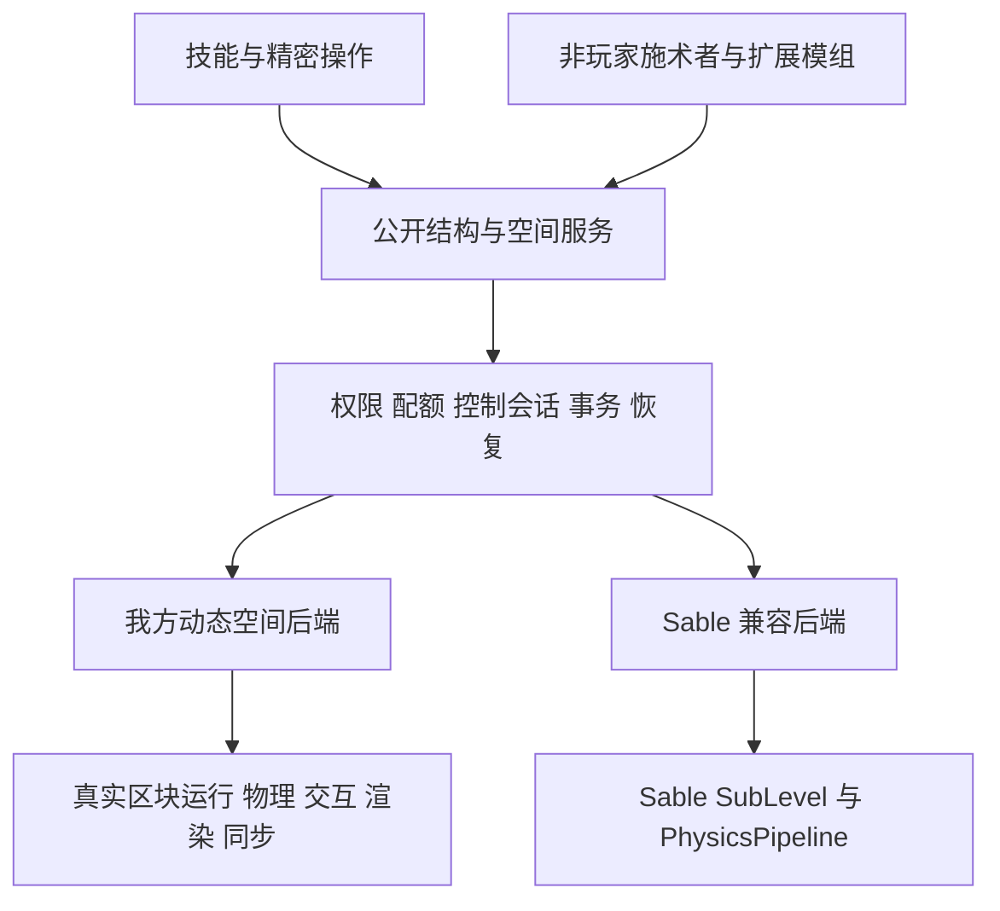

# 方块结构物理化与 Sable 兼容设计方案

本方案将能力使用的方块结构升级为可运动、可碰撞、可逐格操作的动态方块空间。独立安装 AcademyCraft 时也必须支持放置、破坏、交互和物理运动；安装 Sable 时，技能通过同一套公共接口操纵 Sable 结构，并由 Sable 承担该结构的世界运行与物理求解。

建议采用“公共结构服务 + 我方独立动态空间后端 + 可选 Sable 后端”。现有快照实体保留为旧存档迁移入口。完整目标包含独立后端，不能用“安装 Sable 才有完整交互”作为最终交付。

设计基线为 2026 年 10 月 11 日的本地工作区。我方 HEAD 为 `70d4751535f48ca2724eadb9af325bf53145c1f4`；Create fork HEAD 为 `7ec030e99193b16f34eca960ee7ab298ab737c1e`，其移植代码包含大量未提交修改，不能仅用这个提交号复现。2026 年 10 月 12 日起逐批推进空间/安全基础、独立真实区块容器及受限玩家操作；第六批持续采掘和既有客户端回归、第七批独立 Rapier f64 绑定及专项验收已完成。第八批已接真实结构和宿主地形的有界刚体区域，2026 年 10 月 13 日专服 r3、客户端 r1、四类新增保护、专项/全量测试、两种构建及三组 GameTest 均已通过；证明范围和失败记录见[第八批验证与重跑](D:/mcmodtest/AcademyCraft-Reborn-26.2/docs/block_structure_entity_system.md#第八批验证与重跑)。第九批已加入移动玩家交互的有界延迟协调，真实双客户端直连及双向各 100 ms 延迟验收已通过；最终全量/两种构建与既有采掘客户端回归也已通过，其证据不继承第八批通过结论。下文除“本批次落地进展”与独立后端当前实现明确列出的部分外，接口、流程和能力仍为拟议设计。

第十批已完成有界区域与运动检查点及显式恢复，最新 r2 三个独立专服 JVM 已通过正常保存、缺少原生配置时保留数据、恢复与停服门禁；客户端 r2、最终全量/原生测试、三组 GameTest 和两种构建也已通过。此结果不代表自动启动求解、任意崩溃恢复或完整 P0 已完成。

第十一批已写入同宿主多区域、稳定区域 UUID、按区显式恢复和独立加载门禁，以及 manifest v3 与 v2 确定性迁移。真实专服/客户端 r1、原始 v2 完整副本升级、新 v3 三 JVM、双区域跨 JVM r2、原生测试及三组 GameTest 已通过；最终全量测试与两种构建也已通过。第十批的通过记录不作为本批新增行为的验证结论。

第十二批已写入保守地形分区缓存，真实专服/客户端 r1、三 JVM 持久化、双区域专项、2476 项最终基础测试、17 项原生 JVM、12 项 Rust 与三组 GameTest 已通过，两种构建与成品核对也已通过。缓存复用形状和盒列表，仍逐格验证已加载区块、状态及读取依赖；这不是按区段数检查的算法，也没有已测性能收益。

第十一、十二批已按用户授权以本地提交 `f2a2d828` 收录 22 个相关文件。第十三批已写入有限力与单点 PD，2493 项基础测试、20 项原生 JVM、12 项 Rust 和真实专服/客户端 r1、三 JVM 持久化、双区域与三组 GameTest 已通过；最终两种构建和成品核对也已通过，不将旧批次物理记录计为本批证据。

第十三批已按用户授权提交为 `e2bf5ccb`。第十四批接续 P1 的公共控制会话，加入独占限时租约；2507 项基础测试、104 项编辑器测试、20 项原生 JVM、12 项 Rust、真实专服 r1/客户端 r2、跨 JVM 回归、三组 GameTest、两种构建及成品核对均已通过。采用本批证据，保留首次客户端超时记录与限定验收边界。

第十四批已按用户授权提交为 `4f3a1a0a`。第十五批已实现实体绑定租约，为玩家与非玩家提供统一的控制者生命周期撤销；2507 项基础测试、104 项编辑器测试、20 项原生 JVM、12 项 Rust、真实专服 r1、客户端 r1、三 JVM 持久化、双区域、三组 GameTest、两种构建及成品核对均已通过，不继承第十四批通过结论。

## 本批次落地进展

第一批完成 P0 的空间/单位基础和现有快照实体的数据安全改动，第二批加入独立 `ServerLevel` 容器，第三批加入模型投影、旋转后的逐格命中、作用域上下文和受限拉杆交互，第四批加入普通单箱，第五批加入受限放置。第六批实现受限持续采掘及掉落归属处理，第七批完成独立双精度刚体绑定；第八批增加真实结构、地形几何、内容屏障及姿态发布的有界连接。第九批接续服务器姿态历史、同帧玩家回执、请求去重和最新采掘观察，已通过直连与固定延迟的真实双客户端链，最终全量/两种构建也已通过。P0 整体未完成；本表区分已写入代码的范围与完整目标，详细验收及剩余边界见系统文档。

| 范围 | 已写入当前代码的行为 | 仍有边界 |
| --- | --- | --- |
| 宿主投影与同步 | 临时投影实体、状态模型视图和独立姿态头；原版区块变化的有界收集；任意四元数姿态、普通单箱模型和裂纹；第八批客户端已核对 42 个移动姿态样本及两张实际截图 | 最多 4096 格受支持方块；无通用 BE 渲染、网络插值、网络单格差量；物理投影通过不等于连续运动中的玩家操作通过 |
| 逐格命中与上下文 | 真实 OUTLINE 形状、局部/宿主坐标、遮挡、运行期身份/版本重验；线程作用域 SpaceContext | 查询不授予权限，宿主缺块拒绝；尚无通用世界事件转换 |
| 受限交互与菜单 | 原版拉杆和普通单箱；服务端真实视线、控制门禁、保护事件及回调后重验；实际箱子库存和当前姿态下的菜单距离；宿主点击/开关声 | 只适配普通干燥单箱等已审计入口；保护插件须识别空间上下文，不能声称所有原版事件与菜单已等价兼容 |
| 受限逐格放置 | 六种原版方块、主副手选择、真实 `BlockItem.place`、逆变换方向、任意姿态候选碰撞及单件物品预留；第五批已有验收 | 无多格、流体、重力块、通用物品组件或模组机器；写后异常不重放、不覆盖库存 |
| 受限持续采掘 | 第六批加入 START/HOLD/STOP/ABORT 会话、逐 tick 服务端校验、真实工具/掉落/经验、普通单箱内容和输出交付账本；其最终 r3 覆盖移动、取消、旧包、资源及部分交付故障；第九批 HOLD/STOP 追加最新命中观察 | 十种审核方块与原版工具边界；整体方块状态版本变化保守取消；没有通用 HIT_BLOCK 附魔效果或自动恢复；新增移动多人链已通过限定场景，延迟下仍可能取消采掘 |
| 独立 Rapier f64 绑定 | 第七批完成 `rapier3d-f64 0.36.1`、独立 C ABI 与 Java 25 FFM；有界生命周期、原点相对 double、复合盒、重力、碰撞、冲量、睡眠和 CCD；真实加载与引擎探针已通过 | 原生制品仍显式配置、普通 JAR 不含原生库（2026-10-18 起改为内置本项目 Windows x86_64 制品，其他平台按宿主构建打包；Linux/Android/macOS 实机仍待验收），绑定本身不提供玩家承载或 Sable 桥 |
| 真实结构物理区域 | 第八批 `StructurePhysics`/`StructurePhysicsRegion` 接入实际体素几何、已加载宿主地形、共享刚体接触、变更重建和成组姿态发布；专服 r3、客户端 r1 通过代表场景及新增保护 | 每轴 24 格；动态 128 非空气格/64 盒、每原生世界合计 2048 盒；第八批验收时每宿主一个区域，第十一批扩展另列；材料密度与方向锁定未实现；玩家承载已由 P23 接入（`NativeStructureRuntime.java:980,992,1013`），动能投掷/高速喷流/磁场与 Sable 桥已由后续批次接入（见下文），完整 Sable 生命周期仍未完成 |
| 移动玩家操作与延迟协调 | 第九批已写入最多六 tick/八帧的服务器物理姿态历史、命中点位移不超过 0.75 格的双射线复验、同帧回执、右键 nonce/应答，以及最新采掘观察；公开查询仍严格匹配当前版本 | 直连 r6/固定延迟 r1 双客户端链已通过，最终全量/两种构建与既有采掘回归也通过；只覆盖已有受限操作，不提供任意延迟容忍、插值或承载，骑乘玩家拒绝 |
| 物理检查点与显式恢复 | 第十批 manifest v2 保存区域、附加、线角速度、旧局部质心、睡眠观察和稳定碰撞摘要；整组姿态/运动发布，旧 v1 静止兼容；三 JVM r2、客户端 r2 及最终回归通过 | 不自动加载原生库或恢复步进；摘要不匹配暂停整区，重新匹配可继续；睡眠恢复时唤醒，空运动从零速开始；不构成跨文件崩溃原子保存 |
| 同宿主多区域与加载门禁 | 第十一批稳定区域 UUID、按 ID 查询/恢复/放弃、同宿主多独立求解世界及按区暂停已写入；manifest v3 兼容 v1/v2，v2 身份按宿主和边界确定性生成 | 专服/客户端、v2 升级、双区域跨 JVM 和最终回归均通过；全服务器 live 与 saved 合计最多三个区域，实时空区域也计数，同宿主区域至少一轴间隔一格；无主动宿主加载、跨区接触或自动迁移/合并；第十一批不含分区缓存，第十二批见下一行 |
| 保守地形分区缓存 | 第十二批按区域独占 16³ 分片缓存，复用当前回执仍有效的形状/盒列表，脏片候选整批复验后提交 | 专服/客户端、跨 JVM、基础/原生测试和三组 GameTest 已过，两种构建与成品核对也已通过；逐格状态/区块身份复验保留，全域读取/盒预算不放大；无主动加载、容量扩展、自动迁移或已测性能指标 |
| 有限力与单点 PD | 第十三批公开 `StructurePhysicsControl`/`StructurePhysicsControls` 与每结构一个临时控制槽，三个子步读取真实运动并通过点冲量施力 | 基础/原生测试、专服/客户端、跨 JVM、两种构建与成品核对均已通过；力范数有界、暂停与内容失效清槽、不保存或补跑控制；不包含方向锁定、玩家抓取协议、技能迁移、材料或 Sable 接入 |
| 独占限时控制会话 | 第十四批 `StructurePhysicsLease` 绑定精确成员，原子获取初始命令、独占槽、1 至 200 服务器 tick 租期、显式续期及失效回收；限定专项及最终验收已通过 | 死亡/离线/跨维度由调用者 close，超时兜底，不自动检测实体生命周期；无权限授权、抢占优先级、叠力、技能迁移或 Sable 桥 |
| 实体绑定控制会话 | 第十五批新增 `acquireEntityControl`，玩家与非玩家共用精确实体实例绑定，离开宿主/注销事件及物理、更新、续期边界审计已通过本批限定验收 | 玩家注销/连接专项采用 EmbeddedChannel，非真实 TCP 故障链；不自动续期、不保存、不自动迁移技能；原 UUID 标签租约继续由调用方管理生命周期 |
| 空间身份与姿态 | `StructureRef`、`SpaceBlockRef`、`StructurePose`、`StructureAnchor`；double 位置、单位四元数、点/方向正逆变换、表面速度及防御复制 | 已有独立后端生命周期服务；尚无自动锚点重映射和多个后端的选择/迁移 |
| 旧接口衔接 | `BlockStructure.reference()`、`pose()`、`velocityPerSecond()`；旧 yaw 转换补偿 snapshot pivot；`LegacyMotionUnits` 集中换算速度和加速度 | 旧实体仍使用 tick 单位及 Y 轴姿态，技能未全面迁移，质量/力值未重新标定 |
| 捕获与还原 | 捕获前验证 BE 数据能完整重建，通过实体生成事件后再核对来源 state/NBT；写前记录原状态和预期结果，提交及回滚均整批校验；阻挡结算返回 `RETAINED`，保留完整载荷 | 外部回调已转移库存或产生不明确写入结果时保持隔离；这不构成跨区块/实体文件的崩溃原子提交 |
| 重力结算 | 整批接纳自然落方块、写入固定格后才撤源结构；生成取消时撤销批次并回滚；BE 格不走原版落方块路径 | 仍是现有快照实体的终止行为，不是持久刚体睡眠或完整物理 |
| 放置副作用 | 准备写入时抑制 `onPlace`，在内容归属提交后补发放置回调与邻居更新，避免雪傀儡等生成逻辑先消费方块、随后又回滚复制材料 | 提交后的通知失败不应重新生成原载荷；不宣称任意外部回调副作用可回滚 |
| 未完成回滚 | `BlockStructureTransferState` 保留完整 before/after-images、写入及回滚状态；pending 状态随实体保存，重载后冻结、不可选中、无碰撞，普通恢复返回 `RECOVERY_REQUIRED` | 外部修改、未知格式或缺失 after-image 的记录不能自动回滚；独立持久日志、启动协调器和管理恢复入口仍待实现 |
| 碰撞接入 | 包裹我方结构外包框提交，保留原查询并补入索引遗漏；取消原先 HEAD 整体替换 | 仍是现有复合体素碰撞，不代表已经完成与 Sable 的混装验证 |
| 独立容器与公开访问 | 四个静态 void 维度，每身份独占真实 `ServerLevel`；`StructureSpaces`、`StructureBackend`、`StructureHandle`、`StructureWorldAccess` 提供服务端生命周期、局部读取和完整 state/NBT 比较后写入 | 每存档四个永久槽；空结构仍不回收槽；受信内容 API 与玩家操作分离，旧技能尚未接入 |
| 原版运行与加载 | 每槽 16 个实体 tick 票据；原版 BE、红石、计划 tick 和局部实体使用独立 level；`LOADING` 等待区块与实体就绪，停用或隔离暂停整个 level tick | 公共 gameTime 仍推进，恢复时过期计划 tick 可立即触发；外围区块仍受票据等级影响，暂停不保证即时内存驱逐，实体物理边界和第三方机器尚未完整适配 |
| 独立持久化与 I/O 门禁 | 原版区块/实体存储，独立 manifest、永久 owner marker 和 recovery 证据；原版明确报告的存储错误按槽锁存，失败槽禁止继续活动 | 原版静默解析丢弃未全面监测；索引与内容不构成崩溃原子事务；验证限于正常重启和错误报告注入 |

第一批单测覆盖空间变换、锚点、单位和碰撞组合；`academy:block_structure_safety` GameTest 覆盖库存守恒、生成取消、来源变化、异常回滚、落方块批次失败、pending 保存隔离、自然落方块/箱子混合正常结算、雪傀儡放置副作用，以及写后库存外移时拒绝回滚复制。2026 年 10 月 12 日第一批检查已通过：2319 项 JUnit 测试、包含九类场景的 GameTest、隔离客户端检查及开发/发布两种构建。命令与证明范围见[第一批验证记录](D:/mcmodtest/AcademyCraft-Reborn-26.2/docs/block_structure_entity_system.md#第一批验证记录)；这些结果不自动覆盖第二批新增代码。

第二批的 `academy:native_structure_space` GameTest 覆盖独立容器、原版运行和生命周期；正常重启通过同一存档跨两次独立 JVM 启动验证，没有以进程内卸载/装载代替。2026 年 10 月 12 日最终检查结果如下：

| 第二批检查 | 预期证明范围 | 当前结果 |
| --- | --- | --- |
| JUnit 与原有安全 GameTest | Manifest/owner/recovery 和公共契约；旧捕获、还原路径回归 | 2333 项 JUnit 和九类安全场景通过 |
| 真实容器 GameTest | 双 level 隔离、完整 BE CAS、负坐标与边界、传送入口、无人时机器/红石运行、失效句柄 | 通过，含停用 60 tick 后恢复运行 |
| 正常重启 | 身份、永久槽、姿态、完整库存、局部实体及恢复后 tick | 两个独立客户端 JVM 通过；7 钻石、铁矿物料和唯一盔甲架保持，未来计划 tick 完成 |
| I/O 故障报告 | 同步/异步 load/save 报告锁存，普通维度不污染，拒绝分配报告失败的槽位 | 通过错误报告注入；未模拟真实磁盘损坏 |
| 客户端与 dev/release 构建 | 真实普通世界的新维度/Mixin 注册与两进程 native 探针；不证明新容器移动渲染 | 全部通过；旧快照路径本轮由安全 GameTest 回归 |

完整命令与逐项状态见[第二批验证记录](D:/mcmodtest/AcademyCraft-Reborn-26.2/docs/block_structure_entity_system.md#第二批验证记录)。第三批的投影、旋转命中和受限拉杆交互结果见[第三批验证记录](D:/mcmodtest/AcademyCraft-Reborn-26.2/docs/block_structure_entity_system.md#第三批验证记录)。第八批已连接有界真实方块/地形与刚体，但宿主到容器的内容迁移、移动中的完整原版方块交互、实体承载、Sable 适配器和跨后端迁移仍未实现。pending before/after-images、独立 manifest 与原版保存也不是 durable crash-atomic journal：世界区块和实体可能分开落盘，不能据此宣称任意进程崩溃点的数据原子性已经获得验证。

第四批普通单箱和第五批受限放置的实际验收保留在[系统文档](D:/mcmodtest/AcademyCraft-Reborn-26.2/docs/block_structure_entity_system.md)。第六批的设计、工具/方块边界、恢复证据语义、隔离客户端重现命令及验证表见[受限持续采掘](D:/mcmodtest/AcademyCraft-Reborn-26.2/docs/block_structure_entity_system.md#第六批受限持续采掘)。本批 2398 项 JUnit、两种构建、三组 GameTest 及最终采掘客户端 r3 已通过；故障证据核对为已交付 7、未交付 5、BE 剩余 0。既有放置、单箱菜单及投影客户端已在最终代码的全新副本上全部通过；第五批结论不冒充新增路径的验证。

第七批已通过 2414 项基础 JUnit、12 项 Rust 测试、17 项真实引擎 JVM 测试，以及实际 NeoForge 客户端/专服的模块加载与求解探针。动态 `academy` 模块通过固定资源加载独立 unnamed FFM 桥，实际权限由显式 `--enable-native-access=ALL-UNNAMED` 授予。本批最终开发/发布构建及成品资源核对均已通过，详细范围见[第七批验收记录](D:/mcmodtest/AcademyCraft-Reborn-26.2/docs/block_structure_entity_system.md#第七批验证与重跑)。上述结果证明独立绑定和加载生命周期，不代表真实方块物理或 Sable 混装通过。

第八批已通过全量 2425 项 JUnit（包含 11 项新增专项）、12 项 Rust、17 项真实引擎 JVM 和 104 项编辑器测试，均无失败或错误，基础 JUnit/编辑器也无跳过；开发/发布构建及三组结构 GameTest 均通过。两份 JAR 都包含新公开 API 和固定桥资源，不含 DLL/SO/dylib。最终专服 r3 用 240 tick、客户端 r1 用 272 tick 完成三格/四盒/质量 2.25 的真实结构下落、非 yaw 接触、宿主/局部变更重建、动态体接触、空/卸载释放及缺块暂停。两端还验证附加期间 `setPose` 拒绝、NaN/10001 速度拒绝且状态不变、蛛网暂停 10 tick 后恢复、tick freeze 暂停 10 tick 后恢复。客户端记录 42 个移动样本，两张截图已打开核对；初始化仍有旧日志也存在的 `Missing uniform Globals` 异常，不声称零异常。首次专服 r1 因夹具没有持续区块票据而失败，r2 修正夹具后基础通过，r3 才包含新增保护；完整轨迹见[第八批验证表](D:/mcmodtest/AcademyCraft-Reborn-26.2/docs/block_structure_entity_system.md#第八批验证与重跑)。两端均为 `actual_keyboard_actions=false` 的服务端夹具；第八批验收当时将连续运动下真实双玩家操作留待下一阶段，后续第九批的限定场景见下文。

查询 GameTest 首次 r1 在第 15 tick 遇到 `metadata.dat` 原子替换 `AccessDeniedException`；失败日志和目录保留，同一源码在全新 r2 目录通过，未改代码隐藏故障。manifest 读写句柄只读复审未见未关闭路径，具体原因仍未知；第五批也曾发生相似访问拒绝，不能把重跑通过解释为已确定持锁来源或已修复。真实容器 GameTest 本轮运行 550 tick 并包含 `SYNTHETIC_IO_REPORTS_PASSED`，仍不等于真实磁盘故障与所有崩溃点已覆盖。各项日志、成品摘要与边界集中保存在上述系统文档。

### 第九批的实现与验收边界

第九批针对第八批尚未证明的移动玩家操作补充有界协调。只有服务器成功发布、仍属于同一运行期且内容未变的物理姿态可以进入历史；最多六个服务器 tick、八帧，目标表面点到当前姿态的位移不超过 0.75 格。服务器用真实玩家视线验证历史 OUTLINE，再从真实眼睛验证重投到当前姿态的同一格/同一表面；宿主、其他结构、实体和权限始终按当前状态检查。公开 `StructureQueries.validate` 仍严格匹配当前姿态与版本，不为受信 API 的一般调用开启历史宽容。

一次操作以 `NativeStructurePlayerTarget.Observation` 固定接受时的命中、宿主、玩家位置、眼睛、视线和距离。保护事件后及放置/采掘提交前的复验必须返回同一固定目标，不能在回调改变结构或玩家后重新定位。两次查询共享宿主状态/已加载区块/BE 身份回执，最终无形状回调复验，且有读取预算；这不替代第三方位置敏感逻辑的适配。原版玩家始终位于宿主，真实物品和菜单继续沿用既有所有权保护。

右键编号按连接单调消费，重复/倒退返回 `REPLAYED`，拒绝应答不导致自动重试。采掘 START/HOLD/STOP 带最新目标观察，逐 tick 以最近观察校验同一局部格；HOLD 不增加进度，STOP 不能跳过真实服务端工作量。普通单箱按当前世界位置检查距离；骑乘玩家的新操作与持续菜单均拒绝。无玩家承载、姿态插值、通用方块/工具扩展、技能迁移或 Sable 接入，P0 仍未完成。

新增 `validation/native_structure/multiplayer.init.gradle` 为真实专服、actor 和 observer 三个独立 JVM 导出启动参数，固定延迟代理为 `validation/native_structure/tcp_delay.py`。直连与每方向固定 100 ms 的代理轮各用全新隔离目录；代理保序，不覆盖乱序、丢包或断线。启动顺序为 server、observer、actor，使 actor 自然留在前台；阶段使用 `coord/phases/000001.properties` 等只追加记录，客户端校验 session 与单调 sequence，不覆盖正在共享读取的文件。验收须同时保留三端结果、资源归属、共享单箱截图、观察者移动裂纹截图及正常停服证据。

本批 17 项真实引擎 JVM、12 项 Rust 与 query/space/safety 三组 GameTest 已通过，space 包含 550 tick 与存储错误报告注入。真实双客户端直连 r6 三端 PASSED：服务器 717 tick，actor/observer 分别 571/569 个移动版本；双向各 100 ms 的延迟 r1 三端 PASSED：服务器 910 tick，分别 672/670 个移动版本。两轮最终均为 7 钻石、17 圆石、storage 玩家数 0，重复右键/采掘和旧菜单包未改变归属，正常保存、服务端线程结束及退出 0；六张共享单箱/观察者裂纹图已实际打开核对。场景使用真实 TCP 与客户端路径，记录仍为 `physical_keyboard_mouse=false`，不声称全程物理键鼠。

延迟轮首次采掘请求取消，随后新请求完成，MINE 阶段共 242 tick；取消原因尚未定位，不能宣称延迟完全无拒绝。代理日志保留每方向 100 ms 与双向流量，正常关服后的 `Connection lost` 不代表零异常。既有采掘 `runClientDev` 回归也已通过：真实输入、取消/换工具/保护事件、移动/旧包、单箱 7 件、耐久、矿石经验 4、精准采集、创造模式、空结构重载与部分交付隔离均通过；故障注入为已交付 7、待交付 5、BE 剩余 0、总计 12，不是意外错误。`build/native-physics-p9-mining-client.log` 记录成功及正常保存退出，两张石头/单箱裂纹截图已实际核对。

本批最终全量 JUnit 实际为 2446 项，编辑器 104 项、原生 JVM 17 项，均零失败、错误或跳过；Rust 为 12 项通过。开发/发布构建均成功，日志分别为 `build/native-physics-p9-test.log`、`build/native-physics-p9-build-dev.log`、`build/native-physics-p9-build-release.log`，耗时 11/24/28 秒。三组 GameTest 均以 `All 1 required tests passed` 验收，安全组没有另设自定义 PASSED 标记。当前遮挡、距离、骑乘拒绝、保护事件和回调复验由既有 GameTest、相关单测及源码复审分别覆盖，没有把每项都作为本批新增多人负例执行；生产只读复审未发现新增可行动问题。完整扩展矩阵继续保留待验范围。

直连 r1 因观察者名称超长，r2 因未定位的 GLFW `pollEvents` 崩溃，r3 因夹具过早控制陈旧几何，r4 因协调文件替换访问拒绝而未完成；r5 在超距关箱后的旧包检查等待期间仍水平移动，触发区域越界。r6 仅让夹具在双方菜单关闭后停止水平驱动，没有放宽边界。r2 的外部窗口激活只有时间关联，actor 未加载物理 DLL；r4 只改变测试协调，不表示生产 `metadata.dat` 的历史问题已修复。命令、完整失败记录、截图和验收表见[第九批实现与验收](D:/mcmodtest/AcademyCraft-Reborn-26.2/docs/block_structure_entity_system.md#第九批移动玩家操作与有界延迟协调)。第八批的 `actual_keyboard_actions=false` 夹具结论保持原有证明范围。

### 第十批的实现与验收边界

第十批在同一 manifest v2 Entry 中绑定姿态与可空物理关联，保存 bounds、线角速度、旧局部质心、睡眠观察、碰撞/求解配置 SHA-256 和恢复许可。批量 `putAll` 先验证完整候选表，再一起发布；未知格式、非有限值、不一致宿主 bounds 等拒绝并保留原 metadata。v1 不带物理字段时保持原有静止语义。摘要基于稳定局部盒和固定求解配置，不包含运行期计数，也不替代方块、库存或宿主地形校验。

启动仅按既有规则装载结构内容；`savedRegionBounds` 不加载原生库，`resumeRegion` 才显式尝试恢复，缺少配置或权限时保留原记录。已有记录会阻止新 `openRegion` 和直接 `setPose`。活动结构等待装载/几何/宿主区块/时间域满足条件，inactive 结构需显式 load；摘要不匹配暂停整区并保留检查点，原几何重新匹配后可继续。恢复统一唤醒以重建接触，睡眠仅是观察；motion 为空的附加从零速度开始，不补算离线时间。在线内容变更继续按新质心转换旧刚体速度场，不宣称材料密度或全部动量重分配已经实现。

成员卸载暂停当前共享区域并保留记录；detach 清指定关联，显式 close 清整个区域关联，未开启区域可通过 `discardSavedRegion` 明确放弃。以上均保留内容和已发布姿态。正常停服只释放原生资源，先设置 stopping 门禁阻止回调新建/装载或修改检查点，内部关闭、失败标记和最后持久化仍可执行。隔离/求解失败保留数据并撤销恢复许可。此协议不含跨区块/实体/metadata 的崩溃原子提交、硬终止自动恢复或自动修复。

最新 r2 在 `run/native-structure-physics-persistence-20261013-p10-r2` 依次完成 prepare、unavailable、resume 三个独立 JVM：PID 为 81064/72192/83332，分别运行 67/42/23 tick；三阶段结果均 PASSED、正常保存退出 0，均核对 `stopping_guards_verified=true`。非零线角速度与另一睡眠体的观察保存、缺库拒绝后检查点保持、几何不匹配三 tick 且零步进、恢复首步、完整七钻石箱 NBT、卸载/重载、旧句柄/旧命中拒绝及 detach/close 清除均通过。日志为 `build/native-physics-p10-persistence-{prepare,unavailable,resume}-r2.log`。r1 prepare 也是通过，但早于停服门禁修补，仅记历史预检，不列为失败或最终验收。

最终基础 JUnit 为 2459 项、编辑器 104 项、真实引擎 JVM 17 项，均零失败、错误或跳过，Rust 12 项通过；首轮 27 项 focused 已由最终全量再次覆盖。开发/发布构建分别 24/28 秒成功，三组 query/space/safety GameTest 均通过；space 运行 550 tick 并包含存储错误报告注入。所有结果按第十批最新日志与 XML 核对，不沿用第九批结论。具体数值、命令和证据语义见[第十批实现与验收](D:/mcmodtest/AcademyCraft-Reborn-26.2/docs/block_structure_entity_system.md#第十批有界物理区域与运动状态保存恢复)。完整 P0、玩家/实体承载、材料系统、技能迁移及 Sable 桥仍未完成。

客户端回归 r1 在第 223 tick 进入 UNLOAD 时失败：生产区域已按新契约停在 `PAUSED: awaiting_structure_activation`，旧夹具却在分支之前统一要求 READY，尚未执行 UNLOAD 检查便抛异常。`build/native-physics-p10-client-r1.log` 及对应失败目录保留。只调整夹具，改为连续 20 tick 验证暂停原因、步数不变、零刚体和不可 resolve；未修改生产行为，因此三 JVM r2 验收仍有效。全新客户端 r2 已在 276 tick 通过，记录 41 个移动样本、卸载暂停 20 tick 后恢复、正常保存全部维度及退出 0，`build/native-physics-p10-client-r2.log` 为 `BUILD SUCCESSFUL in 56s`。[下落前](D:/mcmodtest/AcademyCraft-Reborn-26.2/run/native-structure-physics-smoke-client-20261013-p10-r2/screenshots/native-structure-physics-before-13264.png)和[接触后](D:/mcmodtest/AcademyCraft-Reborn-26.2/run/native-structure-physics-smoke-client-20261013-p10-r2/screenshots/native-structure-physics-landed-13264.png)两张截图已由根代理打开核对，倾斜复合体到落地没有明显模型错位；该回归仍为服务端夹具，`actual_keyboard_actions=false`。

首次 query GameTest 命令遗漏 `-I validation/native_structure/query.init.gradle`，因此选择器报告未发现测试，并非生产代码断言失败。补入 init 后在全新 `run/native-structure-query-gametest-20261013-p10-r2` 通过，保留 `build/native-physics-p10-query-gametest.log` 与 `build/native-physics-p10-query-gametest-r2.log`。此记录与旧批 Windows `metadata.dat` 替换访问拒绝是不同事件，不能相互归因。

最终证据集中于 [validation](D:/mcmodtest/AcademyCraft-Reborn-26.2/build/native-physics-p10-validation.json)、[artifacts](D:/mcmodtest/AcademyCraft-Reborn-26.2/build/native-physics-p10-artifacts.json)、[source-manifest](D:/mcmodtest/AcademyCraft-Reborn-26.2/build/native-physics-p10-source-manifest.json)、[all-files-manifest](D:/mcmodtest/AcademyCraft-Reborn-26.2/build/native-physics-p10-all-files-manifest.json) 和 [delta-manifest](D:/mcmodtest/AcademyCraft-Reborn-26.2/build/native-physics-p10-delta-manifest.json)。本批影响 16 个文件，连同未提交 P8/P9 累计相关 56 个；没有生成资源更改，当前没有本批提交授权。开发 JAR SHA-256 为 `5db0e2c5b37644ceb2612c95359d2320447b39f650cf8c7ff4af20f3e5454a34`，发布 JAR 为 `24a9474907904536c8e8e8e7053511110f2e1f55738c58359f4f0c835e86284b`；成品含新 Java 恢复类型及固定 FFM 资源，不含原生 DLL/SO/dylib，外部 DLL 未变。

### 第十一批的实现与验收边界

区域现在以持久 UUID 区分，同一宿主可存在多个独立的有界求解世界。`StructurePhysicsRegion.id()` 与原生运行期 session ID 分离；`StructurePhysics.savedRegions(host)` 返回不可变描述列表，`resumeRegion(host, id)` 和 `discardSavedRegion(host, id)` 精确操作指定区域。旧无 ID 的查询、恢复和放弃入口在多个保存区域时拒绝歧义，不选择首项或清空整个宿主。关闭、放弃、成员卸载及几何不匹配均按所属区域处理，其他满足条件的区域可继续步进。

全服务器的实时与保存预留合计最多三个不同区域 UUID，同一区域多个成员只计一次，尚无成员的实时空区域也占配额。没有保存关联的空区域不单独持久化。每轴仍不超过 24 格，同宿主不同区域须至少沿一个轴保留一格间隔；相交、相切或不足一格均拒绝。共享布局校验先合并 live 和 saved 预留，再允许加载原生库；只读取已加载宿主区块，缺块暂停所属区域，不主动加载、不继续使用陈旧几何。四个永久结构槽和原生 ABI 配额不变。

manifest v3 的 `region_id` 必须是完整小写 UUID；同 ID 的宿主和 bounds 必须一致。v1 仍作为静止、未附加结构读取。v2 保留原先每宿主一组 bounds 的约束，再由固定命名域、规范宿主名与六个边界 double 确定 UUID，正负零归一，身份不依赖记录顺序或文件路径。解码不改写原文件，后续正常保存才写 v3；未知字段、坏布局或不符合旧约束的 v2 不借升级修复。第十批的姿态/运动原子发布、显式恢复、摘要匹配、睡眠唤醒、无离线补跑及停服门禁保持。

| 第十一批检查 | 当前状态 |
| --- | --- |
| 布局、配额、区域选择与 manifest v1/v2/v3 单测 | 已通过，包含在最终 2472 项 JUnit 中 |
| 同宿主两区域的缺块暂停、正常区持续运动和按区关闭/卸载 | 专服 r1 240 tick、客户端 r1 273 tick 通过，均确认已加载区域独立推进 20 步 |
| 双区域跨 JVM 的布局/配额、按 ID 选择与独立恢复/暂停/关闭 | r2 prepare/resume 在 114/25 tick 通过，两 JVM 正常退出 0 并通过停服门禁 |
| 第十批完整 v2 存档的隔离副本，经缺库与显式恢复的独立 JVM 升级 | `p11-v2-r1` 两 JVM 通过，非零运动、七钻石完整 NBT 和停服门禁保持；来源世界未改 |
| 新 v3 正常保存/缺库/恢复三 JVM | `p11-r1` 在 67/42/24 tick 通过，三阶段正常退出 0 并通过停服门禁 |
| 原生回归与三组 GameTest | 17 项真实引擎 JVM、12 项 Rust 与 query/space/safety 均通过 |
| 全量测试及开发/发布构建 | JUnit 2472、编辑器 104、原生 JVM 17 项均零失败/错误/跳过，开发/发布构建通过，不沿用第十批统计 |

重跑入口、证据要求及后续结果集中于[第十一批系统记录](D:/mcmodtest/AcademyCraft-Reborn-26.2/docs/block_structure_entity_system.md#第十一批同宿主多区域与独立加载门禁)。本批没有自动区域迁移/合并、跨区域动态体接触、地形分区缓存、主动宿主加载、材料、玩家承载、网络插值、技能迁移或 Sable 桥；按区暂停也不意味着对应 storage level 的原版逻辑一起暂停。P0 和完整加载调度目标仍未完成。

目前实测日志为 [world-server-r1](D:/mcmodtest/AcademyCraft-Reborn-26.2/build/native-physics-p11-world-server-r1.log)、[unavailable-v2-r1](D:/mcmodtest/AcademyCraft-Reborn-26.2/build/native-physics-p11-persistence-unavailable-v2-r1.log) 与 [resume-v2-r1](D:/mcmodtest/AcademyCraft-Reborn-26.2/build/native-physics-p11-persistence-resume-v2-r1.log)。专服确认 `missing_chunk_region_isolated=true`、`loaded_region_steps=20` 并正常保存退出；升级两个新 JVM 分别运行 42/23 tick、退出 0，均通过 stopping 门禁。以上限定实测与本批最终全量验收分别保留证据。

[客户端 r1](D:/mcmodtest/AcademyCraft-Reborn-26.2/build/native-physics-p11-client-r1.log) 已完成 273 tick、41 个移动样本、缺块区与已加载区的独立步进检查，并正常保存退出；根代理已实际打开 before/landed 两张 `84060.png` 截图，确认完整模型和落地呈现。界面仅用于载入隔离副本，场景仍由服务端夹具执行，`actual_keyboard_actions=false`。新 v3 三 JVM 的 PID 为 46940/37036/51388；这套新存档回归与旧 v2 升级分别保存证据。原生测试 17 JVM/12 Rust 与三组 GameTest 已通过，详细日志、截图和退出记录见上述系统文档。

新增区域专项 r1 的 KICK 失败来自贴地时同时赋予平移/旋转后发生正常接触，区域 B 的 X 速度约 `-0.365`，绝对值未达到夹具要求的 `> 0.4`；不是运动检查点丢失。只调整夹具为先真实离地再采样，保留运动断言与失败日志，生产代码未改。r2 已在 PID 78636/692 的两个新 JVM 完成 114/25 tick，result 与 exit 联合通过；两结构最低 Y 超过 `111.35` 后设置运动，下一实际重力步确认两组非零线角速度再保存。跨 JVM 区域 UUID 保持，只恢复 A 不推进 B，B 摘要不匹配暂停时 A 继续，关闭 A 不清 B 且 B 持续运动，均有实测证据。

专项入口为 [physics_regions.init.gradle](D:/mcmodtest/AcademyCraft-Reborn-26.2/validation/native_structure/physics_regions.init.gradle)，两个阶段都显式传原生路径，在全新隔离目录依次 prepare/resume。完整命令和 result/exit 联合判定见[双区域重跑入口](D:/mcmodtest/AcademyCraft-Reborn-26.2/docs/block_structure_entity_system.md#双区域跨-jvm-重跑入口)；结果与日志位于 `run/native-structure-physics-regions-20261013-p11-r2` 和 `build/native-physics-p11-regions-{prepare,resume}-r2.log`。最终全量测试与两种构建已通过。

本批最终 JUnit 2472 项、编辑器 104 项、原生 JVM 17 项均零失败、错误或跳过，Rust 12 项通过；最终 test、开发构建与发布构建分别用 11/23/28 秒成功。证据集中于 [validation](D:/mcmodtest/AcademyCraft-Reborn-26.2/build/native-physics-p11-validation.json)、[artifacts](D:/mcmodtest/AcademyCraft-Reborn-26.2/build/native-physics-p11-artifacts.json)、[source-manifest](D:/mcmodtest/AcademyCraft-Reborn-26.2/build/native-physics-p11-source-manifest.json) 与 [all-files-manifest](D:/mcmodtest/AcademyCraft-Reborn-26.2/build/native-physics-p11-all-files-manifest.json)。本批 18 个相关文件；后续与第十二批一并提交为 `f2a2d828`。开发 JAR SHA-256 为 `23d4bcf3c7aff75db3ecf2ecc7876bc21bcfb2bf3c3efd526746f7d3cdef856e`，发布 JAR 为 `7bc2e87d7f648e42a1d1226c2fa678a7e6beceb89b8dd2cb83d620620b816dfa`；两份均含新增 Java 类型和固定 FFM 桥，不含原生二进制，外部 DLL 与第十批相同。未开启保存区域按 UUID 放弃的正向路径未另做独立实机用例；这项边界与完整部署/混装矩阵仍明确保留，不计作本批已测场景。

### 第十二批的实现与验收边界

本批只缓存宿主地形，不改变原生 ABI、求解参数、结构局部几何提取或 manifest v3。每个区域按原扫描范围与 16³ 区段的交集划分来源格，保持原 halo 和全域邻居读取范围；每格只提取一次，碰撞形状不在片界裁剪。缓存回执保留空气与非空气状态、实际跨片邻居读取和区块对象身份，暖缓存仍检查宿主和世界边界；直接 section 写入不能因没有 dirty 事件而漏检。

脏片只写入候选集合，最终对全部复用/重建分片复验并检查全域读取及当前总盒预算后提交。失败不得回退旧 aggregate 步进；动态几何占用增加后，即使地形全部命中缓存也须重新接受剩余盒数约束。冷热与局部重建的盒序保持稳定，避免无几何变化的原生世界重建。原生世界释放、区域失败/关闭及停服清理缓存，暂停后的恢复重新验证当前数据。

该优化减少形状查询、碰撞盒分解和列表分配，逐格 loaded/state receipt 检查不减少，不宣称复杂度降为 O(section)，也不以命中率代替 MSPT、帧率或内存实测。全服务器三个 live/saved 区域、四个永久结构槽和固定有界范围不变；没有主动宿主加载、自动区域迁移/合并、有限力/PD 抓取、承载、技能迁移或 Sable 接入。

真实专服 r1 已在 246 tick 通过并正常保存退出 0，[日志](D:/mcmodtest/AcademyCraft-Reborn-26.2/build/native-physics-p12-world-server-r1.log)与收据保留于本批隔离目录。初始 18 分片扫描 10,051 格，真实静态帧成功提取计数保持 18；完整提取的几何多重集对照、暖复用、单脏片、原始 section 写入、缩预算、世界边界、clear 重抓及缺块不加载均通过。在区域内安全测试空气格放置不支持的蛛网使区域暂停 5 tick 且不回退旧几何，随后恢复空气并继续；unload/reload/close 缓存项检查也通过。该场景为服务端夹具，计数不代表性能改善。

Rust 12 项已通过；首次编译只因限定嵌套类型的 Nullable 注解位置错误，修正后 compile r2 通过。首轮 2476 项测试中的新增空范围用例误期望 `LIMIT_EXCEEDED`，实际沿用 `INVALID_BOUNDS`；只改测试区分空范围与超额预算，生产未改。[最终基础测试](D:/mcmodtest/AcademyCraft-Reborn-26.2/build/native-physics-p12-test-final.log)已在 9 秒通过全部 2476 项，首轮失败历史保留。

[客户端 r1](D:/mcmodtest/AcademyCraft-Reborn-26.2/build/native-physics-p12-client-r1.log)在 279 tick 通过所有缓存标记，记录 41 个移动样本，正常保存退出 0，任务用时 1 分 2 秒。客户端初始 8 分片和专服 18 分片均扫描 10,051 格，差异来自区域与区段的对齐；静态帧 captures 分别保持 8/18。根代理已查看 before/landed 两张 `77776.png`，确认悬空旋转至落地的完整模型显示正确，仍为 `actual_keyboard_actions=false` 的夹具场景。

新存档 prepare/unavailable/resume 三 JVM 也已通过：PID 57408/41792/62388，67/42/23 tick、任务 14/11/10 秒，三阶段均退出 0 且停服门禁通过，保留缺库、无离线补跑、摘要门禁及运动恢复证据。两图、三份日志和退出记录集中于上述系统文档。双区域专项、原生 JVM 和三组 GameTest 已取得本批通过结果，两种构建也已通过，不能用第十一批统计替代。

双区域 prepare/resume r1 也已通过：PID 58032/45448，114/25 tick、17/11 秒，两端均正常退出并通过 stopping 门禁。原生 JVM 17 项本次 2 秒通过，依赖重跑 Rust 12 项成功；query/space/safety 三组 GameTest 分别 10/12/9 秒通过。四项新增缓存单测覆盖负坐标/halo 归属、半开分片稳定序、非法范围及共享预算；跨片邻居变化和区块对象替换仍只有源码契约复审，没有独立专项实机，不能写成额外测试通过。

最终开发/发布构建分别 23/28 秒成功并退出 0；XML 核对基础 2476、编辑器 104、原生 JVM 17 项均零失败、错误或跳过，Rust 12 项通过。证据为 [validation](D:/mcmodtest/AcademyCraft-Reborn-26.2/build/native-physics-p12-validation.json)、[artifacts](D:/mcmodtest/AcademyCraft-Reborn-26.2/build/native-physics-p12-artifacts.json)、[source-manifest](D:/mcmodtest/AcademyCraft-Reborn-26.2/build/native-physics-p12-source-manifest.json)、[all-files-manifest](D:/mcmodtest/AcademyCraft-Reborn-26.2/build/native-physics-p12-all-files-manifest.json)与[delta-manifest](D:/mcmodtest/AcademyCraft-Reborn-26.2/build/native-physics-p12-delta-manifest.json)。验收冻结时累计 22 个相关文件含当时未提交的第十一批，本批影响 8 个（含两份文档），20 项源码/验证摘要与冻结版本一致；验收冻结时尚无本批提交授权，后续已与第十一批一并提交为 `f2a2d828`。开发 JAR SHA-256 为 `80169f5cff6267ed455ba72608ff2d3fc4e33e157d6678ff91907f03f3237c3f`，发布 JAR 为 `bb1ccb7f6a8959f1202a92129b4e70baae2bde866eb7c1f006e903fa62231e34`；新增类和固定 FFM 桥齐全、无原生二进制，外部 DLL 与第十一批相同。

重跑沿用 [physics_world.init.gradle](D:/mcmodtest/AcademyCraft-Reborn-26.2/validation/native_structure/physics_world.init.gradle)，隔离目录、双端命令和结果要求见[第十二批系统记录](D:/mcmodtest/AcademyCraft-Reborn-26.2/docs/block_structure_entity_system.md#第十二批保守地形分区缓存)。本批没有重新执行全部玩家交互流程或双客户端网络矩阵，未独立实测的跨片邻居/区块对象替换、性能指标与完整部署矩阵继续保留边界。

### 第十三批的实现与验收边界

本批将有限力和单点弹簧阻尼作为实体、玩家无关的公共能力，供后续技能、程序及非玩家调用。每结构一个临时槽，通过 `setControl` 覆盖、`control` 查询、`clearControl` 释放。`Force(localPoint, force)` 在下一次成功的 0.05 秒物理 tick 作用一次；`Anchor(localPoint, targetPosition, targetVelocity, stiffness, damping, maxForce)` 持续到释放或失效，二者互斥且重复设置不累加。非法请求拒绝而保留旧控制，成功的直接赋速/冲量会清槽。

力和 PD 输出按向量范数限制为不超过 10,000；目标速度范数不超过 100 格/秒，刚度/阻尼不超过 10,000。局部点属于当前碰撞 AABB，可位于几何空隙，不承诺绑定某个真实方块。目标在区域与宿主世界边界内，不触发区块加载。每个子步读取实际姿态、质心及角速度，使用点速度 `v_COM + ω × (point − COM)`，计算位置/速度误差并限幅，再以 `J = F × (0.05 / 3)` 调用现有点冲量接口。三个子步都保留真实接触，最后统一发布；没有重力前馈、质量归一化或姿态锁定。

内容版本、旧状态回执、非空气格数或形状改变时撤销该成员控制，卸载后新句柄不继承；仅地形重建且区域没有暂停时可继续，原生 body 从当前成员重新获取。暂停、时间冻结、失败、dispose、detach、关闭与停服清槽，恢复不补跑。控制不存盘，正常保存只保留已发布运动，显式恢复后须重新设置；释放保留实际速度及所有方块。原生 ABI、manifest v3、三区域/四槽配额与已加载门禁不变。

| 第十三批检查 | 当前状态 |
| --- | --- |
| 公共纯数学、参数与范数边界 | 基础测试 2493 项、原生 JVM 20 项、Rust 12 项已通过 |
| 有限力、单点 PD、接触及释放 | 专服 r1 314 tick、客户端 r1 355 tick 通过，客户端三图已核对 |
| 原始区段变更、暂停及清槽 | 专服/客户端 r1 通过同盒替换、AIR 新增空碰撞格、内容变化、冻结、卸载/重载与赋速覆盖；完整异常矩阵未完成 |
| 控制不持久化、运动与多区域回归 | 三 JVM r1 已验证带 Force/Anchor 保存但重启不恢复控制，运动首步恢复；双区域 r1 的错误区域控制隔离及既有回归也已通过 |
| 全量/原生测试、两种构建与成品核对 | 基础 2493、编辑器 104、原生 JVM 20 与 Rust 12 项通过；三组 GameTest、两种构建和成品核对通过 |

本轮 XML 核对基础 2493 与原生 JVM 20 项均零失败、错误或跳过，[test-final](D:/mcmodtest/AcademyCraft-Reborn-26.2/build/native-physics-p13-test-final.log)为 19 秒成功，[native-tests](D:/mcmodtest/AcademyCraft-Reborn-26.2/build/native-physics-p13-native-tests.log)为 2 秒成功并重跑通过 Rust 12 项。专服 [world-server-r1](D:/mcmodtest/AcademyCraft-Reborn-26.2/build/native-physics-p13-world-server-r1.log)为 314 tick、27 秒、退出 0，正常保存；抬升平衡误差 `0.015790130406315942`，平台接触阻挡 20 tick，控制窗口的 pose/velocity writes 均为零。质量/时间步、一次消费、覆盖与清槽标记已过；场景仍为服务端夹具，不代替真实玩家抓取。剩余验证和最终清单待各自结果落地，不用第十二批统计补齐。

具体契约与证据表见[第十三批系统记录](D:/mcmodtest/AcademyCraft-Reborn-26.2/docs/block_structure_entity_system.md#第十三批有限力与单点-pd-控制)。本批不实现方向 PD、独立扭矩约束、多控制者叠力、玩家抓取输入/权限会话、技能迁移、材料质量、承载或 Sable 控制；后续调用者仍须处理死亡、离线、取消等自身生命周期。P0 和完整通用控制目标仍未完成。

客户端 [r1 日志](D:/mcmodtest/AcademyCraft-Reborn-26.2/build/native-physics-p13-client-r1.log)记录 355 tick、46 个移动样本、1 分 31 秒成功和退出 0；全部 P13/P12 标记通过，抬升误差 `0.015790130407253855`。根代理已目视 before/landed/controlled 三图，确认下落、接触和受力悬停投影正确，图片链接与结果保留于系统记录。仍为 `actual_keyboard_actions=false` 的服务端夹具。

三 JVM 持久化 r1 的 prepare/unavailable/resume 也已通过，PID 74664/83740/38280，67/42/25 tick，15/11/10 秒，均退出 0 且 stopping 门禁通过。保存时同时存在 Anchor/Force，下一 JVM 不恢复控制，原运动首步恢复；缺库保留与冻结不重放分别有标记。双区域 r1 的 prepare/resume 为 PID 84012/16288、114/26 tick、17/11 秒，两个阶段均 PASSED、退出 0 且 stopping 门禁通过，新增错误区域控制隔离标记为真。各阶段日志和完整世界见系统记录。

三组 GameTest query/space/safety 分别 10/12/9 秒通过，各有 `All 1 required tests passed`，space 另保留合成 I/O 标记；日志链接见系统记录。客户端仍有与第十二批相同的 Perflib 009 环境错误，不称日志零异常。最终构建及成品核对均已通过；仅地形重建保留控制目前由源码审查覆盖，规定质量与参数下的 PD 结果不代表任意 gain、任意质量都稳定。

最终开发/发布构建分别 23/27 秒成功并退出 0；XML 为基础 2493、编辑器 104、原生 JVM 20 项，均零失败、错误或跳过，Rust 12 项通过。证据为 [validation](D:/mcmodtest/AcademyCraft-Reborn-26.2/build/native-physics-p13-validation.json)、[artifacts](D:/mcmodtest/AcademyCraft-Reborn-26.2/build/native-physics-p13-artifacts.json)、[source-manifest](D:/mcmodtest/AcademyCraft-Reborn-26.2/build/native-physics-p13-source-manifest.json)及[all-files-manifest](D:/mcmodtest/AcademyCraft-Reborn-26.2/build/native-physics-p13-all-files-manifest.json)。本批 13 个相关文件，11 项源码/测试摘要与冻结版本一致；用户已在验收后明确授权为本批创建本地提交。开发 JAR SHA-256 为 `4f62019d079636edac24699d4f0f86d90b47154857a4d0f182fac9d5249b803e`，发布 JAR 为 `7317b83014a7decede034209871212cdbfb5e046506d9c3acf065b6581ec451c`；新公共类型和 FFM 桥齐全，无原生二进制，外部 DLL 与第十二批相同，ABI 与 manifest v3 未变。

### 第十四批的实现与验收边界

本批实现 P1 公共控制会话的有界子集。`StructurePhysicsRegion.acquireControl(reference, controllerId, initialControl, durationTicks)` 在当前几何与命令门禁通过后，原子取得独占槽并安装初始命令；已有无租约命令或活动租约时返回空，不抢占。`controllerId` 只是标签，同 ID 不能找回或覆盖旧租约；返回的 `StructurePhysicsLease` 对象才有更新、续期和释放能力。所有方法仍限所属服务器线程，可变操作拒绝物理步重入。

租期为 1 至 200 服务器 tick，在每次区域 tick 处理结束后减一，不按成功物理步或子步计数。续期将剩余时间重设为请求值，不累加；设置命令不续期，无效请求保留原命令与期限。`Force` 成功消费后只清命令，空槽仍由活动租约独占；续期不会重放已经消费的力。无租约 `setControl`、`clearControl`、`setVelocity`、`applyImpulse` 在租约活动时全部拒绝，无租约时保留原行为。

主动释放、超时、失效分别进入 `RELEASED`、`EXPIRED`、`INVALIDATED`，剩余时间为 0 且无命令。旧对象终态不可复活，重复 close 不影响后来新租约，即使结构与控制标签相同。内容回执/版本/格数/形状变化、句柄替换、卸载、detach、暂停、冻结、失败、关闭与停服均撤销；纯地形重建且没有暂停可保留。租约不保存或恢复，释放保留速度和方块，不隐含停止运动、静态化或销毁。

调用方仍须在技能/程序取消、控制者死亡、离线或跨维度时 close，超时只是兜底，本批没有自动实体生命周期监听。结构可见、取得租约均不授予射线、距离、资源或保护权限。本批不引入玩家抓取协议、旧技能迁移、Sable 控制争用、优先级抢占或多控制者叠力。原生 ABI、manifest v3、显式原生配置与现有区域/存储预算均未变化。

| 第十四批检查 | 当前状态 |
| --- | --- |
| 独占、租期边界、续期、不变性、终态与旧对象隔离 | 新增 14 项状态机单测，最终全量 2507 项零失败、错误或跳过 |
| 真实求解、四种无租约写入门禁与生命周期 | 专服 r1 385 tick、客户端 r2 428 tick 通过全部 P13/P14 标记且正常退出；客户端 44 个移动样本与三张物理截图已核对 |
| 带租约保存、跨 JVM 不恢复及区域隔离 | 三 JVM r1 在 67/42/24 tick、双区域 r1 在 114/25 tick 通过，全部退出 0 且 stopping 门禁通过 |
| 全量/原生测试、两种构建与成品核对 | 基础 2507、编辑器 104、原生 JVM 20 项零失败/错误/跳过，Rust 12 项和三组 GameTest 通过；两种构建、成品及冻结源码核对通过 |

[最终基础测试](D:/mcmodtest/AcademyCraft-Reborn-26.2/build/native-physics-p14-test-final.log) 20 秒成功，XML 2507 项零失败、错误或跳过；[原生测试](D:/mcmodtest/AcademyCraft-Reborn-26.2/build/native-physics-p14-native-tests.log) 5 秒成功，20 项原生 JVM 与 12 项 Rust 通过。持久化 prepare 的活动租约在保存后由冻结先撤销，不能宣称直接停服撤销活动租约已有独立实机证据；客户端三张物理图也不代替租约夹具断言或真实玩家输入。

专服 [r1 日志](D:/mcmodtest/AcademyCraft-Reborn-26.2/build/native-physics-p14-world-server-r1.log)确认 385 tick PASSED、31 秒成功，正常保存和退出 0、线程结束。续租真实 PD 抬升、Force/Anchor 精确到期与紧接重力释放、空槽独占、竞争/非法请求不变性、旧对象隔离，以及同盒原始写入、空碰撞格、内容、宿主暂停、冻结、detach、空几何、卸载/重载及关闭失效均有独立标记。控制窗口 pose/velocity writes 为 0；限定服务端夹具仍不证明玩家抓取输入或全部生命周期/网络矩阵。

客户端 [r1 日志](D:/mcmodtest/AcademyCraft-Reborn-26.2/build/native-physics-p14-client-r1.log)保留首次失败：实验性世界提示页没有及时确认 `Create Backup and Load`，触发全局 4000 tick/200 秒超时，3 分 34 秒构建失败、非零退出。场景未完成，不将其记为租约断言失败或成功；新 r2 隔离副本重跑未修改生产或探针。

客户端 [r2 日志](D:/mcmodtest/AcademyCraft-Reborn-26.2/build/native-physics-p14-client-r2.log)已记录 428 tick PASSED、44 个移动样本、1 分 2 秒成功和退出 0，全部维度正常保存，所有租约与既有物理断言通过。根代理已实际打开 before/landed/controlled 三图确认下落、接触和悬停投影，截图链接见系统记录；`actual_keyboard_actions=false`。启动仍有 Perflib 009 和 OSHI 进程信息采集 NPE，不宣称日志零异常或租约有专用 UI 验收。

三 JVM 持久化 r1 的 prepare/unavailable/resume 分别为 PID 74464/78796/81944、67/42/24 tick、14/12/11 秒，全部 PASSED、退出 0 且 stopping 门禁通过。保存时两个租约 ACTIVE，随后冻结撤销；新 JVM 不恢复租约但可重新获取控制，原运动首步恢复和缺库检查点保留通过。日志与完整世界链接见系统记录。

双区域 r1 的 prepare/resume 为 PID 72748/49184、114/25 tick、17/11 秒，结果与退出门禁均通过，新增 `wrong_region_leases_isolated=true` 在两个阶段均为真；原有运动恢复与区域独立生命周期回归通过。三组 GameTest query/space/safety 分别 11/12/9 秒，均记录 `All 1 required tests passed`。对应日志与完整世界见系统记录，两种构建及成品核对也已完成。

最终[开发构建](D:/mcmodtest/AcademyCraft-Reborn-26.2/build/native-physics-p14-build-dev.log)与[发布构建](D:/mcmodtest/AcademyCraft-Reborn-26.2/build/native-physics-p14-build-release.log)分别 21/27 秒成功、退出 0。[证据收集器](D:/mcmodtest/AcademyCraft-Reborn-26.2/build/native-physics-p14-finalize.py)已核对 9 项源码与冻结版本一致、11 个相关文件范围、2507/104/20 项 XML 零失败/错误/跳过、Rust 12、各探针/退出门禁、截图与成品；结果为 [validation](D:/mcmodtest/AcademyCraft-Reborn-26.2/build/native-physics-p14-validation.json)、[artifacts](D:/mcmodtest/AcademyCraft-Reborn-26.2/build/native-physics-p14-artifacts.json)、[source-manifest](D:/mcmodtest/AcademyCraft-Reborn-26.2/build/native-physics-p14-source-manifest.json)及[all-files-manifest](D:/mcmodtest/AcademyCraft-Reborn-26.2/build/native-physics-p14-all-files-manifest.json)。[开发 JAR](D:/mcmodtest/AcademyCraft-Reborn-26.2/build/libs/academy-26.2.0-0.0.4-alpha-dev.jar)的 SHA-256 为 `5881302a01711901a32ccc8be787f24f529018641e803709d759404848784d7b`，[发布 JAR](D:/mcmodtest/AcademyCraft-Reborn-26.2/build/libs/academy-26.2.0-0.0.4-alpha-release.jar)为 `42ee9aceb3aa71f60dbbfd17f33cc4a668e28088edc7a9a48b17552e6f5cb297`；新公共/内部类型与 FFM 桥完整，成品不含原生二进制，外部 DLL 与第十三批相同。

详细契约与证明范围见[第十四批系统记录](D:/mcmodtest/AcademyCraft-Reborn-26.2/docs/block_structure_entity_system.md#第十四批独占限时控制租约)。本批限定验收已完成，用户已确认并创建本地提交 `4f3a1a0a`；纯地形重建保留租约、活动租约直接停服撤销只有源码/相邻回归覆盖，不能将公共租约子集计作整个 P1 或 Sable 适配完成。

### 第十五批的实现与验收边界

本批优先补齐 P1 控制者生命周期，公开 `StructurePhysicsRegion.acquireEntityControl(reference, actor, controllerId, initialControl, durationTicks)`，返回既有 `StructurePhysicsLease`。绑定精确实体实例、原宿主和实体 UUID，玩家与非玩家共用入口；原 UUID 标签租约保持原语义。实体必须存活、未移除、注册在当前宿主，玩家另通过 `PlayerList` 精确实例及连接检查。相同 UUID 的重生、重连或跨维度替身不继承旧控制。

宿主离开事件与玩家注销按已有运行时路由撤销，不创建新的运行时；物理施力、更新及续期边界再次检查绑定。死亡以边界实际 `isAlive()` 状态判断，不提前依赖可取消死亡事件。已观察的离开不可因同 tick 返回而恢复，未被事件或边界观察的同 tick 死亡后立即恢复不在本批承诺内。检查仅面向已有活动控制，不扫描全部实体，不加载区块，也不自动续期。

失效只撤销对应租约并清命令，保留结构速度和内容，其他控制者与无实体租约仍可工作；区域本身不因控制者失效而暂停或失败。租约独占、1 至 200 tick 期限、终态与旧句柄隔离沿用第十四批；所有绑定与命令均不保存。技能主动取消、资源和权限仍由调用方负责。本批不合并旧动能投掷/喷流迁移、材料密度、承载或 Sable 桥。

本批[基础测试](D:/mcmodtest/AcademyCraft-Reborn-26.2/build/native-physics-p15-test-final.log) 16 秒通过，2507 项零失败、错误或跳过；[原生测试](D:/mcmodtest/AcademyCraft-Reborn-26.2/build/native-physics-p15-native-tests.log) 4 秒通过，20 项原生 JVM 零失败、错误或跳过，Rust 12 项通过。新增行为由真实 Minecraft 夹具覆盖，不将既有测试数量写成新增专项单测。

专服 [r1 日志](D:/mcmodtest/AcademyCraft-Reborn-26.2/build/native-physics-p15-world-server-r1.log)记录 449 tick PASSED、34 秒成功、全维度保存和退出 0，停止事件与线程结束门禁通过。NPC 续期 PD 抬升、死亡前已排队的力不进入下一求解步、新实体有限力按质量积分一次、空租约移除、同 tick 返回及同 UUID 替身隔离通过；死亡写入/续期及时拒绝，区域保持 READY，其他控制者和 UUID 标签租约保留。所有控制窗口直接姿态/速度写入为 0。

客户端 [r1 日志](D:/mcmodtest/AcademyCraft-Reborn-26.2/build/native-physics-p15-client-r1.log)记录 494 tick PASSED、45 个移动样本、2 分 24 秒成功、退出 0 和全维度保存，实体断言及正常相机玩家获取/释放通过。根代理实际确认实验世界备份提示并进入世界，随后打开 before/landed/controlled 三图核对投影下落、接触和悬停。本批两端首次均通过；客户端既有 Perflib 009 与 OSHI NPE 仍记录，不能声称日志零异常。两端 `actual_keyboard_actions=false`，三图不代表新增租约 UI 或抓取操作。

三 JVM 持久化 r1 的 prepare/unavailable/resume 在 PID 65304/30460/74720 完成 67/42/23 tick、15/11/10 秒，均 PASSED、退出 0，停止事件、线程结束与 stopping 门禁通过。保存时实体绑定 Anchor 活动，冻结撤销后夹具显式移除控制实体；新 JVM 原运动恢复，绑定/命令不恢复，同 UUID 新实体显式获取成功。UUID 仅写入独立验收 checkpoint，不是生产 manifest 新增字段，也不把冻结后停服扩大为活动实体租约直接停服撤销的独立证明。

双区域 r1 的 prepare/resume 在 PID 71752/82060 完成 114/25 tick、16/10 秒，两阶段 PASSED、退出 0，停止事件、线程结束与 stopping 门禁通过。错误区域操作/控制/租约隔离、独立恢复和关闭 A 后 B 持续运动回归通过；这是旧区域与 UUID 标签租约回归，不作为新增跨区域实体绑定专项。

三组 GameTest query/space/safety 分别 10/12/9 秒通过，各有 `All 1 required tests passed`；本批未重跑旧 oracle 缺实体字段分支或 v2 迁移，不能把历史迁移记录改成本批实测。最终[开发构建](D:/mcmodtest/AcademyCraft-Reborn-26.2/build/native-physics-p15-build-dev.log)与[发布构建](D:/mcmodtest/AcademyCraft-Reborn-26.2/build/native-physics-p15-build-release.log)分别 21/24 秒成功、退出 0；XML 为基础 2507、编辑器 104、原生 JVM 20 项，均零失败、错误或跳过，Rust 12 项通过。

[证据收集器](D:/mcmodtest/AcademyCraft-Reborn-26.2/build/native-physics-p15-finalize.py)已核对 8 项源码与冻结版本一致、10 个相关文件范围、各阶段结果/退出门禁、三图与成品；证据为 [validation](D:/mcmodtest/AcademyCraft-Reborn-26.2/build/native-physics-p15-validation.json)、[artifacts](D:/mcmodtest/AcademyCraft-Reborn-26.2/build/native-physics-p15-artifacts.json)、[source-manifest](D:/mcmodtest/AcademyCraft-Reborn-26.2/build/native-physics-p15-source-manifest.json)及[all-files-manifest](D:/mcmodtest/AcademyCraft-Reborn-26.2/build/native-physics-p15-all-files-manifest.json)。开发 JAR SHA-256 为 `d23ce0cbf36b9acc3c3fbf5674139a9bd34922ef970b57dc7be2eee4e3f2b64c`，发布 JAR 为 `13eea9362175675c51ffd2fec06e0294a298513bcd71d117363ed675ecfdcbf0`；实体绑定类型与 FFM 桥齐全，成品无原生二进制，外部 DLL 与第十四批相同，ABI 和 manifest v3 未变。

注册 `ServerPlayer` 加 EmbeddedChannel 已覆盖本批夹具的跨维度、死亡、断连标志、关闭连接与注销路径，明确 `entity_player_actual_tcp_disconnect=false`，不等于真实 TCP 断线/重连。本批所有执行阶段首轮通过，限定验收已完成，用户已确认创建本地 Git 提交；完整 P1、旧技能迁移和 Sable 桥仍未完成。详细契约、执行证据和剩余范围统一记入[第十五批系统记录](D:/mcmodtest/AcademyCraft-Reborn-26.2/docs/block_structure_entity_system.md#第十五批实体绑定控制租约与生命周期撤销)。

## 现有系统与目标的差距

当前[系统文档](D:/mcmodtest/AcademyCraft-Reborn-26.2/docs/block_structure_entity_system.md) 同时记录技能正在使用的快照实体后端和新建的独立真实区块容器原型；两者尚未完成内容迁移与调用合并。完整动态空间仍按本方案逐步实现。

| 领域 | 当前实现 | 本次目标 |
| --- | --- | --- |
| 内容 | 旧技能使用不可变快照；新后端持有可变真实区块、BE 和局部实体 | 将内容运行、跨空间迁移与移动世界语义组成可靠闭环 |
| 结构身份 | 旧实体可导出 `StructureRef`；新后端已有实体无关的持久身份和运行时句柄 | 全部技能、程序和两个后端统一使用身份服务 |
| 姿态 | 旧运动仍为平移/yaw；新容器在显式有界区域内由刚体发布四元数姿态和运动快照，第十批检查点及显式恢复已通过本批验收 | 扩展通用控制、插值与完整移动交互 |
| 碰撞 | 旧实体复合盒平移裁剪；新区域有真实体素几何、宿主固定体及同区域动态体接触；第十一批多区门禁已验，第十二批保守地形缓存已通过限定验收 | 主动加载、材料响应、实体接触与高速旋转扫掠完整验收 |
| 承载 | 按平移量推动站立实体 | 支持旋转表面速度、上下船、跳离和挤压处理 |
| 原版操作 | 旧实体整体可选中；新容器已有受限拉杆、普通单箱、放置及已验收专用客户端链的持续采掘；CAS 仍只服务受信调用方 | 正常工具采掘、放置、物品使用、菜单与交互距离验证 |
| 运行 | 旧快照 BE 冻结；新容器运行原版 BE、红石和计划 tick，宿主呈现模型及普通单箱 | 将当地逻辑与移动空间交互、通用 BE、流体和实体边界连通 |
| 终止 | 停止后尝试静态化或落方块结算，失败保留，未完成回滚则隔离 | 睡眠与静态化分离；由技能生命周期策略决定是否还原 |
| 同步 | 旧实体同步快照；新容器姿态、无库存状态视图和真实菜单分离，第六批增加有序裂纹更新 | 姿态插值、分区内容增量、多人跟踪和拆分重映射 |

关键证据是 [BlockStructure](D:/mcmodtest/AcademyCraft-Reborn-26.2/src/main/java/org/academy/api/common/structure/BlockStructure.java:10)、[实体 tick](D:/mcmodtest/AcademyCraft-Reborn-26.2/src/main/java/org/academy/internal/common/world/entity/structure/BlockStructureEntity.java:133) 和 [运动会话](D:/mcmodtest/AcademyCraft-Reborn-26.2/src/main/java/org/academy/internal/common/structure/BlockStructureKineticRuntime.java:90)。后者强制要求 `BlockStructureEntity`，所以仅给 Sable 包一层现有接口仍不能运行。

已有选区、捕获策略、网格吸附、资源消耗、伤害上限和纯算法测试可以复用。快照可继续作为导入导出格式，但不能继续充当活动方块世界的唯一数据源。

设计基线发现的两类优先风险已在本批次修改实现，后续仍需完整验收：

- [结算管理器](D:/mcmodtest/AcademyCraft-Reborn-26.2/src/main/java/org/academy/internal/common/structure/BlockStructureManager.java) 原先在失败时生成不含 BE 数据的普通方块 ItemStack，现改为整体还原或完整保留；重力结算也不再先撤销源结构后无条件逐格降级。回滚无法完成时保留恢复材料并停止结构活动。
- [碰撞 Mixin](D:/mcmodtest/AcademyCraft-Reborn-26.2/src/main/java/org/academy/mixin/common/MixinEntityGetter.java) 已改为局部包裹结构形状提交与返回结果补充，不再在 HEAD 取消整个查询。实际模组组合的注入与行为验证仍是后续兼容工作的必要部分。

## 参考工程的实际机制

`create-fork` 根工程是 Create。真正的物理结构实现位于 `.porting/sources/Sable`，航空学位于 `.porting/sources/Simulated-Project`，基础坐标接口位于 `.porting/sources/Sable-Companion`。

Sable 的核心是带独立姿态的 SubLevel。方块仍处于真实区块中，只是存储地址落在受管理的 plot 区域；世界中的可见位置通过姿态变换得到。区块访问、同步、方块射线、放置方向、交互距离、实体碰撞、渲染均围绕这个空间边界适配。由此可以继续利用原版方块和 BE 逻辑。[上游说明](https://github.com/ryanhcode/sable) 也将其定义为包含普通区块、实体和方块实体的移动子空间。

值得借鉴的是职责分层与行为契约，不是把全部 Mixin 或实现复制到我方：

1. 存储空间和世界姿态分离，普通方块拥有稳定地址。
2. 服务端统一求解物理，客户端插值展示。
3. 方块、交互、玩家、菜单和网络使用一致的空间转换。
4. 装配、拆分、还原会同时处理方块数据、速度与附属关系。
5. 物理力在子步生效，方块逻辑仍按游戏 tick 运行。

两处不能直接照搬的细节尤其重要。Sable 的 `Level.clip` 命中结构后可能返回 plot 地址及 plot 中的命中点，不能直接把它解释成世界坐标。`getContaining` 检查的也是存储 plot 的归属，而不是“世界中的这个点碰到哪艘船”。此外，[assembleBlocks](D:/mcmodtest/create-fork/.porting/sources/Sable/common/src/main/java/dev/ryanhcode/sable/api/SubLevelAssemblyHelper.java:71) 并非我方所需的完整事务：其逐块迁移存在记录异常后继续执行的分支，必须补充预检、校验和恢复机制。

## 对玩家可见的行为契约

独立后端和 Sable 后端需要通过同一份行为测试。二者可以有不同的物理数值和渲染实现，但不能改变方块归属、物品数量、技能输入含义和存档安全性。

| 场景 | 约定 |
| --- | --- |
| 向移动结构放置 | 默认加入命中结构的局部网格；多格方块必须完整通过检查后一起放置 |
| 挖掘结构方块 | 沿用工具、采掘时间、附魔、掉落、游戏模式和权限规则；最后一格移除后回收结构 |
| 右键和容器 | 使用实际局部方块与 BE；距离按结构当前世界位置计算；失去访问条件时关闭菜单 |
| 结构停止 | 进入物理睡眠，仍可交互；方块 tick 是否运行由正常加载及模拟距离规则决定 |
| 技能结束 | 释放控制。需要恢复地形的技能单独请求静态化，不能销毁玩家后来加入的内容 |
| 切断连接 | 按六向连接及专用连接适配器拆成刚体；不因两个结构碰到一起自动合并 |
| 击碎 | 方块破坏改变结构几何；高速撞击碎裂另设材料阈值和限额，避免第一次上线即无限碎片化 |
| 外部船只 | 对整船施力、切出局部结构、破坏单格是三个显式动作；不能命中一格便默认拆走整船 |
| 局部机器连接 | 同一结构内红石、漏斗、管线按局部格工作；跨结构连接需要明确的连接器或专项适配 |
| 原版重力方块和流体 | 方块规则沿局部格轴运行；刚体重力沿世界轴。跨空间流体交换、掉落实体离开结构有专用边界处理 |
| 任意姿态还原 | 只接受有合法整数网格和方块状态旋转映射的姿态；失败则保留结构 |

上表是完整目标。最后一格移除后清除投影，第八批也会在碰撞几何为空时释放刚体。槽位回收协议已实现为显式 `discardEmpty`（`NativeStructureRuntime.java:283`）与 manifest 删除/释放（`NativeStructureManifest.java:218,236`）；但最后一格移除不会自动触发回收，仍需调用方显式卸载后回收。原身份、活动容器和永久槽在回收前保留并允许保存/加载。受限工具与方块支持表也不能代替表中的通用原版交互要求。

“完整能力”首先指结构作为方块空间具备正常放置、破坏、交互、运行和物理运动。它不等于任意第三方机器无需适配即可工作。门户、跨维度机器、外部网络绑定、特殊多方块控制器列入逐项适配表；不支持的捕获应返回明确原因，而不是先拆走再损坏。

## 模块和公开接口

首期在本仓库内按模块职责分包，待两个后端都稳定后再决定是否拆为独立发行组件。公开类型位于 `org.academy.api`，后端实现位于 `org.academy.internal`。



| 接口与拟议扩展 | 职责 |
| --- | --- |
| `StructureRef` | 逻辑 UUID、所在维度、后端标识、身份代次；不要求对应 Entity |
| `StructureHandle` | 生命周期、空间、内容访问和支持的能力；失效句柄不隐式改指另一结构 |
| `SpaceBlockRef` | 空间身份和局部整数格，替代有歧义的裸 BlockPos |
| `StructurePose` | 局部原点的世界位置、单位四元数；固定单位缩放 |
| `StructureAnchor` | 结构身份、局部格、点偏移和法线；可绑定方块代次，解析方负责验证；偏移可伸出格子以支持表面附属物 |
| `StructureHit` | 目标空间、局部格和面、局部及世界命中点、有效几何版本 |
| `StructureWorldAccess` | 分区读取、受控变更、BE、计划 tick、空间事件；写入必须由服务端事务执行 |
| `StructureMotion` | 在给定点施力或冲量、力矩、控制约束、速度读取和受控传送 |
| `StructurePhysics` / `StructurePhysicsRegion` / `StructureMotionState` / `StructurePhysicsRegionInfo` | 第八批已实现的受限子集：显式有界区域、精确句柄附加、运动快照、质心速度与宿主点冲量；第十批增加显式恢复及放弃关联，第十一批增加稳定区域 ID、保存区域列表与按 ID 选择；不等于完整 `StructureMotion` |
| `StructureTransaction` | 捕获、还原、拆分、迁移的准备、提交、回滚及恢复结果 |
| `StructureBackend` | 创建、查询、装载、导出、持久化和能力协商 |
| `StructureActorContext` | 施术者、归属、权限主体、伤害归属和资源提供方；允许非玩家来源 |

公共方法应覆盖 `capture`、`raycast`、`applyForceAt`、`applyImpulseAt`、`holdAnchor`、`releaseControl`、`tryMaterialize`、`extractRegion`、`teleportGroup`。施力不隐含捕获权限，捕获也不隐含控制整艘第三方船的权限。

`StructureRef`、`SpaceBlockRef`、`StructurePose`、`StructureAnchor` 已有第一版实现。第二批又实现 `StructureSpaces` 入口及 `StructureBackend`、`StructureHandle`、`StructureWorldAccess` 的最小服务子集：创建空容器、精确查找、装载/停用、状态查询、姿态元数据和局部单格 CAS。第三批加入 `StructureHit`、`StructureQueries` 和 `StructureContexts`，第四至六批围绕它们增加受限操作及公开保护事件。第八批新增实体/玩家无关的 `StructurePhysics` 区域入口，不暴露原生句柄；第十三批加入有限力和单点 PD 的受限公共子集，已通过本批限定验收。表内的能力协商、导出、批量事务及更完整的通用控制仍是拟议扩展。

保留旧 `BlockStructure` 的兼容适配器和弃用期，但新服务不依赖 `asEntity()`。不能为 Sable 建一个假实体后继续使用旧的移动、碰撞和存档逻辑。确需原版伤害归属代理时，该代理只能携带归属，不负责结构内容和运动。

## 坐标与时间单位

需要明确区分世界坐标、结构局部坐标、后端存储坐标。plot 地址只能存在于后端内部，不应流入技能、音效、粒子、射程、保护区或菜单距离逻辑。

使用双精度位置和单位四元数。局部原点固定，允许局部负坐标；放置新方块或质心移动不能重新编号已有格子。

```text
世界点 = 世界原点 + R × 局部点
世界方向 = R × 局部方向
表面速度 = 质心线速度 + 世界角速度 × (世界点 - 世界质心)
力矩 = (施力点 - 世界质心) × 世界力
```

全局位置、包围盒和射线使用 double。我方独立后端的物理岛及 GPU 数据先转换为局部原点相对坐标，避免把 plot 地址或千万级绝对坐标直接转成 float。当前 Sable 后端仍继承其世界坐标 f32 精度限制，桥不能只给我方结构减原点，否则会与其静态世界和其他刚体错位。若要求 Sable 在远坐标达到同等精度，须另行改造 fork 的整体原点重定位或 f64 求解链路，并重新验收。

新物理接口统一以秒计时：格/秒、弧度/秒、质量单位、力和冲量。旧技能速度为格/tick，集中通过 `LegacyMotionUnits` 转换：速度乘 20；旧每 tick 速度增量换算加速度乘 400。现有 `force / mass` 每 tick 直接加速，质量模型又将变化，因此旧 force 数值不能仅做一次乘法就当新力值；按代表结构的加速度、最大速度、射程和资源消耗重新标定。

游戏 tick 更新目标和资源预算；固定物理子步消费力与约束。一次性冲量带唯一序号，只消费一次；连续力按实际子步时长积分，不能每个子步重复一整个游戏 tick 的冲量。服务器卡顿时限制追赶子步数，不以过大的时间步穿透世界。

## 独立运行后端

### 方块运行与存储

P0 第二批已选择并实现独立 `ServerLevel` 容器，未采用共享宿主的远处 plot。共享 level 的世界规则、实体查询、光照和原始区块入口不能仅靠地址约定形成隔离，所以当前每个结构独占一个静态保留维度。四个 `academy:structure_space_0..3` 由普通维度 JSON 声明，使用 vanilla overworld type 和空 layers 的 flat 生成器，关闭结构、湖泊及装饰；由服务器原版维度加载、保存与关闭流程管理，不动态修改维度注册表。

当前每槽允许固定局部 X/Z `[-32, 31]`，Y 使用实际 level 的构建边界。结构以该 level 的真实区块、BE ticker、block/fluid 计划 tick、邻居更新、光照和实体记录运行，内容由原版存储链保存。对四个 storage level 的公共 Level 方块读写入口施加边界：越界写入失败，读取分别返回屏障、空流体或无 BE；普通维度不变。此约束不覆盖任意直接 `LevelChunk` 访问、直接实体注册及实体物理越界，尚不是所有方块/实体来源的完全隔离层。

公共访问通过 `StructureSpaces.backend(server)` 取得实体无关服务。`createEmpty` 不捕获宿主内容；`StructureRef` 的维度是可见宿主，存储槽保持内部细节。`resolve` 不装载，`load` 返回 `LOADING` 句柄，等区块及实体就绪后进入 `ACTIVE`。`unload` 先保存再停用、撤票，旧句柄永久失效；再次装载保留身份、返回新句柄。新分配在同步区块检查和完整实体加载后两次验空，发现未知旧内容保留认领并隔离。

`StructureWorldAccess` 只允许服务端线程读取和比较后写入完整 state/NBT，读出的 BE 数据为副本。CAS 的 `APPLIED` 表示本次写入已提交，正常回调可能随后消费或改变方块；它不是多格事务，也不负责玩家权限、物品消耗、工具、菜单或掉落。调用方必须是受信服务端逻辑。准备写入失败时仅在整批镜像仍一致的条件下回滚，不确定则进入 `RECOVERY_REQUIRED`，不能恢复陈旧库存。

每槽对 X/Z 区块 `[-2, 1]` 持有 16 个 `ENTITY_TICKING` 票据，flags 14（加载、模拟、保持维度活动），可按 type/ChunkPos/level 明确撤销。原版票据传播会加载外围环，16 不是全部驻留区块上限。`LOADING` 和 `ACTIVE` 才允许运行 storage level 的完整 tick；无活动句柄、停用、隔离或 I/O 失败时从 `ServerLevel.tick` HEAD 暂停。停用意味着冻结和撤票，不承诺立即驱逐所有内存区块，不改变宿主 worldborder 或全局 gamerule。当前加载由显式生命周期和有限票据驱动，按可见世界模拟距离调度仍属后续工作。

每个身份永久认领一个槽位；`owner_N.txt` 不随 unload 删除，四槽用尽后不覆盖旧内容。`metadata.dat` 保存身份、姿态、active/quarantined 标记，第十批 v2 追加可空物理关联，第十一批 v3 为关联加入稳定区域 UUID 并确定性迁移 v2；坏档禁止继续分配/加载，孤立 marker 也保留占用。`recovery_N.dat` 存在即拒绝激活，既不自动重放，也不据此生成第二份内容。正常停服/启动装载健康 active 结构内容，inactive 需显式 load，物理仍须另外显式 resume；重启验证必须覆盖原版库存和实体文件，不能只读取 manifest。

原版 `reportChunkLoadFailure`/`reportChunkSaveFailure` 被动观察四个维度的存储错误并按服务器/槽位锁存，保留原诊断。异步报告不访问世界；失败槽当次会话不能靠 load 清除，运行时尝试保存隔离证据。普通世界报告不受影响。锁存不能发现未进入报告入口的静默解析丢弃，也不能保证磁盘已经完全不可写时仍留下持久隔离。原版缺失 BE/实体类型、无效字段被跳过等需要后续完整性校验和人工恢复工具；索引原子替换不等于跨区块/实体文件崩溃原子。

入口保护通过 NeoForge travel event 拒绝进入保留维度；原版命令与门户走该路径，直接添加实体不在此保护内。只对已保存于四个精确保留维度的登录玩家尝试回主世界安全出生点，不改背包；实际门户、玩家重登录和异常恢复结果仍需单独记录。

后续仍需为跨容器操作建立可嵌套 `SpaceContext`：玩家交互、菜单、声音、粒子、爆炸、实体出入及网络命中都要携带身份，显式完成局部与宿主坐标转换，并在 finally 中恢复上下文。真实玩家不得被全局临时改位置/维度来调用容器逻辑。现有本地格运行不等于这些世界路由已经完成；刚体睡眠与容器停用也将作为不同状态处理。新增容量、动态维度、内容迁移、可见世界模拟距离以及 Sable 后端选择继续服从上层稳定身份契约，不借此复用旧槽。

### 刚体与碰撞

第七批已锁定官方 `rapier3d-f64 = 0.36.1`、Rust `1.99.0` stable 和依赖图，并完成最小 Java/Rust 绑定。实现采用 Java 25 FFM 与独立 C ABI；不复用 Sable 的 JNI 实现。第八批通过显式 `StructurePhysics.openRegion` 接入真实结构，普通启动仍不自动加载原生库或附加结构。Rapier 官方提供 `rapier3d-f64`，刚体支持 CCD 和睡眠。[精度选项](https://rapier.rs/docs/user_guides/rust/getting_started/)、[刚体功能](https://rapier.rs/docs/user_guides/rust/rigid_bodies/)。

第七批已锁定引擎版本、Java 25 FFM ABI、平台清单和制品哈希，采用独立库名、符号、私有加载副本及明确释放流程；Windows x86_64 的独立专服与客户端加载已通过，Linux x86_64 仍待实际验收。后续接入真实结构时，安装 Sable 并选择其后端应不加载我方原生求解库；引擎不可用时应保留结构恢复记录、禁止新捕获，不降级成会损坏内容的假成功。后端选择与捕获联动已实现为 `NATIVE`/`SABLE`/`MIGRATION_REQUIRED`/`INCOMPATIBLE` 四态（`StructureBackendStatus.java:14-23`，第四态见 `:22`）和捕获执行器路由（`StructureBackendRouter.java:87,94`）；引擎不可用时的完整恢复记录、禁止新捕获及跨后端迁移仍按各批限定范围执行。

第八批实现固定有界区域，每轴不超过 24 格，当时每宿主 level 一个、每服务器最多三个。第十一批已将同宿主限制改为多个区域，仍按全服务器 live 与 saved 预留合计最多三个、同宿主区域至少一轴间隔一格控制；新增行为已通过本批限定场景与最终回归。动态结构最多 128 个非空气格和 64 个碰撞盒；每区域动态与地形合计最多 2048 盒，地形按 64 盒分组为固定体。宿主只读取已加载 chunk，缺失时暂停所属区域，不隐式加载。真实 storage 的 `BlockState.getCollisionShape` 经守卫 `BlockGetter` 和空 `CollisionContext` 提取 `toAabbs()`，保留真实空隙；不消费供展示使用的 `NativeStructureChanges.take`。严格原版身份/审核类门禁拒绝流体、未知 mod/BE/上下文相关形状，而不是把它们降级为完整方块。

每 tick 重采结构及宿主实际形状，保存存储变化版本、宿主扫描的全部状态、形状邻居读取和区块身份，在物理步前复验；结构跳过的空气格由存储变化版本覆盖。缺块、超限或观察不一致时不继续旧几何。内容/地形变化构建完整候选世界后替换；相同区域的结构共享动态接触。局部质心改变时保留原速度场 `v_new = v_old + ω × R(c_new - c_old)`，不重编号局部格；重建唤醒刚体，不能让移除支撑后的睡眠体悬空。当前密度 1、摩擦 0.6、回弹 0，动态体开启显式 CCD。

当前每正常 tick 固定 `0.05` 秒、三个子步。先检查所有求解结果仍在区域内，再由运行时成组发布姿态，第十批同时发布对应运动检查点，随后更新菜单有效性、投影和采掘。实时或保存关联中的外部 `setPose` 均拒绝，需 detach 或明确放弃关联后改变姿态。越界或引擎异常使区域失败、保留最后一致姿态/运动并撤销恢复许可，不回放半步。空碰撞几何释放刚体但保留结构身份/永久槽及空运动关联；卸载保留检查点并暂停当前共享组，停服释放资源但保留记录，下一服务器会话须显式恢复。此为第十批新增语义，不能计入第八批原有验收。

时序门禁当前仅为保守暂停：宿主 tick freeze 或任一成员的几何包围盒中心锚点（空几何使用原点）在 `TemporalChannel.ENTITY` 下倍率不为 1 时，暂停整个区域、拒绝新速度/冲量、不积攒追赶步。它不代表整个船体的时间域积分，也不暂停 storage level 的所有逻辑。连续运动点击的有界版本/延迟协调已于第九批接入；玩家承载、技能迁移与 Sable 仍未接入。

第十二批已完成保守地形分区缓存的限定验收，保留逐格状态/加载回执；更完整的失效传播、主动宿主加载调度与材料响应仍为后续目标。门、活板门、活塞等需逐项审核，不能因普通楼梯/栅栏通过便全部开放。合并盒必须保持真实空洞，世界静态分区变化与内容版本在同一物理步屏障前就绪。当前固定区域不是无限移动世界。

后续质量由数据驱动的方块密度和形状计算，必要时由适配器补充容器内容质量；不将硬度直接当密度。引擎已有非零质心、惯性、摩擦、回弹、阻尼和重力倍率基础，第十三批已验证受限公共有限力与单点 PD，通过真实子步施力而非每 tick 强制 setPos。方向约束、材料及技能接入仍为后续工作；任意 setVelocity 和传送均属于显式受控操作。

第八批三个子步仅已覆盖有界代表场景，不承诺高速投掷和旋转扫掠。后续将几何、质量、连通性和内容组成统一 mutation epoch，在下一物理步前一起发布。跨空间交易可延后提交；原版门、活塞或 BE 已经完成的普通空间内更新，则同步重建必要几何，或暂停受影响刚体的下一物理步直至新 epoch 就绪。预算不足不能让已改变的方块继续配旧碰撞运动。

### 原版交互与实体承载

客户端统一射线比较世界方块、普通实体和结构的真实世界距离，再在目标空间内进行体素命中。服务端重新验证 UUID、局部格、朝向、射程、视线、权限和几何版本；不能接受客户端任意 plot 坐标直接写世界。

采掘保留 START、ABORT、STOP 及进度同步；移动不改变正在挖掘的局部格，破坏或超出距离才取消。放置通过局部上下文调用原版放置流程，处理支撑、多格状态、waterlogged、消耗物品与事件取消。普通空间内变更使用 mutation batch，跨空间迁移使用持久化事务；两者最终都经过 epoch 屏障发布内容、质量、碰撞、连通性、渲染和跟踪增量。

第五批已完成六种方块的局部 `BlockPlaceContext` 放置子集。第六批会话新增 HOLD 续租：正数请求 ID 按连接递增，HOLD 不推进进度，STOP 只锁存完成请求，服务端在投影更新后逐 tick 检查真实射线和工具，进度足够才提交。目标绑定局部格，单独改变 pose 可以继续；当前整个存储方块状态版本变化仍会保守取消。`StructureMiningEvent` 提供 START/FINISH 保护入口，真实玩家始终留在宿主。第六批以单人集成客户端验收该子集；第八批加入物理步排他及发布顺序，第九批进一步接入有界历史姿态协调、最新 HOLD/STOP 观察和同帧提交回执，直连及每方向 100 ms 延迟的真实双客户端链已通过。本段完整目标中的多格、含水、通用交互和完整物理 epoch 协调仍未完成。

| 执行上下文 | 坐标和调用规则 |
| --- | --- |
| 方块、BE、邻居、红石、计划 tick | 目标空间的局部格；访问不穿入相邻 plot |
| 玩家位置、射程、领地保护、伤害归属 | 真实世界坐标；事件额外携带结构和局部格供兼容模块识别 |
| 放置方向、方块内部射线 | 由玩家世界视线逆变换得到局部方向，不改写真实玩家位置或所属维度 |
| 菜单和 ContainerLevelAccess | 方块读取走局部空间，距离与有效性走当前世界姿态 |
| 漏斗等局部实体查询 | 查询同空间实体及经边界服务映射的世界候选，并按实体 UUID 去重 |
| 声音、粒子、物品生成和爆炸 | 标明来源空间；在边界统一转换，爆炸还需查询其他空间的受影响对象 |

P0 的最小探针增加持续打开移动箱子菜单、旋转后正确朝向放置、漏斗拾取结构内物品和保护事件取消。入口通过作用域对象及 finally 恢复上下文，不使用全局暂改真实玩家坐标的方案。

菜单必须绑定 `StructureRef + local BlockPos`，每次有效性检查使用当前姿态。普通广播只使用 BE 更新数据；完整容器库存继续通过合法菜单同步，完整持久化 NBT 不作为公开渲染包发送。

玩家承载由同一接触服务处理平移和旋转，记录支撑结构及局部接触点；离开时继承表面速度。必须覆盖行走、跳跃、楼梯、低顶、上下船、边缘脱离和双平台接触。刚体接触、承载推动和玩家伤害只能结算一次；不能一边由求解器推人，一边再调用旧实体搬运代码。

实体拥有唯一空间归属。玩家和普通世界生物继续是世界实体，站立关系用支撑锚点表达；结构内产生的物品、落沙和 TNT 可作为局部实体继续参与当地漏斗、落块和 tick。穿过空间有效边界时执行一次归属迁移，转换位置、朝向和相对速度并叠加表面速度；不能一生成就全部扔到主世界，也不能永久滞留隐藏 plot。进入另一结构必须由边界服务确认后转换，多个空间查询同一实体按 UUID 去重。局部爆炸通过统一空间查询影响实际邻近的方块、结构和世界实体。

流体空间边界默认封闭，结构内部及含水状态遵循局部原版规则；在边缘使用水桶仍修改目标局部格，不能流进相邻 plot。跨空间出水、进水和泄漏作为显式边界能力，只有定义并验证物质映射和限流后启用，不将这部分计入首期已支持的原版外流语义。P2 必测旋转结构内落沙、漏斗拾取、抛物出结构、TNT 和边界水桶。

### 渲染与网络

独立后端使用分区网格缓存、BE 渲染、流体和透明层，保持局部光照与世界环境采样的明确分工；运动只改变姿态，不逐帧重建全部模型。选中框、破坏裂纹、声音、粒子均使用同一个插值姿态。

初次跟踪发送有限分片的内容基线，后续按分区 revision 发送增量。姿态使用服务器 tick、序号、位置、四元数和线角速度；内容使用可靠传输。乱序、迟加入、断线、拆分和 UUID 复用通过代次和 revision 处理。客户端插值不反写服务端状态。

首期独立后端使用现有可靠连接，不另建 UDP 通道。Sable 后端完全复用 Sable 的方块及姿态同步，我方只发控制归属、技能状态和特效。拆分、姿态变更和内容修改在物理步边界发布一致版本，避免客户端先收到新几何却仍使用旧空间。

## 捕获与恢复事务

本节描述后续完整事务目标。当前已有调用内回滚、before/after-images、失败隔离，以及快照实体 pending 数据和独立容器 recovery 文件；后者是失败证据，不是写入前持久准备日志。第六批增加采掘输出账本，在 `adapter_evidence` 中记录 `native_mining_drops_v1`、`manual_recovery_only`、写入与工具观察、剩余 BE 和逐项交付状态。`PUBLISHED` 不是待补发库存，`UNCERTAIN` 不能按未交付重试；写前整箱与原始战利品字段明确只作观察，不可直接恢复或重放。证据编码/落盘失败时只保证当前运行时继续持有对象并隔离，不能保证进程崩溃后的持久恢复。捕获事务已有重启恢复（`StructureCaptureCoordinator.java:122,692,846` 的 `recoverNow`、`recoverPending` 与启动事件入口）；跨存储原子提交/WAL、管理员恢复入口仍无。

统一生命周期为 `STATIC → PREPARING → ACTIVE ↔ SLEEPING → MATERIALIZING → STATIC`。另有 `UNLOADED`、`RECOVERING` 和 `REMOVED`，控制会话与生命周期分开。

捕获、静态化、拆分、后端迁移均执行以下流程：

1. 预检完整选区、来源空间、加载、权限、数据配额、多格依赖和旋转支持；记录源状态版本。
2. 对受影响格子及库存建立短时写入排他；在服务端线程准备目标，暂停该事务范围内的计划 tick、BE ticker、物品转移及重入邻居回调，防止重复产出。
3. 保存交易 ID、源/目标身份、方块及 BE、计划 tick、附属锚点、内容校验值和恢复动作，形成持久化准备记录。
4. 目标写入后逐项校验；源与目标只能有一份可交互的有效所有权。配合区块保存顺序及提交标记，避免世界区块已保存而日志尚未落盘。
5. 提交归属后解除冻结、发布增量及延后的 `onPlace`/邻居更新；最后清理旧容器和事务记录。准备阶段不能让放置回调提前消费方块并生成实体；提交后的通知失败也不能再恢复整份源快照，以免复制已经生成的产物。
6. 任意异常或重启按交易 ID 幂等恢复。恢复写入也需检查结果；不能把日志记录失败当成功回滚。

跨存储文件并无天然原子性，必须有故障注入测试证明恢复策略。备份存在并不授权重新生成第二份库存。未能完成回滚的数据进入可查询的恢复记录，停止交互直至恢复。

静态化先检查整个 footprint、世界边界、实体挤压、区块加载、保护区域和放置策略。默认支持四向水平网格姿态；完整三维整格旋转共 24 种，需要逐方块及 BE 的旋转适配后开放。`BlockState.rotate` 只支持水平旋转，不能直接处理任意 pitch/roll。先进行安全对齐，再整体放回；不允许逐格四舍五入导致重叠。

失败时保留活动或睡眠结构，或者存入可恢复记录。仅显式破坏行为走原版掉落。移除依赖、技能超时、还原占位均不能自动把箱子转成空箱子物品。

新放置与被破坏的方块均以当前内容为准，不从旧捕获快照“恢复”它们。技能可以记录原始格子来源，用于限制自动还原策略，但不能复制已被玩家取走的物品。

### 固定 Sable 源码的后续生命周期审计（设计，未实现）

以下是为下一阶段进行的源码审计，不属于本批捕获能力或验收结果。本批先完成已有 Sable 结构的查询、真实牵引和限定兼容验证；纯 Sable、完整 Suite、专服和客户端分别记录结果，不能由其中一项通过推导其余组合可用。本批桥接代码尚未修改外部 fork；参考仓库中的既有改动需要独立保留。可在 Academy 的版本与哈希门禁之后增加窄桥及必要观察/隔离 mixin；若无法证明内容守恒，捕获和静态化入口继续返回明确的不支持原因，不能调用原装配 helper 代替事务。

公开方法足以组合受限的运行中转移，但不提供跨文件原子提交、事务期间的独立刚体冻结或通用 BE 副作用回滚。Java `public` 也不等于稳定扩展点：标有 `@ApiStatus.Internal` 的占用表、存储指针及加载方法必须单独列入固定版本契约，不能作为无条件兼容承诺。

| 任务 | 已核对的方法与源码 | 使用边界 |
| --- | --- | --- |
| 分配目标 | [SubLevelContainer.allocateNewSubLevel / allocateSubLevel](D:/mcmodtest/create-fork/.porting/sources/Sable/common/src/main/java/dev/ryanhcode/sable/api/sublevel/SubLevelContainer.java:232) | 分配立即加入列表并调用 observer，不是隐藏的准备容器。先持久记录来源与交易 ID，分配成功后记录精确船 UUID/plot，再写入任何目标内容；空目标不能跨 tick 留待填充。直接指定 plot 时还必须检查包含未加载船的 occupancy，不能只检查 `getSubLevel(x,z)==null`。首期优先使用正常自动分配，不写 occupancy。 |
| 创建 plot 分区 | [LevelPlot.newEmptyChunk / getChunkHolder / getCenterBlock](D:/mcmodtest/create-fork/.porting/sources/Sable/common/src/main/java/dev/ryanhcode/sable/sublevel/plot/LevelPlot.java:167) | 只创建新分配 plot 内所需分区；宿主分区预先全部已加载，不能通过读取目标偷偷生成宿主地形。局部格固定以 plot center 为原点。 |
| 写入并更新物理 | `LevelChunk.setBlockState`、`Level.setBlock`；[SableCommonEvents.handleBlockChange](D:/mcmodtest/create-fork/.porting/sources/Sable/common/src/main/java/dev/ryanhcode/sable/SableCommonEvents.java:36) | 经真实方块变更路径更新质量、碰撞与边界，不直接改 section palette。准备阶段抑制放置、掉落及 BE 替换副作用，延后邻居通知；这些 flags 不会屏蔽全部模组回调，写后及整批结束必须再次核验。 |
| 附加事务身份 | [ServerSubLevel.getUserDataTag / setUserDataTag](D:/mcmodtest/create-fork/.porting/sources/Sable/common/src/main/java/dev/ryanhcode/sable/sublevel/ServerSubLevel.java:549) | 复制已有 tag，只更新 Academy 命名空间的交易/来源元数据；不得覆盖其他模组数据。`user_data` 随船序列化，但不是写前日志或落盘回执。 |
| 内容检查点 | [ServerLevelPlot.save](D:/mcmodtest/create-fork/.porting/sources/Sable/common/src/main/java/dev/ryanhcode/sable/sublevel/plot/ServerLevelPlot.java:352)、[SubLevelSerializer.toData](D:/mcmodtest/create-fork/.porting/sources/Sable/common/src/main/java/dev/ryanhcode/sable/sublevel/storage/serialization/SubLevelSerializer.java:186) | 得到内存 NBT，包含 chunk、BE、计划 tick 等内容；不能把方法返回称为保存完成。serializer 会过滤小速度，重载还受 Sable 速度保留配置影响，需单独记录真实运动观察，不能把它当无损运动回滚。 |
| 正常保存 | [SubLevelHoldingChunkMap.saveAll](D:/mcmodtest/create-fork/.porting/sources/Sable/common/src/main/java/dev/ryanhcode/sable/sublevel/storage/holding/SubLevelHoldingChunkMap.java:205)、[SubLevelStorage.flush](D:/mcmodtest/create-fork/.porting/sources/Sable/common/src/main/java/dev/ryanhcode/sable/sublevel/storage/serialization/SubLevelStorage.java:326) | 前者包含加载/卸载处理，部分 I/O 异常仅记录后继续；后者抛出 flush 异常，但不能证明此前每次写入成功。不得通过另开 Sable region 文件写入来绕过其缓存和 holding 索引。 |
| 整船撤销来源 | [ServerSubLevelContainer.removeSubLevel](D:/mcmodtest/create-fork/.porting/sources/Sable/common/src/main/java/dev/ryanhcode/sable/api/sublevel/ServerSubLevelContainer.java:137) | 目标内容及归属提交后，整船 `REMOVED` 可避免逐格清空触发零质量销毁。它还会处理 plot 实体、POI、observer、物理体与排队磁盘删除，因此不是可逆的空壳释放接口。 |

### 首个可交付子集与拒绝条件

建议首批交付“普通宿主块捕获 → 真实受力 → 显式释放 → 安全整船网格静态化”，并让独立与 Sable 后端执行相同结果契约。拟采用现有 256 格上限作为起始预算，另限制包围盒跨度、plot 分区、编码字节和同 tick 写入量。它是待测预算，不是已经验证的吞吐或外部大船容量。

- 捕获仅接纳经过明确适配的普通、正质量、无 BE 方块；先用少量稳定原版实体块验证，不以“无 BE”或任意 tag 自动放行全部模组块。拒绝流体/waterlogged、计划或随机 tick 语义、多格依赖、易掉落支撑块、重力块、红石/POI、装配监听器、实体或外挂组件以及需要特殊坐标迁移的状态。源必须是普通宿主格，不能从另一艘船暗中裁取。完整预检后再复制，权限/内容/加载在回调后复核。
- 目标初期只接纳 AIR，不覆盖可替换植物、液体、库存或未知内容。检查全部 footprint、世界边界、高度、实体挤压、已加载分区和保护策略；未加载返回原因，不主动加载。事务持有精确格子及结构实例 claim，重入、重复请求和同时捕获互斥。
- 静态化初期只接纳 Academy 创建、当前内容仍满足白名单的完整结构；不开放任意外部船拆解或部分裁切。检查实时内容而非原始快照；玩家新增普通块需计入当前结构，加入不支持内容则整次拒绝并保留结构。
- 只接受当前姿态已经满足四向水平整格映射，且线/角速度低于明示阈值的结构；阈值须经真实测试确定。越过容差返回 `NOT_GRID_ALIGNED`/`IN_MOTION` 等原因，不偷偷传送对齐或清速度。安全对齐控制可在之后另行提供。终止技能仍只释放控制并保留惯性。
- 必须排除 plot 实体、乘员、跟踪点、BE actor、外部连接、控制占用和加载依赖。`SubLevelHelper.getLoadingDependencyChain/getConnectedChain` 可作固定版本的保守检查，但它们并不枚举所有外部物理约束；“依赖集合只有自己”不足以证明没有关节。未能观察某种 Suite/第三方约束时，对该状态拒绝静态化，不宣称手杖互斥等于全模组生命周期互斥。

BE 库存是后续独立适配，不在以上首批白名单。普通单箱也需关闭/拒绝活跃菜单、阻止漏斗等物品转移，在源保持完整时准备目标 BE，以完整 metadata/components 改写坐标后往返校验，再按归属阶段移交；不能先 `Clearable.clearContent()`、清战利品表或生成普通方块物品。现有 `BlockStructureTransferState` 的 before/after-image 与完整 NBT 核验可以抽取复用，但它仍是调用内转移对象，不是跨存储 WAL。双箱、网络机器、计划 tick、附着数据和实体迁移逐种补适配与验收。

### 写前日志、提交与恢复隔离

后端无关的 `StructureTransactions`、捕获请求/结果类型已实现（`StructureTransactions.java:26,44`），供技能、程序与非玩家实体共用；结果携带交易 ID、结构引用、明确拒绝原因或 `RECOVERY_REQUIRED`，不把异常变成“没找到结构”。公共接口不暴露 Sable 类型。实现位于 `internal/common/structure/transaction`（协调器、journal、claims、`NativeCaptureTarget`）与 `internal/common/structure/sable/SableStructureTransactions`（固定桥，P24）。静态化只有只读预检器 `StructureStaticization`/`StructureStaticizationRunner`，成功提交路径未实现；跨存储 WAL/原子提交仍未实现。

1. **准备**：服务端线程执行两侧预检，建立 actor/runtime/格子排他，持久记录交易 ID、后端/版本、两侧身份、完整前像/后像、内容哈希、预算、计划所有者和恢复策略。日志在第一处世界写入前完成可检查的写入/刷新；日志写入失败直接拒绝，不能先转移再补记。新船 UUID 必须在第一格目标内容写入前进入日志。
2. **复制与核验**：同 tick 内填充目标，逐格及整批核验目标、源前像、精确结构实例、权限与分区状态。初始姿态按真实 COM 完成一次一致初始化，不把此操作用于持续控制。准备目标不能被菜单、交互、牵引或外部装配当作已提交内容；仅 Academy 查询过滤不足以形成这种隔离。
3. **决定归属**：目标准备完整后，先持久记录提交决定，再清除捕获源格，或在静态化中撤销整艘源船。提交决定前可在全部期望镜像仍成立时回滚；决定后只完成目标与源清理，不能再次复制源库存。每次写入仍检查实际状态；未知回调、身份变化或镜像不符进入恢复隔离，不能覆盖第三方后来写入的内容。
4. **检查点与发布**：源清理与目标保存需要可验证的两端检查点。只在满足持久化条件后写入发布状态、释放 claim、通知客户端和执行延后通知；发布后的邻居/放置回调可以合法消费内容，通知异常不得回滚到旧整份快照。`PUBLISHED` 日志只作核对与清理证据，不能因重启重新补发物品或还原旧库存。
5. **回收日志**：需要确认目标内容、来源删除、Sable holding 索引及宿主区块保存一致，才允许清理可恢复载荷。未确认保持日志和诊断，不因一次 `saveAll()` 返回而删除唯一恢复证据。正常停止与强制终止分别测试。

保存证据需要补两处 Academy 观察能力。首先，[现有 NativeStructureStorageErrors](D:/mcmodtest/AcademyCraft-Reborn-26.2/src/main/java/org/academy/internal/common/structure/space/NativeStructureStorageErrors.java:22) 只锁存四个独立存储维度的错误，不覆盖普通宿主区块。其次，Sable 的 `attemptSaveSubLevel`、holding 索引保存及 `saveAll` 会吞掉部分 I/O 异常。必须增加精确事务范围的失败观察并核对内容与索引回读；“再次 flush 没抛错”不能抹除前一次失败。独立日志需校验长度/版本/哈希、原子替换与刷新，损坏日志只隔离，不猜测提交方向。

硬断电保证须另作限制：[SubLevelStorageFile 的大载荷路径](D:/mcmodtest/create-fork/.porting/sources/Sable/common/src/main/java/dev/ryanhcode/sable/sublevel/storage/region/SubLevelStorageFile.java:232) 先写外部临时文件再替换，外部文件写入没有显式 `force`；常规 `flush()` 只 force 主存储文件。不能把进程重启测试等同于操作系统/磁盘断电原子性。首期限制载荷并持久保留完整 WAL；若未验证外部载荷与目录刷新条件，应明确拒绝该持久化分支或保留恢复状态。

重启必须在来源分区可交互以及涉事船开始物理/tick 之前读取日志并建立隔离。`SubLevelSerializer.fullyLoad` 先分配并通知 observer，之后才恢复 `user_data`，因此仅在普通 `onSubLevelAdded` 回调检查 tag 太晚；隔离应按日志中的 UUID/宿主格识别。可评估 Academy 自有的固定哈希窄 hook，在 `SubLevelHoldingChunkMap.loadHoldingSubLevel` 进入前保留待恢复 holder，完成协调后才继续正常加载，不直接调用 `fullyLoad` 生成另一份船或绕过 holding 索引。运行中 `moveToUnloaded` 会处理整条加载依赖链，仅在已证实独立单船的恢复路径才可评估使用；这不构成通用精确卸载 API。当前没有经验证的这套隔离，故仅完成复制/回滚代码不能开放生产捕获。

最后质量格与移除异常需要独立规则。[SubLevelPhysicsSystem.updateMassDataFromBlockChange](D:/mcmodtest/create-fork/.porting/sources/Sable/common/src/main/java/dev/ryanhcode/sable/sublevel/system/SubLevelPhysicsSystem.java:517) 在质量失效时同步 `destroyAllBlocks()` 并标记移除，空 bounds 也会标记移除；逐格清空 plot 可能掉落剩余无质量内容，并永久失效原句柄。因此整船静态化优先在归属提交后调用 `removeSubLevel(ship, REMOVED)`，不逐格把船删空。该调用会通知多个 observer、处理实体/POI、卸载 chunk 并排队存储删除，任一回调异常都可能留下半移除状态：需核对 UUID 映射、精确实例、plot/物理及持久记录，保留 `RECOVERY_REQUIRED` 并幂等完成清理；禁止直接重试整段、重新创建同 UUID 或宣称原句柄恢复成功。失败目标的清理也只允许处理本交易独占且内容匹配的实例。

### 下一阶段验收矩阵（部分已实施）

截至 2026-10-18（HEAD 782d935b），本矩阵仅部分实施：普通方块捕获、预检与争用已有实现和 `academy:structure_transactions` GameTest，Sable 捕获已由 P24 接入；方块实体、安全静态化成功路径、跨 JVM 强杀恢复仍待实施。下表保留完整验收目标，不能按已通过处理。

| 验证组 | 必须覆盖的场景 | 验收依据 |
| --- | --- | --- |
| 普通块完整流程 | 单块/跨 chunk/上限选区、真实下落碰撞、牵引、释放、四向整格静态化；新增/破坏后的当前内容 | 两侧格数、状态、唯一归属一致；无额外物品，停止后惯性/重力保留；独立和 Sable 分别执行 |
| 预检与争用 | BE/流体/负或零质量/不支持状态、目标占用、未加载、保护取消、超限、UUID 重载、重入与重复请求、外部约束/依赖 | 首次写入前拒绝；未加载宿主仍未加载，源与控制状态不被部分改动 |
| 逐阶段异常 | 日志准备、分配 observer、建 plot chunk、第 N 格目标写、目标核验、提交决定、第 N 格清源、整船 remove observer、两端保存、发布通知、日志清理分别注入失败 | 提交前经核验回滚，提交后完成清理或隔离；不双发、不覆写不匹配内容，不把失败日志写作成功 |
| 独立 JVM 恢复 | 在上述阶段强制结束进程，另一个 JVM 读同一存档；分别组合宿主新/旧快照、Sable 新/旧快照、重复恢复与损坏日志 | 恢复前不可交互/不参与物理；稳定交易 ID 幂等，单一所有者；无法判断时保留两侧证据而非自动补物 |
| 持久化失败 | 宿主异步保存报告、Sable payload/holding 索引/删除写入/flush 失败、WAL 磁盘不可写及大载荷分支 | 每次失败被对应事务观察；恢复证据不提前删除，静默旧数据不通过哈希与索引核验 |
| BE 后续适配 | 单箱库存/战利品表/components、菜单与漏斗争用、准备/提交回调消费、失败后库存变化 | 完整 NBT 和物品守恒；未知状态不从旧快照恢复。此组通过前 BE 始终不在准入白名单 |
| 兼容与用户流程 | 无 Sable、固定纯 Sable、固定完整 Suite 各自专服/客户端；真实技能捕获至终止及显式静态化 | 不加载第二套物理；真实权限/资源路径；未完成的依赖组合继续明确门禁，不以单端或测试入口代替实际输入 |

纯函数测试验证网格映射、预算、日志状态迁移和镜像条件；真实世界测试验证回调、物理与守恒；故障注入必须跨进程读取实际文件。既有正常重启、气动牵引和单格 CAS 结果可复用其原范围，不能替代本表的跨存储事务验证。

截至 2026-10-18（HEAD 782d935b），以下仍属未实施，不得标为已完成：跨存储 WAL、安全静态化成功路径、有限力矩/真实旋转、拆分合并映射、跨后端迁移、通用 BE/流体边界、Sable 完整生命周期、完整多人异常矩阵。

## Sable 共存与后端选择

后端按结构固定，不按每次调用重新猜测。运行环境具有可用且经过验证的 Sable 桥时，新建 Academy 结构使用 Sable；没有 Sable 时使用独立后端。仅存在 Create 或航空学不是启用桥的充分条件。

| 能力 | 本地参考入口 | 桥接职责 |
| --- | --- | --- |
| 结构查询及空间变换 | `SableCompanion.INSTANCE`、`getAllIntersecting`、`SubLevelAccess.logicalPose` | 对外归一为世界/局部类型，隐藏 plot 地址 |
| 从存储坐标找结构 | `getContaining` | 只用于已确认的存储命中；不能拿世界位置直接找船 |
| 装配 | `SubLevelAssemblyHelper.assembleBlocks`（仅行为参考） | 禁止直接用于生产捕获；按前节组合受限复制、持久事务及恢复隔离 |
| 施力及速度 | `RigidBodyHandle.of`、`PhysicsPipeline` | 单位、局部/世界方向、作用点、冲量序号转换 |
| 执行时序 | `ForgeSablePrePhysicsTickEvent` | 在物理子步消费控制目标 |
| 碰撞与承载 | Sable 物理和实体接触流程 | 提取统一接触事件；停用旧碰撞、搬运和重复伤害 |
| 内容及呈现 | Sable plot、方块更新、同步和渲染 | 我方不再维护另一份活动内容或模型 |

`SubLevelHelper` 虽位于 api 包，其类被标记为内部接口，且 push/pop 使用单槽临时状态，不作为我方通用接口依赖。`RigidBodyHandle.applyImpulseAtPoint` 的局部/世界注释存在歧义；已核对当前 Java pipeline 和 Rust 实现：作用点为 plot-local，冲量为局部向量，随后由刚体姿态转到世界空间。连续力必须先乘子步时长得到冲量。`addLinearAndAngularVelocity` 则接收世界速度。桥需集中完成这些转换，并通过“旋转 90 度后偏心冲量”的契约测试防止版本变化带来回归。

原计划允许在上游补充可恢复装配、接触回调、数据附件或拆分映射等窄接口；本批先评估现有公开路径与 Academy 自有、受版本门禁的窄兼容 hook；外部 fork 的修复另行记录源码差异、构建及成品哈希。不能用不稳定的反射写私有字段替代可靠数据迁移。原生 Rapier 类属于内部实现，我方不直接调用或再次加载它。当前 Sable 还存在无效质量触发方块销毁的路径、部分卸载事件和实体碰撞行为的 TODO；桥必须对无质量内容、BE 卸载和接触去重做专项验证。现有路径无法证明内容守恒时，该类捕获继续关闭，不假设未来 fork 修改已经获准或完成。

我方结构创建者与外部 Sable 船所有者分开保存。对已有船只只建立引用，不复制船体；控制权使用有期限的 lease，协商 Sable 手杖、航空学控制器和其他学院技能的冲突。一般推力可以叠加，独占抓取、时停和传送需要明确优先级及撤销规则。不能默认把“能看见船”视为“能拆解船”。

Sable 和我方独立求解器不同时求解会互相接触的动态结构。现有独立后端存档首次切换到 Sable 时，先进行批量迁移预检，再执行可恢复迁移；需要保留的其他类型通过导入导出适配。迁移未完成的对象保持可恢复但不参与第二套动态物理。不能把两个世界互相映射成静态碰撞代理后宣称获得了正确的动量交换。

模组安装本身不触发静默破坏性重建。提供后端状态、迁移预览和显式迁移入口。世界启动采用以下状态：

| 状态 | 运行行为 |
| --- | --- |
| `NATIVE` | 未加载 Sable 且原生存档一致，启用我方动态空间及求解器 |
| `SABLE` | 桥兼容且迁移完成，由 Sable 承担所有活动动态结构 |
| `MIGRATION_REQUIRED` | 后端变化、版本不兼容或迁移未完成；显示原因与数量，只读加载旧内容和检查点，暂停受影响结构的 tick、交互、物理及新捕获 |
| `INCOMPATIBLE` | 检测到 Sable 但版本/哈希不匹配已测试桥；禁用 native 激活、桥接与新捕获，保留诊断和恢复证据（`StructureBackendStatus.java:22`） |

迁移状态下普通世界可运行，受影响结构需有可见的只读状态和恢复入口，不能无声消失。迁移取消保持原数据；部分成功按交易记录保留已提交归属并等待续作，不提前启用两套求解器。旧 plot 与 Sable 数值地址冲突时只离线读取旧数据进行导入，禁止将旧 plot 注册到当前 Level 路由。服务器回到原来的兼容依赖组合后，才可在一致性检查通过的前提下恢复原后端。

缺少原后端时保留注册表与最近一致的恢复检查点；Sable 自己的存档保留原样。在移除 Sable 前执行导出/迁移；卸载后不能保证仅凭我方元数据恢复它最后一次保存的全部内容，必须明确提示所需依赖或一致检查点。

构建采用隔离兼容包及运行时反射视图（2026-10-25 替代原固定版本 `compileOnly` 方案）；普通编译与测试不需要 Sable 成品，本地实机验证才显式添加私有运行依赖。发布 Academy JAR 不嵌入 Sable、Veil、Suite 或其 JNI。方法签名与常驻静态初始化中不直接链接可选类；[MixinPlugin](D:/mcmodtest/AcademyCraft-Reborn-26.2/src/main/java/org/academy/mixin/plugin/MixinPlugin.java:24) 保留模组和能力门禁。版本不兼容时明确关闭桥及新捕获，不把结构加载失败当作结构不存在。详见 [反射接入说明](sable_reflection_bridge_2026_10_25.zh-CN.md)。

## 现有技能迁移

### 本轮确定的发布顺序与行动契约

本轮用户确定的后续顺序为：先完成 Sable 适配及两个后端的共同契约，再优化动能投掷、高速喷流、磁场操作等创建结构的技能，随后重设计矢量操作、电击使、空力使的精密操作行动节点。每一步必须形成可验收的纵向功能，不以已接入一个外部类或完成一个节点代替整个阶段。Sable 适配首先贯通已有结构的查询、权限和真实受力；可恢复捕获/还原、接触归属与旋转控制是后续创建技能的前置能力，不能绕过内容事务或用假实体承担第二套物理。状态更新（2026-10-18，HEAD 782d935b）：下列第 3–6 项已由 P25–P33 完成；反射、传送、时停仍走旧路径（`VectorMotionRedirects.java:47` 仍以旧 `BlockStructure` 作为直接伤害源），安全静态化成功路径仍未实现。

固定 fork 的源码还限定了本轮可承诺的生命周期范围：`SubLevelContainer` 会删除质量为零或质心不存在的空结构，不能把 `allocateNewSubLevel` 直接映射为我方可跨 tick 填充的 `createEmpty`；`SubLevelAssemblyHelper.moveBlocks` 的逐格转移会在异常后继续，并在后续清除源格，不能直接当作可回滚的捕获/静态化事务。`user_data` 可保存自定义身份与事务元数据，但本身不保证方块转移原子性。Sable 的内部加载/卸载操作可能作用于依赖链，现有拆分回调缺少完成后的旧格到新结构映射，方块碰撞回调也不等于全局接触事件流。因此已有船体查询/牵引先开放；安全创建、恢复、拆分映射和技能碰撞归属完成公共契约及失败恢复验证后再开放。

用户已确认：**“终止”表示释放本次控制并保留结构、现有惯性和重力；安全静态化是独立操作。** 睡眠、停止喷流、失去磁场和程序结束均不默认删除或放回方块。静态化必须验证完整目标 footprint、加载、权限、占用和可支持的方块状态旋转；只有全部目标内容成功接纳后才能撤销来源。拒绝或恢复待处理时保留唯一内容所有者，不先 `discard` 再尝试补方块。

三类能力共享身份、内容、碰撞和求解器服务，但保留各自的作用机制：

| 能力 | 创建与提取 | 移动与旋转 | 发射与终止 |
| --- | --- | --- | --- |
| 矢量操作 | 保留动能投掷的蓄力、选区、前方/上方安全裁剪和能力许可；按总质量、几何和 CP 预算提取 | 通过有限线动量、角动量或目标运动控制作用于刚体；姿态修正受惯量、角冲量和力矩预算限制 | 有限冲量发射，真实接触后结算技能效果；终止控制保留已形成运动，静态化另行请求 |
| 电击使 | 提取具有磁性耦合的格子或结构；强制磁化是显式、付费且有期限的覆盖效果 | 在实际磁性部分施力，整船总质量决定加速度，磁性作用点决定可用力矩；一格铁不能给予整船无限推力 | 发射使用已取得的控制权；真实接触才伤害；终止撤销本次磁场和磁化覆盖，不删除内容 |
| 空力使 | 气动控制与宿主提取分开授权；喷口支撑格必须能解析到实际结构格 | 压力或喷口在局部锚点施加有限力，方向随完整姿态逐子步变换；旋转来自喷口布局/力偶 | 停喷撤销后续力，保留线角速度；喷口移除、控制终止和结构静态化分别处理 |

公共层沿 `StructureActorContext`、`StructureTransaction`、`StructureMotion` 扩展，复用现有 `StructureRef`、`SpaceBlockRef`、`StructureAnchor`、`StructurePhysicsLease` 和 `StructureTractionSession`。能力层分别提供公开的矢量、磁力和空气结构服务，技能、程序和非玩家入口调用同一能力服务。玩家 CP/压缩空气、非玩家资源提供方、权限主体和伤害归属由 actor context 明确给出，不因使用公共 API 而变成无限预算。

目标运动和姿态由求解器实现，普通移动/旋转不能采用 `detach → setPose → attach`。单点牵引可自然产生力矩，但不保证目标姿态；完整旋转控制需要角速度反馈、最短四元数误差和有限力矩。多喷口/多磁性点提交同一 operation 的有限力组，合成总力与 `Σ(r × F)`，不能让节点数、喷口数或拆分碎片复制完整预算。共享推力和独占抓取必须分别协商控制。当前 Sable 没有公共手杖租约接口，本轮针对已核验哈希的固定 fork 增加隔离的只读占用观察和手杖入口拦截，双向测试通过后仅承诺学院与该版本手杖的互斥；未知版本或尚未完成 handler 观察时拒绝控制，不能宣称与所有模组控制器互斥。

材料服务读取当前后端的真实总质量和惯量，并另行提供磁性参与质量、作用点和可受压表面；不能以我方材料估算覆盖 Sable 的质量。既有 `MagneticTargets` 的 tags/材料兼容规则可用于准入，但布尔磁性判定不足以计算整船作用力。预算覆盖捕获格数/形状/BE 数据、总质量、参与质量、力、力矩、冲量、角冲量、功率、距离和持续时长。动能投掷旧 `2.5 格/tick` 对应 `50 格/s`，磁力旧 `2.3 格/tick` 对应 `46 格/s`；使用 `LegacyMotionUnits` 明确换算并重新标定，旧推力还依赖原质量模型。现有有界物理验证不等于这些高速场景的 CCD 和旋转扫掠已验。

### 精密操作节点的数据流与版本迁移

新增结构引用/集合、结构局部格、结构锚点、姿态/角速度、结构操作结果，以及绑定 actor、runtime 和 invocation 的运行期控制令牌。旧 `ProgramBlockPosition` 和 `ProgramWorldPosition` 继续表示宿主格和世界点，结构引用不隐式转换为 `Entity`；控制令牌不是可保存后自动恢复的授权。公共查询和坐标转换可以共享，三类行动节点分别执行上表的能力策略。

| 节点职责 | 必需输入 | 输出与规则 |
| --- | --- | --- |
| 创建/提取 | flow、选区或宿主格、能力配置、预算 | structure、result、flow；完成内容事务后才发布结构引用 |
| 获取控制 | flow、structure/anchor、能力控制配置 | control、result、flow；权限/占用/质量/范围拒绝均有明确结果 |
| 移动 | flow、control、世界目标或显式跟随锚点、持续时长 | result、flow；矢量动量修正、磁性牵引和气动受力保持不同约束 |
| 旋转 | flow、control、目标姿态或角运动、作用点/喷口配置 | result、flow；能力无法形成所需力矩时拒绝或返回有限结果，不无条件赋姿态 |
| 发射 | flow、control、方向及冲量/能力强度 | result、flow；交接为有界发射操作，不能提前对整条预设轨迹结算伤害 |
| 终止控制 | flow、control | result、flow；幂等撤销自己的后续命令，保留结构与运动，不触及继任控制 |
| 安全静态化 | flow、structure、目标网格姿态、放置策略 | result、flow；与终止分开，失败保留内容和恢复证据 |

迁移涉及三套 `*ProgramNodeIds`、`*ProgramNodeCatalog`、`*ProgramRuntime`、`Server*ProgramRuntime`、`*ProgramExecutionBridge`、capabilities/definition，以及公共 value types、目标解析、执行 frame、invocation、scheduler 和 operation 清单。编辑器 palette/options、模板、翻译、剪贴板和导入导出同步更新。当前行动节点主要只输出 flow；创建/控制的结果必须成为后续节点可以使用的显式数据，不能按“该玩家最近控制的结构”隐式寻址。

程序、节点 schema 和二进制 envelope 的版本分别迁移。旧图保留原端口语义，通过明确迁移器转换并保留原数据；不能只把 catalog schemaVersion 改成 2，导致当前严格版本检查拒绝旧图。持久保存的结构身份在运行时重新解析和授权，失效控制令牌不得重获权限。

`ProgramActionTransaction` 跨 tick 执行时，补偿必须区分未提交内容与已参与物理的效果：未提交捕获可按版本回滚；已发生运动、碰撞或伤害不能通过恢复旧速度倒退世界。程序失败/取消撤销本 operation 的未执行命令和持续力，必要时另发起可恢复还原；成功结束明确释放控制或移交有期限操作。已消耗的物理功不能因程序失败无限返还资源。现电磁 `damageAlongTrajectory`、单格 FallingBlock 的先 discard 后补源格、空气节点恢复旧速度等路径均须迁移。

### 后续迁移清单与验收

1. Sable 查询/身份/真实牵引桥及同契约验证先行；门禁不兼容时明确拒绝，保持单一内容所有者和单一求解者。
2. 捕获/安全静态化事务、材料采样、真实接触归属和有限角控制形成公共前置闭环；普通块、部分碰撞形状和受支持 BE 分别验收。
3. **已完成实现及限定验收（P25/P29/P30）**：迁移 `KineticThrow` 与矢量能力服务：蓄力提取、悬停、有限冲量发射、实际接触、终止和静态化拒绝；高速薄墙及旋转扫掠仍属后续专项验证。
4. **已完成实现及限定验收（P27/P32）**：迁移 `HighSpeedJet`、`HighSpeedJetStructureService`、`HighSpeedJetNozzle` 及其显示：完整 pitch/roll 下局部方向、偏心力矩、对称喷口抵消、断块/卸载不误挂、共享资源预算；多锚点物理力矩等价仍只到服务层与纯函数断言。
5. **已完成实现及限定验收（P28/P31）**：迁移 `MagnetManipulation` 与公开磁性服务：铁/非铁/混合材料、少量磁性材料拖动大结构的预算、强制磁化到期、磁性格移除后的撤销。保留自身磁悬浮及普通实体分支。
6. **已完成实现及限定验收（P30–P33）**：重设计三类精密操作节点，每类以“创建 → 移动 → 旋转 → 终止”和“发射/安全静态化失败”图验收，玩家、程序、非玩家入口复用同服务；rotate/staticize 的成功路径仍未实现。

反射、传送、时停仍走旧路径（`VectorMotionRedirects.java:47` 仍把旧 `BlockStructure` 当作直接伤害源）；上面的“已完成”只指对应实现与该批限定验收，不代表完整矩阵或所有入口通过。

既有 `KineticThrowTest`、`HighSpeedJetTest`、`HighSpeedJetStructureServiceTest`、`MagnetManipulationTest`、三类 `*ProgramExecutionBridgeTest` 及程序事务/版本/调度测试继续复用；它们目前主要覆盖配置、公式、schema 和模拟 runtime，不能替代真实世界验收。新增场景必须包括源格被占、结构被其他玩家编辑、拆分后锚点映射、同 UUID 重载、资源耗尽、程序取消、BE 库存变化、喷口破坏和真实双客户端竞争。每项在独立与 Sable 后端分别核对内容守恒、力预算、伤害去重和停止控制后的自由运动；未完成项仍记录为待验。

第十五批已提交为 `1b027ac3`。第十六批已接入气动牵引对已有独立刚体的控制：它复用有限力、单点 PD 与实体租约，形成真实技能调用闭环。公共牵引会话面向任意合法控制实体，资源与玩家权限保留在调用层；专服、非玩家入口及客户端真实 G/滚轮/H 输入的限定场景已通过。客户端持续控制采用临时 G 启动/H 松开绑定，默认 G 持续按住未实测。现有宿主捕获、动能投掷结算和喷流挂载仍各自需要内容事务与接触能力，不在这批一并迁移。实现、失败轨迹和本批验证状态见[第十六批记录](D:/mcmodtest/AcademyCraft-Reborn-26.2/docs/block_structure_entity_system.md#第十六批气动牵引接入独立物理结构)。

先梳理各能力分类的通用效果，再迁移技能。结构移动、受力、命中、归属、约束和材料查询均成为公开服务，供精密操作与非玩家施术者复用。

| 分类及入口 | 当前耦合 | 迁移要求 |
| --- | --- | --- |
| 矢量操作的动能投掷 | 捕获和 hold/launch 依赖旧结构实体 | 保留选区与资源规则；使用结构控制句柄、真实接触事件与显式释放策略 |
| 空气操纵的高速喷流 | 喷口跟随 Entity UUID 和 yaw，持续推力取发射时方向 | 改为持久锚点；每子步将局部喷射方向转到世界，在喷口点施力并产生力矩 |
| 气流喷射、气动抓取、拒绝之风等 | 用实体查询和 `instanceof BlockStructure` | 统一运动目标查询，同时覆盖普通 Entity 与动态结构；有限力和质量限制 |
| 电磁操纵及其程序节点 | 临时 FallingBlockEntity、直接赋速、释放重力 | 单格也作为结构；磁性按材料和实际参与质量聚合，不以一块铁无限吸动整船 |
| 矢量反射与折射 | 从伤害 direct Entity 找结构，直接 setPos/setDeltaMovement | 接触上下文携带结构身份、速度、碰撞点、归属；通过公共服务改变刚体运动 |
| 单体和区域传送 | 原版 Entity 列表与 AABB 安全检测 | `TeleportGroup` 管理结构、乘员、喷口及附属实体；检查完整几何、去重并整体传送 |
| 时停及时间缩放 | 主要从 Entity/Level tick 拦截 | 分开控制刚体、局部块 tick 与乘员；外部后端只应用一次时间倍率 |
| 精密操作 | 坐标只有 dimension 和 x/y/z，目标多为 Entity | 增加结构引用、空间格和锚点类型；旧世界坐标节点保持原义 |

喷口必须依靠静态化、拆分及迁移事件重映射，而不是父实体暂时消失后寻找附近 sturdy 方块重新挂载。[现有喷口](D:/mcmodtest/AcademyCraft-Reborn-26.2/src/main/java/org/academy/internal/common/world/entity/skill/HighSpeedJetNozzle.java:288) 的这种回退会在后端卸载时误挂。

磁力精密操作的 `damageAlongTrajectory` 目前对预设整段轨迹提前结算。迁移后应由真实接触事件施伤，并保留原有威力、冷却和归属，避免实际没有抵达的目标提前受伤，以及新旧两条伤害路径重复结算。[对应运行时](D:/mcmodtest/AcademyCraft-Reborn-26.2/src/main/java/org/academy/internal/common/ability/electromaster/program/ServerElectromasterProgramRuntime.java:438)。

精密操作保存格式新增版本，`ProgramBlockPosition` 仍表示主世界格，新增类型显式表达结构格与跟随锚点。新增“世界点转换为结构局部点”“解析锚点世界位置”“对结构施力”“提取结构区域”等节点；程序回滚必须调用结构事务，不能直接 discard 后补原方块。

时停默认冻结被选结构的刚体，阻止新增控制力；整结构时间冻结才暂停其局部方块逻辑。乘员依据自己的时间规则行动。恢复时撤销本次控制覆盖并按策略恢复速度，不能对冻结期间被删除、拆分的结构应用陈旧状态。跨维度传送需同时迁移内容、结构注册、加载 ticket 和跟踪者，不能仅改变一个姿态字段。

## 拆分与控制生命周期

方块变更后在预算内重算受影响连通域。门、床、专用连接件由连接规则适配器处理；Create 胶水等连接仅在对应后端/模组启用时采用。

拆分出的每个刚体继承原角速度，其质心速度按 `v_child = v_parent + ω × (c_child - c_parent)` 计算；质量和惯性重新计算，随后发布身份及格子映射。主结构保留哪一个 UUID 必须固定规则，其他子体分配新 UUID。喷口和局部锚点跟随实际格子；整体控制会话按技能策略选择主子体或终止，不能默认对所有碎片复制完整推力和伤害预算。

玩家退出、死亡、跨维度、程序取消、结构卸载、控制超时或锚点破坏均撤销 lease。控制释放不销毁结构。静态化、回收和分解由独立服务负责，也必须考虑其他玩家后来修改过的内容。

## 配额与性能目标

捕获、导入、公开 spawn、网络解码和结构扩展共用校验，覆盖格数、空间跨度、分区数、碰撞形状数、BE 字节、计划 tick、实体数和交易日志大小。现有 256 格默认捕获、4096 格快照硬限可以作为迁移期基线，不能未经测量直接套在大型外部船只上；对外部结构应分别限制允许施加的力、参与查询的几何和操作预算。

每维度设活动刚体、拆分、几何重建、邻居更新、网络字节与区块 ticket 预算。睡眠和距离分级降低物理及渲染开销；超额时拒绝新的操作或延后事务，不删除已有数据。

在固定硬件和存档下记录 MSPT、物理子步耗时、GC、内存、上传带宽、客户端帧时间和长期漂移。建议建立 1、16、64 个活动结构以及 1、33、256、4096 格的场景网格；其中 64×4096 属于压力用例，不预先承诺实时支持。验收性能阈值在 P0 实测基线后冻结，不用空场景帧率代表满载能力。

## 分阶段实施与验收

| 阶段 | 交付 | 完成条件 |
| --- | --- | --- |
| P0 数据安全与技术原型 | 修复旧结算丢数据；定义空间/单位契约；验证真实区块路由、刚体绑定、旋转后交互 | 强制异常与重启不复制或丢失库存；独立原型完成箱子、拉杆、楼梯的运动交互；锁定引擎及地址方案 |
| P1 公共服务与旧 API 迁移 | 结构身份、锚点、控制会话、事务、接触归属；旧 Entity 适配 | 技能和程序核心不再强制依赖 BlockStructureEntity；现有行为回归通过 |
| P2 独立动态空间闭环 | 原版放置破坏、BE/红石/计划 tick、保存重载、菜单、同步及渲染 | 不安装 Sable 的单人及真实专服完成核心交互闭环 |
| P3 完整物理和技能迁移 | 旋转碰撞、CCD、承载、拆分；喷口、磁力、反射、传送及时停 | 同一功能通过玩家、程序和非玩家入口；不重复伤害、不误挂、不穿透代表场景 |
| P4 Sable 接入与跨后端迁移 | 版本门禁、Sable 子步控制、原版命中归一、可恢复导入导出 | 同一行为契约在两个后端通过；既有独立存档能安全迁移；无双重求解 |
| P5 航空学与发布组合 | 控制争用、Create 网络、外部船只、渲染模组、性能及平台制品 | 固定成品 JAR 和模组哈希的整合包专服验收通过 |

Sable API 契约探针可以在 P1 后与独立后端开发并行，但不先把技能写成 Sable 特例。P2 是独立完整能力的必要里程碑；P4 或某个简单演示不能代替它。

当前阶段状态为 **P0 部分落地**：空间/单位值类型、旧接口读取适配、结算失败保留、回滚隔离和碰撞接入调整，以及四个独占 `ServerLevel` 的真实容器、公共生命周期与受控内容访问已写入代码。第三至六批完成模型投影、旋转命中、拉杆、普通单箱及受限放置/采掘的代表场景；第七批完成独立 Rapier f64 绑定和专项验收。第八批有界真实结构/宿主地形求解、姿态发布和生命周期已通过其完整检查；第九批的移动共享单箱、竞争放置/采掘、重放保护和观察者裂纹已通过真实双客户端直连与每方向 100 ms 延迟的限定场景，既有采掘客户端回归也通过，最终全量/两种构建也已通过。运动承载、通用原版交互、技能迁移、Sable 桥及完整异常/网络矩阵仍未完成。上表完成条件保持不变，不将有界原型与代表场景计作整个 P0、P1 或 P2 完成。

连续运动下的受限交互和并发验证已在第九批推进到上述有界范围，后续不再将其整体列为未做。第十批的运动检查点与显式恢复已通过最新三 JVM 专项、客户端和最终回归；第十一批已写入同宿主多区、稳定区域身份和只面向已加载区块的独立调度，限定场景与最终回归已通过。第十二批保守地形缓存已完成本批验收，第十三批已进入有限力与单点 PD 的实现和验证，已通过本批限定验收；后续继续补齐尚未覆盖的部署/网络边界，并扩展主动加载、材料与承载。通用方块/工具、菜单、跨空间实体/流体和恢复容量仍逐项验收。固定延迟通过不覆盖迟加入、断线重连、丢包、乱序或全部高转速情况，延迟轮已出现一次被保守取消后重新发起的采掘。原版 tick freeze/解冻已有证据，真实 Temporal 混合区域、能力时间倍率和异常发布仍需专项验证。技能迁移和 Sable 桥按 P1 至 P4 的契约推进，不因限定多人链或正常重启通过便提前宣告混装或完整玩家物理完成。

每阶段保持可运行的纵向场景：先“一组箱子和楼梯被抓起，移动中放置拉杆、开箱、挖掉一格，再保存重载”，再扩大到喷口和复杂机器。任何阶段的未完成项明确列为待验证，不能以能渲染或能编译代替世界语义。

## 验证矩阵与发布基线

两边当前均使用 Java 25 与 NeoForge 26.2.0.70；我方 Minecraft 元数据为 `26.2.0`，fork 为 `26.2`，最终需以打包后的依赖范围和实际启动验证。

fork 锁文件记录 Sable `2.0.6-port.26.2.0.70`、Companion `1.6.0-port.26.2.0.70`、Veil `4.3.2-port.26.2.0.70` 和 Simulated/Aeronautics/Offroad `1.3.2-port.26.2.0.70`。[锁文件](D:/mcmodtest/create-fork/porting/aeronautics-dependencies.json:1)。相同版本字符串可能对应不同本地修复，验证报告必须记录 JAR SHA-256。

| 验证轴 | 必须覆盖 |
| --- | --- |
| 安装组合 | Academy 单独；Academy + Sable；Academy + Create + Sable + Suite；最终整合包 |
| 游戏部署 | 单人；真实双客户端专服；迟加入、断线、重连、换维度 |
| 方块内容 | 普通块、台阶/楼梯、门/床、含水块、沙砾、箱子、熔炉、漏斗、红石、活塞、至少一种 Academy 机器和一种 Create 机器 |
| 空间命中 | 任意姿态、结构空洞、两个结构前后遮挡、结构内向外瞄准、移动时采掘、保护区拒绝 |
| 刚体运动 | 平移和旋转、斜坡、堆叠、体间碰撞、高速、偏心推力、低顶承载、边界与远坐标 |
| 数据安全 | 含库存的捕获/还原、覆盖拒绝、每个事务阶段崩溃、区块卸载、正常重启、模组缺失、重复包 |
| 技能 | 动能投掷、各空气推动入口、磁力、反射折射、单体/区域传送、时停、程序回滚和非玩家 API |
| 网络 | 内容分片丢失后的恢复、乱序姿态、版本过期、拆分重映射；Sable UDP 开关及 TCP 回退 |
| 渲染 | 原版、Sodium、Iris 无着色包、明确名称版本的着色包；透明层、BE、流体、资源重载 |
| 发布 | dev/release 成品；支持平台原生库、重复开关世界与释放；长时间运行及压力场景 |

测试分层包括：纯函数单测验证变换/网格/单位/序号；故障注入测试验证交易恢复；两个后端共同执行的 GameTest 验证交互契约；真实双端验证渲染、承载、协议与服务器权威。外部行为测试不能只镜像实现公式。

现有 fork 的 [physical-block-fix](D:/mcmodtest/create-fork/porting/physical-block-fix.md:35) 记录完整组合中的白色混凝土和拉杆交互，所用 Sodium 0.9.2、Iris 1.11.4、Jade 26.2.10 与我方开发依赖 0.9.1、1.11.2、26.2.8 不同。其 [手杖验证记录](D:/mcmodtest/create-fork/porting/physics-staff-fix.md:27) 未覆盖真实多人和开启着色包；[Sable 测试说明](D:/mcmodtest/create-fork/porting/tests/sable/README.md:64) 也限定了独立网络测试与远坐标测试的证明范围。这些记录可以作为测试起点，不能作为本次混装验收结论。

每批代码实现按仓库要求依次执行 `./gradlew test -DisDev=true`、`./gradlew build -DisDev=true`、`./gradlew build -DisDev=false`，并通过 `runClientDev` 及真实专服进行受影响场景验证。各批次执行结果与待验收边界记录在[结构系统文档](D:/mcmodtest/AcademyCraft-Reborn-26.2/docs/block_structure_entity_system.md)。第五批完成单测、两种构建、三组 GameTest 和集成客户端受影响场景；第六批完成其基础检查、最终采掘客户端和既有客户端回归，当时尚未做真实双客户端专服。第九批已补独立后端的真实专服加双客户端直连及每方向 100 ms 延迟场景，并重跑三组 GameTest、原生测试和既有采掘 `runClientDev`，最终全量及开发/发布构建均已通过。采掘单人重跑见[第六批入口](D:/mcmodtest/AcademyCraft-Reborn-26.2/docs/block_structure_entity_system.md#第六批重跑入口)，移动多人重跑与失败轨迹见第九批记录；本方案完整部署、网络、内容和混装矩阵仍未全部通过。

第十一批已通过真实专服/客户端独立步进、完整旧 v2 世界副本的跨 JVM 升级、新 v3 三 JVM 回归、双区域跨 JVM r2、原生测试及三组 GameTest；最终全量测试与两种构建也已通过。升级验证保留来源世界、运动、库存和正常退出证据，不能只凭新格式 round-trip 或编译成功判定兼容。上述完整矩阵和既有历史统计不因本批添加了测试夹具而改变。

## 代码来源与许可边界

我方项目元数据为 GPL-3.0-only。参考目录中的 [Sable 许可证](D:/mcmodtest/create-fork/.porting/sources/Sable/LICENSE.md:1) 是 PolyForm Shield 1.0.0，并含 Noncompete 条款；[Companion](D:/mcmodtest/create-fork/.porting/sources/Sable-Companion/LICENSE:1) 为 MIT；[航空学许可证](D:/mcmodtest/create-fork/.porting/sources/Simulated-Project/LICENSE.md:3) 将代码与保留所有权的 assets 分开。

因此独立后端以我方行为契约和自行编写的实现为基础，直接依赖经确认许可的物理引擎；Sable 通过外部依赖桥接。不能把“可以阅读参考源码”解释成“可以把整库实现改包后作为我方 GPL 代码发布”。若后续选择迁移具体代码或再分发资源，应按所用文件核实授权范围和 notices；本方案不作这种复制或发布授权判断。

## 后续实施需要保持的决定

1. 独立运行完整能力为必选目标，动态空间是基础设施工程，不作为实体类的小幅增强估算。
2. 每个结构只有一个有效内容所有者、一个物理求解者、一条原版交互路径和一个姿态权威。
3. 世界坐标、局部坐标与后端存储坐标在类型和边界上分离。
4. 先保证方块、库存和附属关系守恒，再增加物理与视觉效果。
5. 睡眠不等于还原；技能释放不等于删除；安装模组不等于无条件迁移存档。
6. 统一公开服务先行，技能、精密操作和非玩家实体共同使用；两个后端通过相同的行为契约验收。

## 第十六批：SubLevel 五项修复实现（2026-10-20）

本批把 FILL-SPEC 的五个 SubLevel 骨架补成实现，范围限定在本地 `sublevel` 后端，不改变 native 区域与 Sable 的既有权威路径：

| 范围 | 写入当前代码的行为 | 仍未验证/边界 |
| --- | --- | --- |
| 性能 | 脏版本、休眠跳过求解、地形按需、局部盒空间网格、姿态差量快照、变化才发送、阶段实测 | 无 Sable/local 配对数据；不宣布性能目标达成 |
| 碰撞 | 宿主 `Level` 不再追加结构 AABB；`Entity.collide` 真实 OBB 裁剪、台阶、有界去穿透；客户端局部盒 + 插值姿态；精确支撑承载 | 实机手感、斜面/空心/旋转平台、骑乘链未测；干燥/摩擦/支撑方块仍是宿主方块语义 |
| 交互 | 服务端会话 START/CONTINUE/ABORT、裂纹、耐久/loot/XP 一次结算、局部空间放置、容器实时距离、旧 BREAK 只续约 | 多人/生存/创造/取消/乱序实机未测；无 HIT_BLOCK、无全局 BlockDropsEvent |
| 抬升 | 3/5/7、源位姿×局部质心、实际世界质心验收 0.1、首次到位 +200 tick、PD 重力前馈 | 三档实机上移/横移/到位 tick 未采；Sable 牵引质心未测 |
| 软块 | 旋转扫掠、允许/保护 tag、actor 授权、预算、掉落、地形缓存失效 | 草/叶/保护区/关闭开关的实机正负用例未测 |

验证：`verifySubLevelScaffold` 通过；2735 项普通 JVM、26 项原生、16 项 Sable、104 项编辑器、13 项 Rust 全部通过；开发/发布构建成功；`runClientDev` 启动到主菜单且无新注册/mixin 错误，未进入世界。`run/saves/test` 保持 160 文件。逐项边界与复验步骤见 [FILL-SPEC.md](../FILL-SPEC.md)。

本批没有创建 Git 提交；按仓库要求，待用户确认提交范围后再单独提交。
