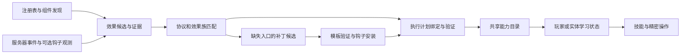

# 逆推理：外部效果学习、操控与运行时兼容重设计

状态：投射物控制、实体技能解析与真实方法体热修改已完成首批实现及隔离回归；完整路线尚未完成。第 12 节保留设计方案，当前实现、灾变与 Sorcery Age 回归及未完成边界见第 12.9 节。设计日期：2026-11-01，实施记录：2026-11-02。

本方案联合审查本体与独立附属 `D:/mcmodtest/inverse-reasoning`。正文保留总体设计及最初审查基线，不代表所有规划能力已经实现；当前范围见第 11 节，新增设计见第 12 节。附属实际 modid 为 `academy_inverse_reasoning`，实现与构建继续留在独立仓库；本体承担通用矢量效果 API 与扩展契约，因此跨仓库设计保存在这里。

## 1. 目标与基本决策

逆推理应让矢量操作学习其他模组的效果，逐步获得识别、干涉、接管和再次释放的能力。**学习单位改为“效果及其执行契约”**：一枚追踪弹、一束射线、一个持续法术、一种施法过程，而不再以 Java 方法列表作为主要产品。

用户已明确首要目标：**自动识别并操控未知模组的效果**。首个可玩版本优先验证陌生投射物、持续制导和无实体射线的识别与控制；运行期补钩随后扩展已加载目标的覆盖。学会后原生再次施放仍在整体方案中，新增法术引擎适配排在后面；现有 Iron/Ars 保留为迁移兼容，不作为自动兼容能力的证明。原有 Lv5、矢量反射前置、40 CP/100 tick 分析、5 CP 法术动作先保留为迁移基线，新操作的成本另作平衡，不把旧数值套到所有效果。

自动化的覆盖单位是**协议和效果族**。一种标准投射物协议可以覆盖多个此前没见过的 mod；一种法术引擎适配器可以覆盖其注册的所有符合契约的法术。字节码分析负责为缺失的观测点和操作点生成候选绑定；成功匹配经过验证的变换模板时，可以自动生成兼容补丁。无法解释的状态与控制流保留为待适配，不把“读取了 class”视为“理解了技能”。

必须分别回答四个问题：

1. 能否看见并区分这个效果？
2. 能否改变已经存在的效果，并保留原来的命中行为？
3. 能否在新的施术者上下文中再次释放它？
4. 缺少必要入口时，能否补入观察或控制钩子？

某一项成功不会自动授予其他项。学习进度与工程支持程度也分开：玩家可以尚未学会一个完全支持的效果，也可以已收集充分样本但当前运行环境无法执行某种操作。

## 2. 当前实现为什么达不到目标

以下为实施前的审查记录，附属路径相对于 `inverse-reasoning/`；行号是当时的定位点，部分问题已在首批实现中修复。

| 现状 | 源码依据 | 实际限制 |
| --- | --- | --- |
| 采样主要记录被玩家有效攻击的实体、武器、拾取或合成物品的运行时类 | `neoforge-mod/.../InverseReasoningEvents.java:72,145,158` | 没有记录一次外部攻击从施放、生成、飞行到命中的因果链；被攻击、防御拦截也没有完整采样入口 |
| 分析按签名及已登记调用筛选 | `mod/.../analysis/BytecodeMethodAnalyzer.java:98,149` | 普通辅助方法、字段写、对象创建、lambda、循环、switch 常被归入 UNKNOWN，不能自动解释实际玩法 |
| 生产策略只登记少量查询，执行器只接受 QUERY | `MinecraftAnalysisPolicy.java:19–60`；`LearnedMethodInvoker.java:199` | 测试夹具中的矢量写操作不等于生产支持；扩大方法列表不能产生完整施法协议 |
| 无物品施法只支持两个特定引擎 | `SpellItemAction.java:38–44`；`NativeSpellCasting.java:23–88` | Iron/Ars 已有可用的原生施法流程，但选择器和数据模型硬编码在一起 |
| Agent 只捕获字节码 | `agent/.../InverseReasoningAgent.java:76,219` | `retransformClasses` 用来触发捕获，transform 返回 null；尚无热修改器 |
| 方法身份包含整类哈希 | `mod/.../runtime/LearnedMethod.java:71`；`PlayerKnowledge.java:89–97` | 无关方法变化也会改变知识 ID，旧封装容易留下失效引用 |
| 首次执行会同步捕获和重新分析，无 Agent 时每次执行读资源并哈希 | `LearnedMethodInvoker.java:150–205` | 学习放到后台并不能保证精密操作的执行热路径稳定 |

现有静态筛选还不是“纯查询”的证明：数组存储指令、方法级 synchronized、获批调用内部的动态派发需要专门反例验证。顶层接收者的覆写检查已经存在，不能把它误写成完全没有检查。以上是源码审查发现，本轮未执行新增反例测试。

本体的兼容系统目前更偏向防御结算：

- [VectorExternalAttackClassifier](../src/main/java/org/academy/internal/common/ability/accelerator/reflection/compat/VectorExternalAttackClassifier.java) 根据伤害来源和方向证据分类；[VectorCompatProfile](../src/main/java/org/academy/internal/common/ability/accelerator/reflection/compat/VectorCompatProfile.java) 的形状目前只有 HITSCAN。
- [VectorRedirectExecutor](../src/main/java/org/academy/internal/common/ability/accelerator/reflection/compat/VectorRedirectExecutor.java) 可以重新扫描并返伤。这不等于保留原模组的施法、命中附效和持续状态。
- [VectorProjectileStateAdapter](../src/main/java/org/academy/internal/common/ability/accelerator/reflection/compat/VectorProjectileStateAdapter.java) 已能操作原投射物，是新通用服务的基础；[VectorProjectileTargeting](../src/main/java/org/academy/internal/common/ability/accelerator/reflection/compat/VectorProjectileTargeting.java) 中按成员名推测追踪目标的做法，应降为候选发现，补上绑定验证和失败诊断。
- 相关实现位于 `internal`；公开的 [VectorDefenseProtection](../src/main/java/org/academy/api/server/ability/VectorDefenseProtection.java) 只有状态查询，没有外部效果 provider SPI。

## 3. 效果模型与可执行操作

### 3.1 通用效果族

先梳理矢量分类可复用的通用作用，再组织具体技能，避免把兼容逻辑继续埋进“逆推理”技能类。

| 效果族 | 应描述的核心状态 | 首要操作 | 支持边界 |
| --- | --- | --- | --- |
| 实体投射物 | 实体身份、位置、速度、朝向、owner、追踪目标、碰撞、寿命 | 偏转、反射、停驻、释放、接管 | 保留原实体及原生命中流程；自定义运动/碰撞需独立绑定 |
| 瞬时射线/扫掠 | 起点、方向、长度、宽度、候选命中、结算位置 | 转向、改写命中路径、截断 | 必须在原结算前取得控制点；只收到伤害后事件时不能声称已改写原射线 |
| 持续束流/区域 | 会话身份、锚点、形状、逐 tick 结算、退出条件 | 重定位、转向、终止、有限接管 | 需要会话级租约和完整结束流程；区域效果不自动等同于可反射线性效果 |
| 原生施法过程 | 能力 ID/参数、施术者要求、资源、冷却、阶段、取消入口 | 原生再次施放、引导、取消 | 通过引擎协议获得整套流程；发现 damageType 不足以推出施法入口 |
| 复合效果 | 子效果、生成/触发关系、独立状态 | 对已识别子效果操作 | 召唤物 AI、传送、仪式、复活等需要专门语义，不能统称为矢量重放 |

一个火球可能同时具有“投射物 + 命中爆炸 + 燃烧附效”；模型记录组合关系，不把所有内容压成一个伤害数值。控制原火球与自己生成一团模拟爆炸是两种不同执行计划。

### 3.2 数据对象

下列为总体架构中的目标契约，包含已实现与待实现对象；当前公开 API 和交付范围见第 11 节。

| 对象 | 职责 |
| --- | --- |
| `EffectObservation` | 服务器采样快照：时间、维度、参与实体、事件类型、来源、关联 trace、已观察状态；不长期持有游戏对象 |
| `EffectDescriptor` | 稳定效果身份、效果族、参数语义、已验证操作集、保真度、证据、缺失条件 |
| `EffectHandle` | 服务器持有的活效果引用，含服务器会话/维度/实体或会话身份/代次；客户端 token 不能自行取得控制权 |
| `LearnedCapability` | 某 actor 的学习状态、效果 ID、参数快照和允许操作；与共享兼容知识分离 |
| `InvocationPlan` | 已绑定入口、目标与上下文、资源归属、前置检查、依赖版本、结束方式、执行结果合同 |
| `PatchPlan` | 所需观察/执行钩子的位置、模板、匹配证据、补丁版本、影响范围和启停状态 |

可执行操作集至少区分 `OBSERVE`、`REDIRECT_EXISTING`、`CONTROL_EXISTING`、`CAST_NATIVE`、`RECONSTRUCT`。终止也需要独立支持证据。`RECONSTRUCT` 代表按已知物理语义构造本体效果，不能在界面上冒充原模组法术。

保真度按具体操作记录：`NATIVE`（原协议/原效果）、`VERIFIED_BRIDGE`（经验证的桥接）、`APPROXIMATION`（明确缺少部分行为）。近似操作以独立选择呈现，原生操作失败时不静默切换成模拟返伤。

证据分为协议声明、结构匹配、运行观测、行为验证。置信度只帮助选候选，不直接决定执行权；执行资格由所需操作合同是否齐全决定。方向、速度、位置分别带单位和空间坐标系，不能仅因都是 Vec3 就互相替代。

## 4. 自动发现与兼容计划生成



### 4.1 发现必须围绕真实行为

1. 由实体、物品、组件、注册表和公开能力接口找候选；读取元数据不初始化所有第三方类，也不在每个 tick 扫描全部对象图。
2. 对玩家正在分析的效果开启有限观测窗口，记录施放、生成、运动、命中、伤害、状态附加和消亡。保留现有拾取/攻击样本入口，并补上遭遇外部攻击、防御拦截及主动观测。
3. 优先用原生施法 ID、实体 UUID、owner、会话 token 建立因果关系；仅有时间或距离相近只能产生低可信候选，不合并成同一个效果。
4. 同步调用链可使用作用域上下文；跨 tick、调度任务、子实体使用显式 token 传播。ThreadLocal 不能独自承担异步或跨 tick 的因果归属。
5. 第一次遇到效果也不保证能补救已经发生的命中。缺少预结算挂钩时，采样用于下一次识别；保留本体已有防御行为，但明确其保真度。

运行观测只记录真实发生的行为。不会在正式世界里轮流调用未知方法来试验它是否有用；探索性执行留在隔离世界/测试夹具中。观测到 A 后出现 B 也不等于证明 A 可以在新上下文中重新执行。

### 4.2 三种自动化来源

| 来源 | 如何扩大覆盖 | 何时能直接执行 |
| --- | --- | --- |
| 标准协议 | 一次实现 Projectile、原生实体移动/命中等协议，发现符合协议的未知内容 | 操作所需的运动、归属、碰撞、同步等合同成立；自定义 tick 持续覆写速度时不能仅改一次速度就宣称接管 |
| 引擎 provider | Iron、Ars 等 provider 自动枚举引擎内法术，统一序列化与施放 | provider 完整绑定参数、消耗、冷却、取消，且当前版本通过兼容校验 |
| 结构与数据流模板 | 扫描生成实体、射线查询、命中结算、目标更新等已知终点，向上切片至相关入口 | 参数数据流、动态派发、控制依赖和副作用满足某个已验证模板；否则只输出候选和缺失项 |

字节码分析从“方法准入白名单”升级为有预算的调用图、控制流与数据流分析。支持常见普通控制流，识别 receiver 与参数来源、字段读写、别名及虚调用候选；遇到反射、native、无法解析的派发或跨线程路径，记录不完整边界，不假装已解析。反编译代码只作为开发诊断，不参与正确性判定。

自动生成的执行器由已验证的操作模板组成，不任意拼接方法调用。第三方 provider 仍可增加更复杂的效果合同。这样新增兼容知识以效果族/引擎复用，避免每出现一个法术就新增一段硬编码。

### 4.3 代表性结果

- **未知 mod 的普通火球**：自动识别原实体与 owner；偏转后仍由原 mod 执行爆炸和燃烧。若无法获得可靠的生成与初始化合同，可以接管当前火球，但不开放凭空施放。
- **持续追踪的飞弹**：同时验证速度、制导目标、命中归属和同步；仅改 deltaMovement 后下一 tick 又追踪回来，验收必须失败。目标控制可以来自协议，也可以来自结构匹配生成的定向钩子。
- **没有实体的射线**：在射线求交与原始命中调用间生成或使用挂钩，改写路径并保留原始载荷。若只捕获到最终伤害，提供观察或独立标明的近似返伤，不能显示“原生射线接管”。
- **Iron/Ars 法术**：从具体法术 ID/语法快照生成能力条目，由 provider 原生施放。无需继续要求玩家在方法库中找 `Scroll.use`/`SpellItem.use`。

## 5. 执行、资源与本体公共 API

### 5.1 模块职责

| 所属 | 职责 |
| --- | --- |
| 本体 `org.academy.api.common.ability.vector`（拟新增） | 效果描述、操作请求、能力标志、结果、扩展 provider 契约 |
| 本体 `org.academy.api.server.ability.vector`（拟新增） | 通用矢量操作服务、控制租约、防御扩展、服务器句柄解析 |
| 本体 `internal` | 实现与现有反射、投射物、线性结算桥接；不把内部类型直接搬成公共签名 |
| 附属 `analysis` / `runtime` | 发现、证据、兼容计划、学习状态、队列、缓存、版本迁移 |
| 附属 `compat`（拟拆分） | 协议与引擎 provider，Iron/Ars 各自独立，不侵入分析核心 |
| 附属 `agent` / `protocol` / 拟新增 `transform` | 能力探测、字节码捕获、加载期/运行期挂钩、协议与补丁生命周期 |
| 附属 `neoforge-mod` | 事件、持久化、技能、精密节点、网络和展示适配 |

本体只承担能够供其他技能复用的机制，不依赖逆推理的学习数据库、Agent 或特定法术 mod。附属通过正式 API 注册 provider；本体原技能保持原有行为，不安装逆推理也能运行。

### 5.2 拟新增服务边界

`VectorOperationService` 提供 `describe`、`prepare`、`apply`、`stop`；操作请求描述偏转、速度变化、接管或释放。`prepare` 无世界副作用，返回绑定 actor、目标、操作和依赖代次的服务器计划；`apply` 重新检查活对象/目标约束，不接受过期计划。

拟新增 `VectorOperationAuthority` 作为权限合同，由服务器运行入口提供可复核的授权来源与目标策略。现有 AbilityActorContext 只承载施术参数和资源账户，构造 context 不代表取得目标、方块或效果控制权。apply、持续 tick、实际命中分别复核当前技能资格、actor 状态、维度、队伍、目标/方块规则及租约，不能仅在 prepare 时检查一次；这些复核不重复扣启动费用。

`ExternalEffectProvider` 提供能力探测、效果描述、计划构建与生命周期处理。provider 声明支持的操作、适用版本和优先级；精确绑定优先于通用协议，冲突必须可诊断，不能由类路径偶然顺序决定。静态 provider 在本体 Ready 前注册并冻结，世界中的兼容计划与策略快照可以版本化更新，不改冻结注册表。

矢量防御再增加正式的外部观察/拦截扩展点，沿用原防御资格、费用预算和重入保护。一次效果由统一协调器决定接管者，使用实例与阶段标识去重，不能因为附属和本体都订阅事件而反射两次或扣费两次。

复用已有 [AbilityActorContext](../src/main/java/org/academy/api/server/ability/AbilityActorContext.java)、[AbilityResourceAccount](../src/main/java/org/academy/api/server/ability/AbilityResourceAccount.java)、[AbilityExecutionHandle](../src/main/java/org/academy/api/server/ability/AbilityExecutionHandle.java)。新通用效果以 `LivingEntity` 为施术主体；玩家权限与非玩家 provider 各自适配。现有 [EntityAbilityService](../src/main/java/org/academy/api/server/ability/EntityAbilityService.java) 已有 executor/provider 注册、施术检查和资源结算，应直接衔接。

精密操作目前仍由 ServerPlayer 发起：[ProgramActionContext](../src/main/java/org/academy/api/server/ability/program/ProgramActionContext.java)、[AbilityProgramService](../src/main/java/org/academy/api/server/ability/program/AbilityProgramService.java) 不能当作已有通用 NPC 程序运行器。本期让 NPC 与程序共同调用效果服务，完整 NPC 程序 VM 另行设计。若外部原生施法只支持玩家，明确返回该限制，不制造假玩家当作普遍兼容方案。

### 5.3 操作的一次执行

```text
解析已学习能力/服务器活效果句柄
  → 校验 actor、技能、范围、维度、控制租约与依赖代次
  → 无副作用预检并形成操作计划
  → 由所属技能/程序/NPC 入口结算 Academy 资源一次
  → 调用原生 provider 或通用效果服务
  → 返回成功、拒绝、失败或部分完成，以及可终止会话句柄
```

玩家主动技能沿用技能执行入口；精密节点使用 [ProgramAction](../src/main/java/org/academy/api/common/ability/program/ProgramAction.java)/ProgramEffect；NPC 使用 EntityAbilityService。通用效果服务不再次扣 Academy CP。原生法术的魔力/冷却等由原引擎结算：这与逆推理的 CP 费用分账记录，不能把原生消耗检查绕过后称作兼容。

`CAST_NATIVE` 默认保留原引擎成本与条件。若以后需要用 CP 代替魔力，应新增明确的资源转换合同与平衡规则，不能通过热补丁偷偷跳过检查。已经产生的伤害、爆炸或物品消耗不能通用回滚；原生开始施法失败、部分完成、持续通道中断分别返回明确结果，是否退 CP 遵循所在入口的合同，不承诺跨模组原子事务。

控制租约绑定 effect、actor、用途、代次和到期条件，定义 owner/伤害归属/追踪目标各自的更新策略。不能只改速度而遗漏命中与归属。退出、死亡、换维度、卸载、程序结束、封装删除、补丁失效时终止自己的会话；取消必须幂等，不取消同一玩家随后自行开始的其他法术。

## 6. 字节码修改：保留目标，明确部署与切换边界

### 6.1 三种正式能力层级

| 层级 | 实现 | 用途与限制 |
| --- | --- | --- |
| API/事件模式 | 公开入口、通用协议、provider | 不依赖 Agent；支持范围由已存在入口决定 |
| 加载期挂钩 + 策略热更新 | 独立 CoreMod 按已验证模板插入稳定 dispatch 钩子 | 类加载后学习主要更新策略；已错过加载期的目标需运行期变换或下次启动 |
| 运行期方法体变换 | 可选 Agent 对确切 Class 身份做保持结构的 retransform | 补入此前不存在的观察/控制点；需 JVM 与目标类都支持，不保证任意类可修改 |

加载期和运行期共用变换模板与验证器，入口分开。拟采用正常启动 Agent（可提供可选启动配置）和受支持的 Attach API 两条部署路径；动态挂载可用时仍可保持现有单 mod JAR 的便利，不把它作为所有平台的必达条件。检测到 JVM 禁止挂载时降级并说明缺少的能力，不把 JNA/Unsafe 内部绕行当成正式跨平台保证。

现有本体 `libs/academy-agent-source/` 是归档，未编译、加载或打包；其旧对象头 klass 指针改写不进入新架构。正式功能不要求打开增强结构 HotSwap。项目已有增强类重定义相关的稳定性线索，但根因未确定，不能把历史 JVM 崩溃直接归因于某条归档代码。

标准 retransform/redefine 可改方法体，不能增删或重命名字段/方法、改方法签名、修饰符或继承。新增状态放在附属的 side table/会话服务中，新增实现放在自己的类中，不修改第三方类结构。活动栈帧继续旧方法，已有实例与静态状态保留；必须设计新旧代次共存与切换时机。[JDK 25 JVM TI](https://docs.oracle.com/en/java/javase/25/docs/specs/jvmti.html#RetransformClasses)

### 6.2 钩子的运行合同

- 钩子在类层面安装，行为在实例/效果会话层面生效。至少匹配服务器会话、维度、effect/actor、操作租约和策略代次；不能修改全局方法后让所有玩家及无关实体一起受影响。
- 没有激活策略、服务未初始化、token 过期或上下文不匹配时，执行原逻辑。不得把找不到目标的异常转成默认成功。
- 以方法入口、参数、原求交结果、命中载荷等明确插入点构建模板；同一控制点最多有一个变更所有者，观测方可共享。多 provider 冲突要给出冲突原因。
- transformer 回调只处理字节和不可变配置，不加载游戏类、不读世界、不运行分析器。最小桥接协议不能依赖 premain 阶段尚不可见的 Minecraft 类型；验证 NeoForge 游戏类加载层对桥的可见性。
- 热策略更新通过 volatile/AtomicReference 发布不可变快照，一次操作固定快照；新操作绑定新代次，旧会话按合同结束或保持旧代次至完成。钩子/桥接 ABI 代次与策略代次分开管理：旧活动方法体仍可能调用旧钩子，不能因新代码安装成功就销毁旧桥和相关策略，必须等调用与会话排空，无法确认时保留至重启。
- 运行钩子也必须检查线程：异步线程只能提交有界观测或调度请求，不能直接操作世界。控制点若要求同步结果、又无法在正确线程保留原语义，则拒绝该控制绑定。类变换不在每次施法时执行；对第三方内部正在执行且无法协作暂停的流程，不承诺瞬间切换，必要时延期或要求重启。

### 6.3 补丁生命周期

```text
DISCOVERED → MATCHED → VERIFIED → INSTALLED → CONFIRMED → ACTIVE
                                            ↓             ↓
                                       FAILED       DISABLED / STALE
```

每个计划保存目标 artifact 指纹、加载器/模块身份、类名、方法描述符、所见输入字节来源与结构摘要、模板版本、插入点数量、所需能力和行为探针。类名相同不代表同一 Class；持久化不保存运行期 loader 对象 ID 作为跨启动身份。

安装前对副本执行 ASM 验证、结构限制检查、命中数量检查和幂等检查。单 JVM 批次安装的成功不等于整个多阶段业务更新成功；多类计划先保持策略关闭，全部所需挂钩确认后再统一发布。transformer 抛异常可能被忽略并继续其他转换，不能把它当作安装事务自动中止。[ClassFileTransformer 合同](https://docs.oracle.com/en/java/javase/25/docs/api/java.instrument/java/lang/instrument/ClassFileTransformer.html)

帧计算与验证所需的类层级查询同样使用离线元数据，不能让 ASM 默认层级解析隐式加载/初始化游戏类。静态验证之外，在独立启用 verifier 的 JVM 中验证真实链接、桥可见性及多加载器场景。

**捕获字节有来源和阶段。** 磁盘资源、加载期输入、Agent 回调输入分别标记；后续 transformer 仍可能修改结果。保存一个 SHA 不是“最终执行字节已被证明”的充分条件。通过安装回执、受控探针及依赖代次确认可用能力；无法确认时不激活依赖该钩子的操作。对本系统无法观察的其他 agent 修改，不宣称能持续证明绝对一致性。

重变换必须与其他 transformer 链组合；不能把原 JAR 的类整体恢复覆盖其他模组补丁。禁用首先切断自己的策略并清理会话；只有在能验证组合关系时才尝试移除自己的钩子。`removeTransformer` 不会撤回已安装的代码，恢复方法体也不会恢复世界状态；撤销无法确认时保留休眠钩子并要求重启相关能力。[Instrumentation 合同](https://docs.oracle.com/en/java/javase/25/docs/api/java.instrument/java/lang/instrument/Instrumentation.html)

客户端所需动画、参数同步与渲染挂钩独立声明。服务器作用成功并不代表客户端已完整表现；涉及双方的能力在握手确认协议与能力摘要后开放。普通技能操作提交服务器目录中的操作 ID 与类型化参数；第 12 节新增的高级方法编辑允许提交源码或补丁 IR，由服务器按当前运行类重新编译、验证并安装，不直接信任客户端生成的 classfile。真实运行期方法体插桩已获用户明确许可，属于附属正式设计范围。

## 7. 性能、缓存与失败处理

共享兼容分析以 artifact/协议/模板版本复用；玩家学习只记录解锁与样本参数，不为每名玩家反复扫描同一个模组。运行时采用 `bindingGeneration` 检查与预链接调用，不在节点执行中读 class 资源、计算整类 SHA、反编译或触发 retransformation。

保留现有有界后台队列，同时补全任务合并、可取消 Future/令牌检查、公平调度、服务器关闭清理与引用释放。队列满不先扣学习费用；开始后的取消/退款规则明确列入技能合同。Java 调用和 JVM retransformation 无法靠 Future 超时安全强杀；超时表示拒绝继续依赖该结果、停用能力并诊断，不代表执行已被终止。

字节缓存设总字节数和单类限制；描述符、方法句柄、加载器映射按会话与 LRU/弱引用生命周期管理。取消后排队任务及时移除，运行中任务在可控阶段检查取消。实际世界对象读取和修改在服务器线程完成；后台只处理不可变快照和字节码。

观测默认关闭全量调用追踪，按目标/时间窗口开启；用有界环形缓冲和丢弃统计处理过载。普通钩子的无策略路径只作轻量检查。补丁安装单独计量停顿，不能混进“每 tick 平均开销”掩盖卡顿。

先记录无附属、附属空闲、采样、分析、执行、安装六种负载的基线，再确定预算。验收至少报告平均与 p95/p99 tick、分配率、缓存上限、队列等待、实际覆盖率、补丁停顿；数字必须说明硬件、模组集合和负载，不能在方案阶段写成已达到的性能。

## 8. 学习体验、精密操作与存档迁移

默认入口是“效果库”：名称、来源、已学会操作、参数、使用条件、当前不可用原因。方法/字节码详情保留在诊断页。玩家选择“接管此飞弹”“释放已学法术”，不需要先辨认 Java owner、方法描述符与 Vec3 参数含义。

精密操作维持少量静态节点类型，再使用现有命名预设机制引用能力包：观察效果、取得效果句柄、偏转/接管、释放能力、终止会话。不同操作具有明确 schema；能力不支持方向/目标输入时不展示一个实际不起作用的端口。异步分析与持续施法返回真实状态，不把排队成功显示成效果完成。

稳定身份分三层：

- 内容身份：mod/provider/注册效果 ID；没有注册 ID 时使用 provider 定义的稳定键。具体法术参数快照单独保存，同一个 `use` 方法下的两种法术不能互相覆盖。
- 玩家封装身份：独立 UUID、名称、能力引用、参数 schema 与数据；重命名、重分析不会偷换已保存法术。
- 执行有效性：artifact hash、相关方法/协议依赖摘要、provider/patch 版本与运行期代次。有效性变化可以禁用执行，不直接改掉玩家封装 ID。

更新 mod 后先重验相关依赖；确知兼容才保留执行资格。旧查询封装经专用 legacy provider 继续存在；旧 Iron/Ars schema-4 快照迁移为原生施法能力。只存了 `use` 方法而缺失法术快照的旧记录要求重新取样。迁移不能确定的条目保留原数据、名字和引用，标明原因，不静默丢弃或猜一个新能力替换。

将 schema-4 中写回的 Ars 演化状态与不可变学习蓝图区分：provider 声明哪些状态属于单次施法、哪些允许跨次延续，分别保存。能力包删除和原生施法完成的生命周期也分别处理。

## 9. 实施批次与退出条件

| 批次 | 本体工作 | 附属工作 | 必须达到的退出条件 |
| --- | --- | --- | --- |
| A：建立可测基线 | 标记现有投射物、返伤与防御协调入口 | 建立未知效果矩阵，复现并修复保留查询路径的分类/热路径问题；固定现有存档样例 | 能解释每个支持/失败案例，不把“分析了多少方法”当覆盖率 |
| B：效果与通用操作 | 发布描述/句柄/provider/矢量操作门面，迁入标准投射物操作；提供最小统一防御协调、去重和费用衔接 | 效果目录与学习模型；旧方法及 Iron/Ars 封装过渡适配；自动发现标准投射物 | 未硬编码 modid 的测试投射物可偏转，保留命中附效且只结算一次；NPC 与玩家调用同一通用服务 |
| C：结构分析与加载期挂钩 | 扩展射线/制导的观察与拦截合同 | 有界数据流模板、射线/制导挂钩、策略热更新、冲突诊断 | 未预置 modid 的合成射线和制导实现均通过模板自动绑定；原生载荷/无关实例不变 |
| D：运行期补钩 | 支持依赖代次与操作停用 | Agent 写模式、补丁管理器、同结构重变换、启停/撤销 | 已加载目标类能补钩并只影响授权效果；冲突/不可修改时准确降级，卸载停用可验证 |
| E：扩大原生能力复用 | 复用现有动作与会话接口，补必要结果合同 | 完成引擎 provider 拆分、扩大能力包和原生再次施放覆盖 | 无物品释放真实法术，资源/冷却/取消正确；能力包不会互相覆盖 |

每批可以独立交付。B+C 是围绕未知效果识别与控制的第一版玩法闭环；D 完成真实运行期补钩，E 扩大原生能力复用，不能在 B+C 完成时宣布全部目标完成。结构性增删成员与对象头替换不属于本方案正式实现范围。

## 10. 验收矩阵

| 场景 | 验收点 |
| --- | --- |
| 未预先登记 modid 的标准投射物 | 发现、学习、偏转/反射、原实体继续存在、原命中附效、owner/友军判断、多人同步 |
| 每 tick 自行制导的投射物 | 接管后不会立即抢回轨迹；速度、目标和取消的处理均有证据 |
| 无实体射线 | 结算前改写原命中；每目标结算一次；伤害后采样不能被算作成功拦截 |
| Iron/Ars 多种真实法术 | 空手再次施放、资源不足、冷却、蓄力、持续结束、法术参数隔离；测试固定依赖版本 |
| 部分可识别的复合效果 | 仅开放有合同的子操作；近似重建与原生施放有清晰区分 |
| 双人同时操作、两侧矢量反射 | 互不串租约、不无限递归、不重复扣费、不错误转移其他玩家法术 |
| 玩家/NPC | 共同效果服务；原生入口只支持玩家时返回明确限制 |
| 无 Agent、启动 Agent、禁止动态挂载 | 模式与能力列表真实；基础玩法继续；安装失败不伪报支持 |
| 同名不同加载器、覆写、动态定义类 | 不串绑定；未覆盖路径准确报告；缓存可释放 |
| 两个 transformer 的先后顺序与目标漂移 | 不覆盖其他补丁、幂等、插入点数量严格、安装失败不激活策略 |
| 运行中更新/停用补丁 | 旧方法/旧桥与新策略交叠、会话取消、异步回调线程门禁、无关实例不变、残留钩子休眠、必要重启明确 |
| 数据包与 mod 更新、重登/重启、旧档迁移 | 知识和封装身份稳定，执行有效性重新验证，不丢原始记录 |
| 查询分类与执行反例 | 数组写、synchronized、动态派发、不支持参数、取消队列；不能仅复测人工白名单夹具 |
| 高频精密操作与长期混装 | 执行不触发字节分析；测量缓存、队列、tick 尾延迟和补丁停顿 |

必须用测试作者新建、未登记到 provider 的模组夹具验证“自动”，并追加真实未知内容验证。覆盖率按“效果 × 操作 × 执行保真度”统计，分母公开；不能拿解析出很多方法或两个专用适配成功作为自动兼容率。

实现阶段按仓库要求运行本体 `test -DisDev=true`、开发/发布两种 build，附属独立 build；游戏行为用隔离 `runClientDev`、专用服务端及多人场景验证。字节码生成与重变换增加启用 verifier 的独立 JVM 测试，不能依赖本体游戏启动的 `-Xverify:none` 来验证正确性。每批复用同修订已通过的检查，未执行项目明确保留待验证。

## 11. 本次交付边界与参考

当前首批实现以 **已有 Projectile 实例的运动接管** 为闭环：本体新增公开效果描述、句柄、provider、操作预检与控制租约；附属增加效果采样、后台结构分析、独立效果知识、效果库和精密操作封装。玩家与 NPC 使用同一服务。动作入口负责 CP，通用服务不再次扣费。

结构 provider 不按 Iron/TACZ 的 modid 分支，而是分析实际继承链的速度读取到碰撞查询数据流，并检查运动和 owner 方法的运行时派发。可选 Agent 已支持精确类身份、输入指纹和指令位置的同结构方法体变换；控制策略只绑定指定实例、服务器线程及代次。原实体、原生伤害载荷和碰撞逻辑继续使用。未证明的路径不给出控制能力。

现有查询分类补充数组写、同步和动态派发反例；查询和法术执行改为后台准备与有界证据缓存。Iron/Ars 原生施法拆成 provider，保留 schema-4 法术快照及资源、冷却、取消语义。新增效果存档独立保存稳定内容身份与可执行依赖摘要，重新分析不替换封装 UUID。

空间封装进一步提供本体公开的 `SpatialCastRequest` / `SpellCastGeometry`，统一起点、终点、方向和目标的类型及约束。附属按实际数据来源识别 Iron 的目标预检和直线弹体发射协议、Ars 的主形状射线与飞射协议，在原生施法作用域内绑定空间输入，保留原生资源、冷却与命中载荷。精密操作只为已验证的封装预设显示相应端口；旧节点仍保留原生行为。终点用于瞄准和缩短射线，不承诺飞弹停止或必然命中。具体合同和固定版本回归见附属交付文档。

首批跨越 A、B 和 D 的投射物部分，同时完成 E 的 provider 拆分及部分空间封装。**C 的任意未知无实体射线通用拦截、正式加载期 CoreMod、完整跨效果因果链、更多原生施法引擎尚未实现。** 已支持的 Iron/Ars 原生施法射线不代表能接管世界中的所有射线；停止控制也不撤销已经发生的命中。结构模板保守拒绝无法证明的调用路径，不作全模组覆盖率承诺。

附属的 `docs/EFFECT_CONTROL.md` 记录当前用法、固定依赖、回归命令、验证结果及待验证项。最终性能基线、双客户端同步和长期混装仍须独立验收，不能用单元测试或单客户端烟测替代。

- [本体附属注册与注入边界](addon_registration_api_design.md)：补充公开 API，遵守授权、资源、结算与同步合同。
- [本体现行 CoreMod 机制](neoforge_coremod_migration.zh-CN.md)：归档旧 Agent 与实际加载期实现的区别。
- [JDK 25 Agent 加载合同](https://docs.oracle.com/en/java/javase/25/docs/api/java.instrument/java/lang/instrument/package-summary.html)：启动 Agent、动态挂载及类加载环境。

附属审查路径速查：`neoforge-mod/src/main/java/org/academy/inverse/neoforge/` 为事件/执行/法术类目录；`mod/src/main/java/org/academy/inverse/analysis/` 为分析器目录；`mod/src/main/java/org/academy/inverse/runtime/` 为知识模型目录；`agent/src/main/java/org/academy/inverse/agent/` 为捕获 Agent 目录。本方案中的简写路径均据此展开。

## 12. 实体技能解析与真实方法体热修改：新增方案

本节对应 2026-11-02 的新增需求：解析目标实体，把其攻击/技能封装为可释放能力；允许逆推理对目标实体所用类进行真实运行期方法体插桩。两条功能共享行为分析、运行类绑定与插桩底座，但分别交付、分别验收。用户明确允许附属实施真实插桩，因此方法体编辑是正式目标，不以属性调整或单独运行一段 `main` 代码代替。

本节最初由代码、用户指定灾变 JAR 和参考视频的只读审查形成；现已进入实现和隔离回归。阶段退出条件仍按下文逐项验证，不能用目录发现代替技能通过。用户随后明确：学习封装免除原模组资源消耗与施术者资格，保留逆推理自身 CP 消耗；该规则覆盖下文早期的原生资源约束。

### 12.1 已核实的基础与缺口

| 检查对象 | 已确认事实 | 对设计的影响 |
| --- | --- | --- |
| 当前实体采样 | 已记录实体类型和运行类，但还没有从实体构建完整攻击状态机与技能目录 | 新增主动选择实体的解析入口，不要求先攻击实体，也不把采集 class 当作学会技能 |
| 当前方法执行器 | 查询执行要求接收者符合声明类型；玩家不是 Boss 类的实例 | 不能把 Boss 实例方法直接绑定到玩家后当作技能释放 |
| 当前 Agent | 已有 `retransformClasses`、方法入口/返回前/调用前后通知、引用结果替换、实例绑定与冲突检查 | 扩展现有真实插桩系统，不能继续按“Agent 只捕获字节码”描述现状 |
| 当前插桩限制 | 通知钩子不能直接改写已压栈参数；调用结果替换不支持 primitive；没有玩家方法体编辑器 | 补齐参数、基本类型返回值、提前返回/取消和完整方法体编辑 |
| 灾变攻击组织 | `LLibrary_Monster` 体系使用动画与动画 tick；`Internal_Animation_Monster` 体系使用同步攻击状态与攻击 tick；效果也可能由内部 Goal 触发 | 分析单位为一次攻击过程：入口、阶段、效果、退出，而非一个方法 |
| 原生载荷的持续依赖 | 焰魔火球的二次追踪读取 `Mob.getTarget()`；部分激光每 tick 从特定 Boss 更新位置，客户端还读取施术者朝向 | 玩家释放必须重绑定整个载荷生命周期中的目标/锚点，构造器接受 `LivingEntity` 不足以证明兼容 |
| 参考视频 | 约 32 秒可见 `getMaxHealth()` 返回 `-676767`；约 61 秒新生成 Boss 显示该值；后段演示编译结果和语法错误定位 | 验收包含真实方法返回行为、同类新实例、编译诊断、应用与恢复。视频未显示完整内部安装机制，不据此推断实现细节 |

视频中的物品 ID 为 `supersteve:jedit`，名称“Java 编辑器”。本地参考包与旧源码的类标签/执行器功能状态不完全等同于视频；只借鉴交互和可核实的技术机制，不把其 `Executor.main` 运行成功当作方法体热修改证据，也不照搬对象头或 JVM 内部地址修改。

### 12.2 统一解析底座与数据模型

```text
选中实体 → 服务器确认实体身份与解析资格 → 运行类/继承链/Goal/状态协议
       → 有界调用与数据流分析 + 按需运行观测 → 实体行为模型
           ├─ 技能蓝图 → 执行契约验证 → 能力封装 → 玩家/NPC/精密操作释放
           └─ 可改写方法与控制点 → 补丁编译验证 → 实例或类型范围热修改
```

新增模型拟采用以下职责划分，实施时与已有描述符复用字段，不重复维护多套效果身份：

| 模型 | 内容与寿命 |
| --- | --- |
| `EntityBehaviorProfile` | 实体类型、运行类继承关系、Goal/动画/状态入口、行为候选、证据与未解决依赖；共享兼容知识 |
| `LearnedAbilityBlueprint` | 稳定技能 ID、准备/生效/恢复阶段、原生效果载荷、几何端口、资源与冷却、取消规则；可持久化 |
| `AbilityBinding` | 确切 `Class`/加载器/模块、相关方法指纹、钩子、运行代次和已验证执行计划；仅当前运行期有效 |
| `AttackSessionState` | 一次释放的阶段、目标、临时状态、子效果句柄与退出原因；不能携带原 Boss 的全部可变状态 |
| `BehaviorPatchRecipe` | 方法/控制点身份、源码或结构化 IR、参数、范围、有效期、版本与恢复策略；可持久化 |
| `EntityPatchPlan` | 当前基线、编译结果、依赖类、冲突和安装回执；验证后才可激活 |

内容 ID、玩家封装 UUID、执行有效性继续分离。重新分析或第三方版本变化只使旧绑定过期，保留玩家名称、节点连接和原始封装；验证后重绑，不用整类 SHA 充当唯一知识 ID。

解析流程：

1. 服务器读取选中实体的快照，后台分析字节码和离线类型信息；解析过程不触发实体攻击、不执行候选方法来试错。
2. 从生成实体、伤害、状态效果、射线/范围查询、速度、爆炸、召唤等效果调用点反向追踪到 Goal、状态切换和动画时间条件。同步分析命中回调与后续 tick，形成有界跨方法依赖图。
3. 识别状态协议与数据流，而非依赖 `shoot`、`attack` 等名称。名称可作为候选提示；类名、字段名变化但结构相同的夹具仍需通过。循环、switch、继承和动态派发按具体证据处理，不能一概忽略或一概放行。
4. 将多个方法、延迟子效果和结束条件合并为攻击过程。运行观测通过调用作用域和跨 tick 会话 token 佐证关联；不能仅因同一位置/时间出现伤害就归给该技能。
5. 独立记录“发现候选、观察到效果、可由原实体执行、可由新施术者释放、可热修改”。说明缺失的接收者、状态或客户端合同，不用一个笼统的“解析成功”掩盖差异。

自动兼容覆盖协议与效果族。灾变只进入回归样本和结构反例，不在生产代码按 Boss ID 为每招分支；特定引擎 provider 可以补充协议，但其覆盖必须单列，不能充当未知实体通用性的证明。

### 12.3 技能封装与再次释放

同一蓝图可以具备不同执行模式，分别显示资格与验证结果：

| 模式 | 执行语义 |
| --- | --- |
| 原实体执行 | 在兼容实体上请求其原生攻击流程；保留其原状态机，不能因此宣称玩家已能释放 |
| 新施术者释放 | 从已验证的攻击过程生成可移植执行计划，调用原生载荷，并绑定新施术者与会话；这是学习封装的核心验收 |
| 近似重建 | 使用已知通用效果重建一部分表现，明确标注差异；不能在原生执行失败时静默切换 |

不把玩家强转为 Boss，不通过隐藏生成一只 Boss、修改对象类型或假玩家来宣称通用兼容。依赖 Boss 身体结构、骑乘、抓取或完整 AI 的攻击，须解决相应契约后才开放新施术者模式；可以先提供原实体执行或明确的可移植子效果。

可移植执行计划采用有类型的行为 IR：阶段条件、局部计算、几何查询、会话状态读写、原生载荷创建与调用、等待和退出。对攻击调用图做有界依赖切片，纯计算与可证明状态转入 IR 或附属自有执行类；世界查询与原生载荷调用通过已验证绑定执行。仅当接收者与参数要求可由当前 actor、会话或原生载荷合法满足时，才保留原调用；依赖 Boss 接收者的辅助方法须递归解析并完成状态迁移，否则拒绝该新施术者计划。

每项被读取状态标记来源：常量、学习参数快照、当前 actor 查询、单次会话变量或尚未解决的原实体依赖。写操作限定为本次会话/载荷的已声明状态；原 Boss 的怒气、武器阶段等必须映射为显式前置条件或会话参数，不能无差别复制实体字段。保留分支、循环边界和阶段时间语义，遇到未解释的动态调用、异步任务或身体依赖即停止扩大可执行闭包。对原生弹体内部的接收者限制，再通过已证明语义的实例/载荷钩子桥接目标与锚点，不能仅在生成时赋值。

空间契约复用 `SpatialCastRequest` / `SpellCastGeometry`，继续统一起点、终点、方向和目标：

- 起点指定发射/结算锚点；方向描述朝向；终点用于瞄准和适用的长度约束；目标是独立的实体身份。追踪目标不等于施术者视线，也不等于伤害归属。
- 显式方向、终点和目标同时存在时，按能力声明的规则解析与校验，不能让某个输入悄悄失效。非有限坐标、零方向、跨维度、越界和互相矛盾的组合在扣费前给出具体原因。
- 保留原技能局部坐标、扇形/环形排列、地面贴合与时间偏移。任意远程起点只对已验证支持此能力的技能开放；近战、冲刺、抓取不能假装支持脱离身体的任意起点。
- 对弹体、激光与持续区域，持续更新空间上下文，覆盖服务端结算及需要的客户端朝向。终点不自动保证飞弹停止或必然命中。

执行上下文显式区分 `actor`、学习来源实体类型、载荷 owner、目标、锚点和会话 ID。原生伤害来源、友军判断、击杀归属、命中附效和回馈治疗应绑定新施术者；不能遗留原 Boss UUID。针对 `Mob.getTarget()` 等已证明的依赖，提供会话目标桥接，不改变玩家实际类型，也不全局劫持其他实体的目标。

本体拟新增薄的 `ExternalAbilityService` / `ExternalAbilityProvider` 契约，公开在 `org.academy.api`：`describe → prepare → start → tick/stop`，复用 `AbilityActorContext`、`AbilityExecutionHandle` 和空间请求。逆推理负责解析、蓝图、编译、Agent 与 provider 实现，本体不依赖灾变或逆推理。精密操作与 `EntityAbilityService` 调用同一通用服务；当前玩家程序 VM 不因此自动变成 NPC 程序 VM。

`prepare` 无世界副作用；启动前复核绑定、目标和逆推理资格。Academy CP 由技能/程序/NPC 入口扣一次；封装释放不要求原模组魔力、咒力、术式归属、学习等级等条件，也不扣原生资源。通过已验证的原生免资源入口或精确调用门控实现，不临时灌满资源、不修改玩家职业，也不影响旁路的普通原生施法。调用门控须核对施术者、能力对象、线程和会话，只豁免资格与已证明的扣费点；目标准备、真实载荷、阶段、命中与取消仍执行。依赖实体专属成员的代码必须另行移植或桥接，不能以跳过资格检查掩盖类型不兼容。连续阶段、蓄力、连击、子效果和取消归入会话；运行中失败返回可追踪的阶段、原因及已完成效果。取消停止后续行为并按载荷合同处理已生成效果，不承诺撤销已发生的伤害。

### 12.4 真实热修改的能力与安装流程

提供两种编辑方式，共用补丁编译器和生命周期：

1. 结构化修改：返回值、参数、常量、条件分支、特定调用取消、攻击入口与阶段时机等。支持 `boolean/int/float/double` 等基本类型，不只替换对象引用。
2. 高级方法体编辑：展示所选方法及只读类上下文，编辑真实 Java 方法体，提供行列编译诊断、改动预览、应用、停用与版本恢复。完整方法体编辑是独立交付项，不以几个预设数值选项替代。

普通技能使用学习与解析结果产生的已验证补丁；高级编辑保留服务器明确配置的代码编辑资格。单人/开发测试环境可启用完整编辑，用户本轮授权已覆盖这项设计；这里不新增逐次向用户请求批准的流程。客户端提交源代码或 IR 与预期版本，服务器重新校验目标、编译并决定安装，不能直接把客户端 classfile 当作可信运行基线。

```text
当前运行类与方法基线
  → 反编译展示 / 方法体编辑
  → 服务端编译 → 方法结构与依赖验证 → 字节码与链接验证
  → 与现有补丁组合 → 安装休眠钩子 → 确认所需控制点
  → 服务器 tick 边界统一激活 → 观测状态 / 停用 / 恢复版本
```

编译与变换约束：

- 使用当前确切声明类的二进制名、包、父类/接口、成员签名、必要泛型信息与真实常量值生成离线编译类壳，并提供合法构造器桩，在原声明上下文内编译所选方法；不在游戏加载器定义这个同名类。这样才能保持 `this`、private 访问和 `super` 调用的含义。不能把任意辅助类的 `Code` 原样复制进 Boss 类。
- 仅提取获准方法的代码，重建常量池引用、标签、异常表、栈帧、bootstrap 引用与调试位置，再与当前验证基线组合；保留未编辑方法及类结构，维护编辑片段与编译类壳的行列映射。编译器只使用受控依赖快照、禁用注解处理，在有界后台任务中工作；游戏 tick 内不启动编译。合并原/新方法分支后仍检查 JVM 方法体大小和常量池上限。
- 反编译结果是编辑参考，不是可靠的整类源码。Mixins、桥方法、泛型、嵌套类等导致类壳无法忠实表达时说明原因；不宣称任意第三方类都能完整反编译再编译。
- 新 lambda、匿名类、局部类或合成方法若要求向目标类增添成员/结构，首版明确拒绝该写法；后续可通过附属自身的辅助类与明确 ABI 扩展，仍不改变第三方类结构。不能把未安装的辅助依赖当作成功；字符串拼接等不新增目标成员的 `invokedynamic` 按已验证的 bootstrap 合同处理，不一概拒绝。
- 标准 JVM 支持保持结构的方法体变换；不依赖改变字段/方法数量、签名、继承或对象头。构造器、类初始化器、native/abstract、monitor/synchronized 和不能证明实体上下文的 static 方法作为初期明确边界，后续按模板逐项开放。[JDK 25 Instrumentation](https://docs.oracle.com/en/java/javase/25/docs/api/java.instrument/java/lang/instrument/Instrumentation.html)
- 整个方法体替换与同一方法内部的局部修改首版互斥；普通观察钩子能否组合也须重新验证，不能沿用旧指令偏移。同一控制点多所有者冲突明确拒绝。多类计划先全部安装且保持关闭，确认完毕后一次发布策略代次。

高级方法体代码在游戏 JVM 中执行；静态字节码验证只验证结构/链接等已声明条件，不等于任意 Java 的沙箱或终止性证明。模板模式限制可表达操作；高级模式明确属于服务器授予的代码能力。编译任务可在独立进程终止，但不能承诺超时能安全中断已经运行的任意方法体；这不阻止正式提供真实热编辑，也不能用验证器结果虚报运行可靠性。

### 12.5 实体范围、状态同步与恢复

物理插桩发生在类的方法上，玩法作用范围通过方法内的条件分派实现：

```text
目标实例与补丁代次匹配 → 执行修改后的方法体
未匹配 / 无激活策略    → 执行原方法体
```

默认范围为选中实体：绑定逻辑服务器会话、维度、UUID、当前活对象身份和代次。同类 A/B 只有 A 改变；此后新生成 C 仍保持原行为。即使方法实际声明在共同基类，也必须经过实例过滤，不能连带修改其他子类。

所有单实体补丁都须能唯一解析受影响实体：来源可以是实体接收者、经数据流验证的 owner/参数或会话 token。Goal、控制器等对象的 `this` 不是实体，必须另外证明其实体归属；不能只给 static 方法设置这个条件。归属不明或一次调用混合多个实体且无法分离时，拒绝该单实体作用域，不扩大为全局匹配。

另提供明确的“此实体类型”范围，按注册 `EntityType` ID 过滤现有与新实例；高级“此运行类”范围按 Java `Class` 匹配，是否包含子类单独声明。二者不能混用：不同注册实体可能共享 Java 类，同一注册类型也可能产生不同运行子类。视频中新生成 Boss 同样改变可由相应类型/类范围实现。界面显示实际声明类、有效实体选择器与持续时间，避免把“编辑基类方法”误解成只修改当前 Boss。static 辅助方法只有能证明实体参数来源或传播执行会话时才提供单实体模式，不能悄悄扩大范围。

字段与 getter 的修改须区别对待：改 `getMaxHealth()` 返回值会改变以后调用观察到的结果，不自动改变当前生命字段、属性、存档或客户端同步值。每项预设声明需要的服务端状态更新与客户端表现；UI 显示“运行行为已修改”“状态已同步”等真实结果，不能仅凭界面数字变化验收。视频中的负返回值可作为隔离环境高级编辑测试，但不预设所有 Boss 必然以同样方式死亡。

补丁恢复优先停用实例策略，再结束其会话；钩子与旧桥待活动调用排空后才移除，不能确认时保留休眠状态。活动栈帧继续运行旧代码，未来调用才使用新方法；恢复不会复活已死亡实体，也不会撤销伤害、掉落、召唤等世界变化。[JDK 25 Instrumentation](https://docs.oracle.com/en/java/javase/25/docs/api/java.instrument/java/lang/instrument/Instrumentation.html)

方法体默认不在战斗阶段中途强制切换；可以等待阶段结束，或执行已验证的取消/恢复阶段后启用新代次。禁用攻击针对其入口或效果分支，不粗暴跳过整个实体 `tick`，避免冻结同步、移除和其他生命周期。

持久化源码/IR、逻辑目标、依赖指纹、范围、版本与有效期，不存活对象或加载器引用。运行租约默认仅当前会话有效；跨重启恢复先重新验证，自动重应用必须有明确的存档策略。其他 transformer 或 mod 更新导致基线漂移时停用受影响绑定并说明原因；恢复时只重组自己的修改，不覆盖原 JAR 字节来抹掉其他补丁。

### 12.6 交互与精密操作

解析实体后展示“技能”和“行为修改”两个入口：技能项显示阶段、几何输入、原生效果、支持的执行模式和缺失条件；行为项显示可编辑方法/控制点、当前有效补丁和范围。普通学习流程不要求读 Java，高级编辑提供方法列表、类上下文、编译诊断与版本对比。

技能封装使用静态节点类型加动态能力预设，不为每个学会的 Boss 技能注册新的 NeoForge 技能。节点按验证结果显示起点/终点/方向/目标及持续时间等输入；输出执行状态和会话句柄。新增“应用行为修改”“停用行为修改”使用服务器已保存的补丁版本，不在每次图执行时反编译、编译或 retransform。

解析与编译可异步，但排队、分析完成、编译通过、安装确认、激活和运行结束必须分开显示。沿用 `ProgramActionRejection` 的具体拒绝原因，并补持续阶段失败通知：实体失效、接收者不兼容、目标缺失、状态不可移植、空间输入冲突、方法基线变化、Agent 不可用、补丁冲突等，不能再统一显示“行动被拒绝，未提供更具体原因”。

### 12.7 灾变与既有模组回归矩阵

固定用户提供的 `D:/MC/cs/.minecraft/versions/ACclient1.1/mods/cataclysm-3.33.jar`。本次静态检查 SHA-256 为 `84D1E245718B2C47FACCC891B50D2D52A5AAD53939042626FB72A13D4EBD00D5`；其元数据指向 Minecraft/NeoForge 26.2。运行前检查 Curios、Lionfish 及客户端/测试端版本；当前目录 Lionfish 包与灾变声明的版本不一致，需实际核实加载兼容性，不能仅凭文件名或裸版本字符串断言加载器一定拒绝。测试使用隔离目录，不自动替换用户正在使用的模组。

先覆盖八个主 Boss 的无副作用解析、技能目录与双实例隔离：焰魔、末影守卫、先驱者、远古遗魂、咒翼灵骸、利维坦、下界合金巨兽、斯库拉。重点完成以下六组原生释放回归：

| Boss | 代表攻击/协议 | 必须验证的行为 |
| --- | --- | --- |
| 焰魔 Ignis | 动画阶段、范围近战、火球 | 扇形与目标过滤、原生伤害/燃烧/治疗；玩家 owner 下仍能按合同二次追踪 |
| 末影守卫 Ender Guardian | 延迟地面符文与弹幕 | 地面贴合、位置偏移、延迟、排列、owner；变更起点/方向后原生命中正确 |
| 先驱者 Harbinger | 蓄力激光、转向与追踪导弹 | 阶段时机、持续长度、转向、目标桥接、中断及客户端朝向 |
| 远古遗魂 Ancient Remnant | 状态 6、延迟多沙暴 | 第 55 tick 的三处生成、持续区域结算、诅咒、施术者死亡/取消后的处理 |
| 咒翼灵骸 Maledictus | 战戟/箭弹、武器与怒气状态 | 连发/排列、状态依赖、伤害归属、目标独立、阶段取消 |
| 利维坦 Leviathan | 长动画、深渊光束、多部件依赖 | 光束时序与服务端/客户端锚点一致；骑乘、抓取、传送等未解依赖明确不可移植 |

真实热修改单独验收：

- 改浮点 getter 返回值、改某次攻击参数/延迟、禁用一种攻击、编辑方法体中的分支；验证真实调用与游戏效果，不只看日志计数或文本展示。
- 单实体 A 生效、同类 B 与之后生成 C 不变；同一注册类型范围下 A/B/C 一致改变；不同注册类型共用 Java 类、同一注册类型产生子类、共同基类的其他子类分别按声明选择器保持隔离。
- 编译语法/返回类型错误、增加成员、过期基线、同方法冲突、缺失 Agent、不可修改类、多类中途安装失败均给出具体原因，失败不得留下部分激活策略。
- 编译移植覆盖 private 字段/方法、`super` 调用、递归、异常路径、宽类型局部变量与字符串拼接；新 lambda/匿名类的未支持写法明确拒绝。编译或预检失败保留上一有效版本，基线漂移则停用该过期绑定，两类失败不能混用。
- 活动栈帧、递归、错误线程、换维度、卸载、重进、服务器重启、停用恢复及另一 transformer 共存；保留必要的旧桥，确认其他实体与补丁不受影响。
- 若运行期修改抛异常，在尚未产生世界副作用的控制点才允许按模板回落；发生过部分效果时终止并报告，不能再执行原方法制造双倍攻击。

通用性使用未登记到 provider 的夹具和留出实体验证，覆盖重命名、继承、分支、循环与反例。自动覆盖率按“攻击过程 × 执行模式 × 保留语义”统计，解析方法数量不算成功数量。运行期插桩允许扩大可观测与可控制点，不等于自动证明任意未知代码语义。

继续保留铁魔法、TACZ、魔法艺术 2 的既有回归，重点防止新会话/目标桥接污染旧封装：猩红刺狱实体目标、指定起点与方向的魔法飞弹、Ars 主形状空间输入、TACZ 原生弹体命中、资源/冷却、取消、存档与具体失败诊断。新实体修改与原生法术在同一 tick、连续 tick 和多人同时执行时互不串上下文。

### 12.8 实施顺序与交付条件

| 阶段 | 内容 | 退出条件 |
| --- | --- | --- |
| P0：固定环境与契约 | 固定依赖、八 Boss 基线、模型/ID、执行模式与作用范围、成本和诊断契约 | 可复现依赖环境；目录与测试分母明确；无副作用解析夹具准备完成 |
| P1：实体目录与真实热改最小闭环 | 主动实体解析；primitive 返回值、参数与入口取消；单实体/类型范围；应用与恢复 | 一个实体的真实方法行为可改变并恢复，同类隔离与新实例范围可证；不能仅交付属性/NBT 修改 |
| P2：方法体编辑与基础技能封装 | Java 方法体编译/诊断/安装；范围攻击、原生弹体、地面符文；共享施术服务 | 编辑一个真实分支方法并热生效；玩家和 NPC 从独立封装释放原生载荷；成本与空间输入正确 |
| P3：持续与复合行为 | 动画/状态多阶段、制导、光束、区域、客户端同步、取消、多类补丁一致发布 | 上述六组深度用例通过，持续依赖可解释，部分失败与取消可见；不支持项逐一列明 |
| P4：通用性与长期验证 | 未知夹具、留出实体、版本迁移、多人/专服、故障注入、性能与旧模组回归 | 形成按能力统计的支持矩阵；无实体/会话泄漏、无重复扣费，待验证项明确 |

方法体热修改在 P1 开始形成真实闭环，P2 交付编辑器；不推迟到所有 Boss 技能都可移植之后。技能蓝图和方法体补丁共享绑定/指纹/生命周期，但二者的成功不能互相代替验收。

实现阶段按仓库规则依次运行本体 `test -DisDev=true`、开发与发布 build、附属测试/build，并使用隔离 `runClientDev`、专服和双客户端检查行为与渲染。补丁编译/加载另运行 JBR 25 `-Xverify:all` 独立 JVM 测试。测量无附属、空闲、实体解析、持续观测、施法和安装补丁时的 tick 分布与停顿，结果中写明样本和环境，不预先承诺性能数字。

实现验收使用隔离目录和独立验证包；不覆盖用户游戏目录的 JAR 或世界。附属 README 与测试报告记录当前已实现行为，测试数量、成功项和未通过项须以最终运行结果为准。

### 12.9 本轮实施记录与未完成边界

实体目录、Java 方法体编译/实例策略、保存配方与图中启停、共享玩家/NPC 技能服务已形成可运行闭环。
已验证 Ignis 原生火球与再制导、四类地面延迟效果、Remnant 参数化地震弹体，以及 Sorcery Age 的
Fireball/Dismantle/BlueFire；地形与输入在预检时冻结，源实体状态 getter 作为显式参数，未知世界写和
接收者依赖继续拒绝。零原生资源/无原术式资格的玩家经实际实体技能节点图产生伤害，逆推理只计费一次。
方法体回归包含 Ignis、Jogo 自身方法的实例 A/B、新实例 C、类范围及停用恢复；修改配方的实际图生命周期
也已验证。当前实体 GameTest 14 项、既有模组三模组与新增射线/重施法 GameTest 31 项通过。

铁魔法冰霜射线新增直接射线与独立视觉协议，开放四个空间输入；同时平移本次原生射线的候选实体包围盒，
避免只改变光束却仍从玩家身边筛选命中实体。旧图节点通过服务器验证的“刷新已存节点”更新当前保存槽位，
保留连线和布局。提供版本的该法术为瞬发，仍由原生服务器 tick 结算。

这些结果不代表 P3/P4 全部完成。Harbinger/Leviathan 的完整 Goal 阶段与持续光束客户端锚点、Remnant
第 55 tick 沙暴、复杂多部件行为仍未完成对应深度用例；当前 UI 展示声明上下文，没有完整原方法 Java
反编译。独立双客户端长期联机与 tick 延迟分布也未声称已验证。具体能力、成本策略、隔离目录和证据见
[附属当前实现记录](https://github.com/yumeDusk/academy-inverse-reasoning/blob/master/docs/EFFECT_CONTROL.md#实体解析方法体修改与免原生资源)（私有仓库，需要访问权限）。
